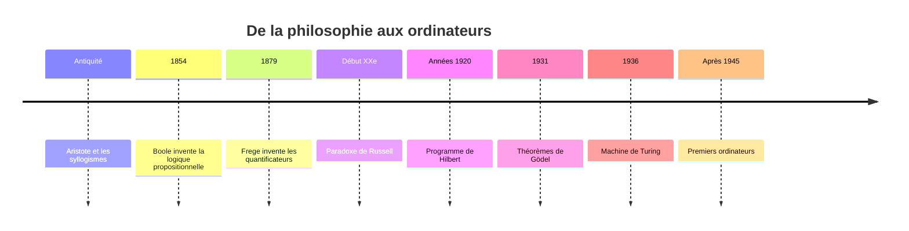
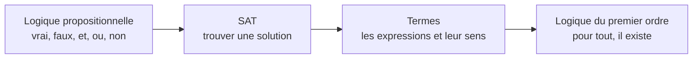

# Introduction : à quoi sert la logique ?

## Une question de tous les jours

Ce matin, tu te dis : *« S'il pleut, je prends le bus. Il pleut. Donc je prends le bus. »*

Tu viens de faire un **raisonnement logique** sans y penser. La logique, c'est l'étude de ce genre de raisonnement : à partir de phrases que l'on sait **vraies**, comment en déduire d'autres qui sont **forcément vraies** ?

Un ordinateur fait exactement la même chose, des milliards de fois par seconde. Chaque `if` dans un programme, chaque recherche dans une base de données, chaque vérification d'un processeur repose sur la logique. C'est pour ça qu'elle est au programme d'une licence d'informatique.

---

## Comment fonctionne l'UE

| | |
|---|---|
| Cours (CM) | 6 séances d'environ 1h30 |
| TD/TP | 1h30 chaque semaine |
| Examens | 2 DS de 2h : mi-semestre et fin de semestre |
| Aussi évalués | ta présence (amphi, TD, TP) et tes rendus |
| Seconde session | **aucune** : c'est du contrôle continu intégral |
| Absente à un DS ? | un DS de substitution de 3h |

Formules annoncées en cours (TA = taux d'assiduité, TE = travaux effectués) :

- 1ʳᵉ chance : `(TA × DS1 + TE × DS2) / 2`
- DS de substitution : `min(10, (TA + TE)/2 × DSs)`

Deux types de travail à la maison :

- le **TPA** (travail préparatoire en autonomie) est distribué en **CM** et se rend au TD suivant ;
- le **TR** (travail de révision) est distribué en **TD** et se rend au TD suivant.

> ⚠️ Un rendu en retard (non justifié) compte comme manquant, un rendu au mauvais format n'est pas pris en compte. Prévois environ **1h de travail perso par heure de cours**.

---

## Petite histoire : de la philosophie à l'ordinateur

**Aristote** invente les syllogismes (« Tous les hommes sont mortels, Socrate est un homme, donc Socrate est mortel »). Puis, pendant plus de 2000 ans, presque rien ne bouge.

Au XIXᵉ siècle, la logique devient des **mathématiques**. **Boole** (1854) invente le calcul avec vrai/faux, ce qu'on appelle aujourd'hui les *booléens*. **Frege** (1879) ajoute les mots « pour tout » et « il existe ».

Au début du XXᵉ siècle, c'est la crise. **Russell** trouve un paradoxe qui ressemble à celui du barbier : *« le barbier rase tous ceux qui ne se rasent pas eux-mêmes ; qui rase le barbier ? »* En maths, ça donne :

> U = l'ensemble de tous les ensembles qui ne se contiennent pas eux-mêmes.
> Si U ne se contient pas, alors par définition il se contient. S'il se contient, alors il ne se contient pas.

On peut donc prouver une chose et son contraire : les fondations des mathématiques tremblent.

**Hilbert** propose alors de tout reconstruire avec un nombre fini de règles et de prouver que ces règles ne se contredisent jamais. **Gödel** (1931) montre que c'est impossible : dans tout système assez riche pour faire de l'arithmétique, certaines vérités ne sont pas démontrables, et le système ne peut pas prouver sa propre cohérence. Plus tôt (1929), il avait aussi montré un résultat positif, le **théorème de complétude** : en logique du premier ordre, toute formule valide est démontrable.

L'idée géniale de Gödel : **coder les phrases logiques par des nombres** et transformer le raisonnement en calcul. C'est exactement ce que fait un ordinateur.

**Turing** (1936) en tire trois choses :

1. une définition précise de ce qu'est un **algorithme** (la machine de Turing) ;
2. une **machine universelle** capable d'exécuter n'importe quelle autre machine, c'est-à-dire un ordinateur programmable ;
3. un problème **qu'aucun algorithme ne peut résoudre** : savoir si un programme va s'arrêter (problème de l'arrêt).

C'est la naissance de l'informatique, et les premiers ordinateurs sont construits après la Seconde Guerre mondiale.

---

## Syntaxe et sémantique : l'idée qui revient partout

Prends la phrase *« Le chat mange la souris »*. Elle a une **forme** (des mots dans un ordre correct) et un **sens** (une scène que tu imagines). La phrase *« La souris mange le chat »* a une forme tout aussi correcte, mais un sens différent.

| | Syntaxe = la forme | Sémantique = le sens |
|---|---|---|
| En français | la grammaire | ce que la phrase raconte |
| En logique | les formules | vrai ou faux, les modèles |
| En informatique | le code source | ce que fait le programme quand il tourne |

Tout le cours va jouer sur cette distinction.

---

## Où sert la logique en informatique ?

| La question | Son nom | Un exemple réel |
|---|---|---|
| C'est vrai **ici et maintenant** ? | vérification de modèle | `if age >= 18 and inscrit:` ; trouver les clients qui ont commandé en 2025 dans une base de données |
| Existe-t-il une situation où c'est vrai ? | **satisfiabilité (SAT)** | trouver un emploi du temps sans conflit, résoudre un Sudoku, optimiser un programme |
| C'est vrai **dans toutes** les situations ? | **tautologie** | prouver qu'un programme de pilote automatique ne plante jamais |

Un article célèbre (*On the Unusual Effectiveness of Logic in Computer Science*, Halpern et al., 2001) compare la logique pour l'informatique aux mathématiques pour la physique. Il cite par exemple la vérification des **processeurs** : avant de fabriquer une puce, on prouve logiquement qu'elle calcule juste.

---

## Le programme de l'UE

➡️ On commence : [Chapitre 1 — Écrire une formule](01-Logique-propositionnelle/1-Syntaxe.md)
