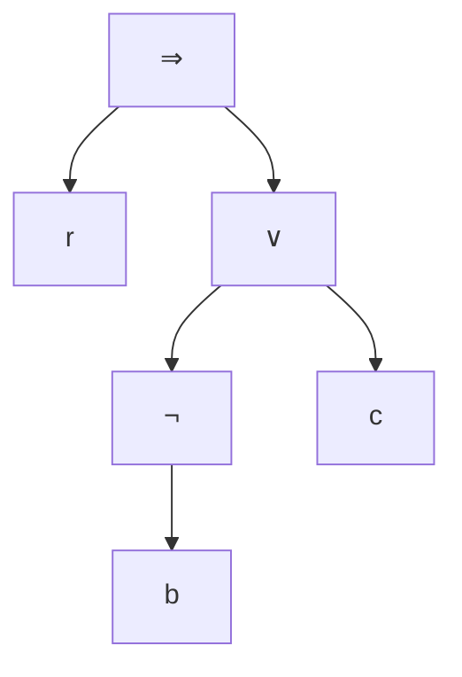
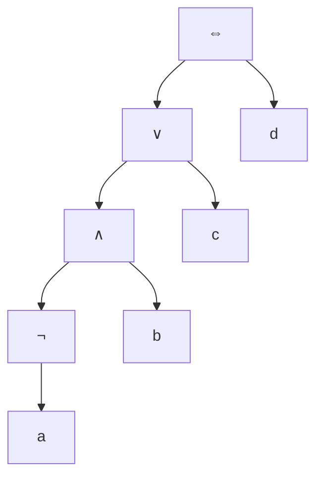
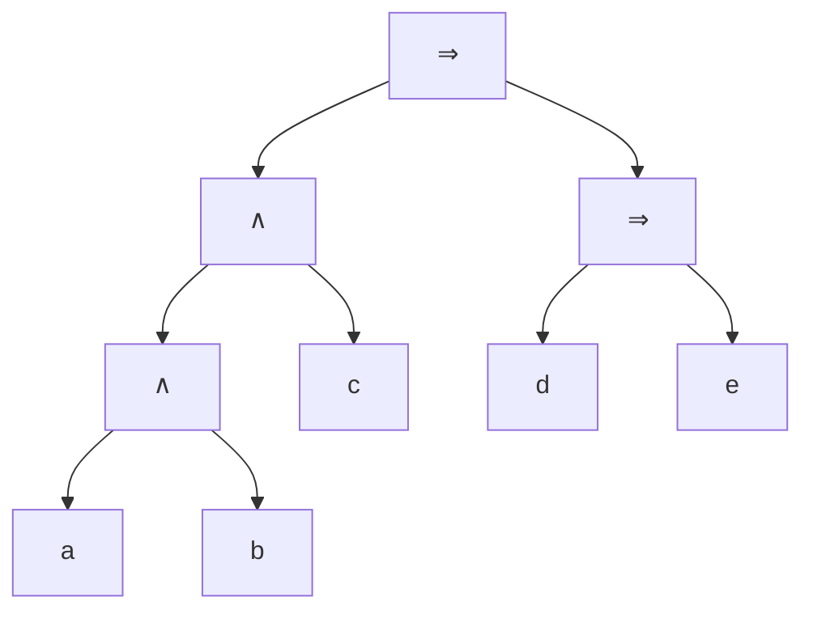

# Chapitre 1 — Écrire une formule (la syntaxe)

> **Objectif** : savoir transformer une phrase en formule, lire une formule sans ambiguïté et la dessiner sous forme d'arbre.

---

## 1.1 De la phrase à la formule

Prends cette phrase : *« S'il pleut et que je n'ai pas de parapluie, alors je serai mouillée. »*

On repère les petites phrases qui peuvent être **vraies ou fausses**, et on leur donne un nom :

| Lettre | Signifie |
|---|---|
| `p` | il pleut |
| `a` | j'ai un parapluie |
| `m` | je suis mouillée |

La phrase devient : **`(p ∧ ¬a) ⇒ m`**

Les lettres `p`, `a`, `m` sont des **variables propositionnelles**. Les symboles qui les relient sont des **connecteurs**.

| Connecteur | Se lit | Exemple de la vie courante |
|---|---|---|
| `¬φ` | non φ | « il **ne** pleut **pas** » → `¬p` |
| `φ ∧ ψ` | φ **et** ψ | « je prends un café **et** un croissant » |
| `φ ∨ ψ` | φ **ou** ψ | « je paie par carte **ou** en espèces » |
| `φ ⇒ ψ` | **si** φ **alors** ψ | « **s'il** pleut, **alors** je prends le bus » |
| `φ ⇔ ψ` | φ **si et seulement si** ψ | « la lampe est allumée **ssi** l'interrupteur est sur ON » |

Il existe aussi deux formules spéciales : `⊤` (« toujours vrai ») et `⊥` (« toujours faux », l'absurde).

> 💡 Les lettres grecques `φ` (phi) et `ψ` (psi) désignent **n'importe quelle formule**, petite ou grande.

### Ce qu'on ne peut pas traduire

Une variable doit être une affirmation simple qui est **vraie ou fausse**. « Merci ! » ou « Quelle heure est-il ? » ne sont ni vraies ni fausses : on ne peut pas les traduire.

---

## 1.2 La règle du jeu : qu'est-ce qu'une formule ?

Comme en français où une phrase suit une grammaire, une formule suit des règles de construction :

1. `⊤` et `⊥` sont des formules.
2. Une variable (`a`, `b`, `x₁`…) est une formule.
3. Si `φ` est une formule, alors `¬φ` est une formule.
4. Si `φ` et `ψ` sont des formules, alors `φ ∧ ψ`, `φ ∨ ψ`, `φ ⇒ ψ` et `φ ⇔ ψ` sont des formules.

C'est une définition **récursive** : on construit des grandes formules avec des petites, comme des Lego.

> ⚠️ Une formule bien écrite n'est pas forcément vraie ! `p ∧ ¬p` (« il pleut et il ne pleut pas ») est parfaitement bien écrite, mais toujours fausse. La syntaxe parle de la **forme**, pas de la vérité.

---

## 1.3 Une formule est un arbre

Tu connais déjà ça avec la calculatrice : `2 + 3 × 4` se calcule `2 + (3 × 4)`, parce que la multiplication est « plus forte ». On peut le dessiner comme un arbre, l'opération principale en haut.

C'est pareil pour les formules. Voici `r ⇒ (¬b ∨ c)` :

- Les **feuilles** (en bas) sont les variables.
- Les **nœuds** sont les connecteurs.
- La **racine** (en haut) est le connecteur principal : c'est lui qui dit de quel « type » est la formule. Ici, c'est une implication.

On parle de **syntaxe abstraite** pour l'arbre et de **syntaxe concrète** pour l'écriture en ligne.

---

## 1.4 Enlever des parenthèses sans se tromper

Pour ne pas écrire des parenthèses partout, on fixe des **priorités**, exactement comme en calcul :

| Calcul | Logique | Force |
|---|---|---|
| le signe « − » devant un nombre | `¬` | la plus forte |
| `×` | `∧` | |
| `+` | `∨` | |
| | `⇒`, `⇔` | la plus faible |

Et quand le même connecteur se répète :

- `∧`, `∨`, `⇔` se regroupent **à gauche** : `a ∧ b ∧ c` = `(a ∧ b) ∧ c`
- `⇒` se regroupe **à droite** : `a ⇒ b ⇒ c` = `a ⇒ (b ⇒ c)`

**Exemple 1** : `¬a ∧ b ∨ c ⇔ d` se lit `(((¬a) ∧ b) ∨ c) ⇔ d`

**Exemple 2** : `a ∧ b ∧ c ⇒ d ⇒ e` se lit `((a ∧ b) ∧ c) ⇒ (d ⇒ e)`

> 💡 **Astuce** : pour trouver la racine, cherche le connecteur **le plus faible** qui n'est pas entre parenthèses.

---

## 1.5 Trois calculs sur les formules

Puisqu'une formule est construite étape par étape, on peut définir des fonctions **cas par cas** en suivant ces étapes. C'est le principe de la **définition par récurrence** (ou induction).

### Les variables d'une formule : `Var(φ)`

C'est simplement la liste (l'ensemble) des lettres qui apparaissent.

| Cas | Résultat |
|---|---|
| `⊤` ou `⊥` | `∅` (aucune variable) |
| une variable `x` | `{x}` |
| `¬φ` | `Var(φ)` |
| `φ op ψ` (op = ∧, ∨, ⇒, ⇔) | `Var(φ) ∪ Var(ψ)` |

Exemple : `Var(r ⇒ (¬b ∨ c)) = {r, b, c}`. On note `Prop(X)` l'ensemble des formules qui n'utilisent que des variables de `X`.

### La hauteur : `h(φ)`

C'est le nombre d'étages de connecteurs dans l'arbre.

| Cas | Résultat |
|---|---|
| `⊤`, `⊥`, une variable | `0` |
| `¬φ` | `h(φ) + 1` |
| `φ op ψ` | `max(h(φ), h(ψ)) + 1` |

Exemple : `h(b) = 0`, `h(¬b) = 1`, `h(¬b ∨ c) = 2`, `h(r ⇒ (¬b ∨ c)) = 3`.

### La substitution : `subst(φ, σ)`

C'est le **« rechercher / remplacer »** de ton traitement de texte : on remplace chaque variable par une formule, toutes en même temps.

`σ` (sigma) indique par quoi remplacer chaque variable.

| Cas | Résultat |
|---|---|
| `⊤` ou `⊥` | inchangé |
| une variable `x` | `σ(x)` |
| `¬φ` | `¬subst(φ, σ)` |
| `φ op ψ` | `subst(φ, σ) op subst(ψ, σ)` |

Exemple : `φ = a ∧ ¬b` avec `σ(a) = c ∨ d` et `σ(b) = a`. On obtient `(c ∨ d) ∧ ¬a`.

> ⚠️ Les remplacements se font **simultanément** : le `a` qui apparaît à la place de `b` n'est pas remplacé à son tour.

---

## Ce qu'il faut retenir

- Une formule = des variables reliées par des connecteurs, construite selon des règles précises.
- Une formule **est un arbre** ; la racine est le connecteur principal.
- Priorités : `¬` > `∧` > `∨` > `⇒`, `⇔`. Attention, `⇒` se regroupe à droite.
- `Var`, `h` et `subst` se calculent **cas par cas**, en descendant dans l'arbre.

---

✏️ S'entraîner : [exercices proposés, partie A](../../02-TD-TP/1-Logique-propositionnelle/enonces-proposes.md)
⬅️ [Introduction](../00-Introduction.md) · ➡️ [Chapitre 2 — Vrai ou faux ?](2-Semantique.md)
