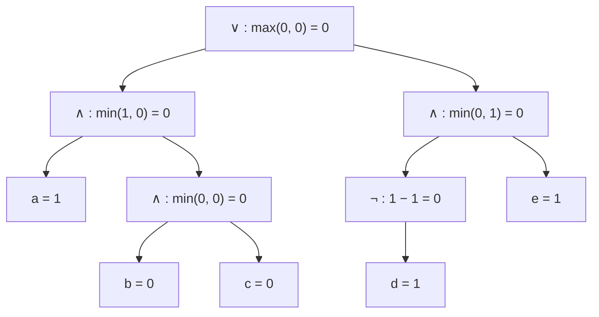
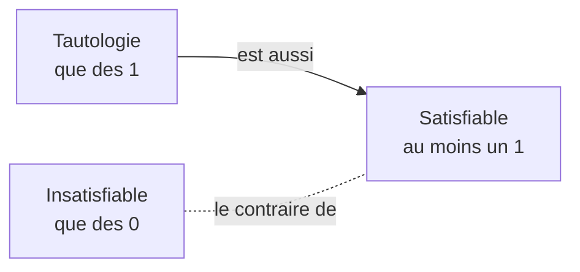

# Chapitre 2 — Vrai ou faux ? (la sémantique)

> **Objectif** : savoir calculer si une formule est vraie dans une situation donnée, construire une table de vérité, et reconnaître une formule toujours vraie ou jamais vraie.

---

## 2.1 Une formule n'est ni vraie ni fausse… toute seule

La phrase *« il pleut et j'ai cours »* (`p ∧ c`) : est-elle vraie ? Ça dépend du jour ! Lundi pluvieux avec cours : vraie. Samedi ensoleillé : fausse.

Une **situation** (un jour, un moment) donne une valeur à chaque variable : c'est une **valuation**.

> Une **valuation** `ν` (« nu ») associe à chaque variable **1** (vrai) ou **0** (faux).

| Situation | `p` (il pleut) | `c` (j'ai cours) | `p ∧ c` |
|---|:-:|:-:|:-:|
| lundi pluvieux | 1 | 1 | 1 |
| mardi ensoleillé | 0 | 1 | 0 |
| samedi pluvieux | 1 | 0 | 0 |

On note `⟦φ, ν⟧` la valeur de la formule `φ` dans la situation `ν`.

---

## 2.2 Le sens de chaque connecteur

### `¬` : le contraire

`¬p` est vrai quand `p` est faux. Calcul : `⟦¬φ⟧ = 1 − ⟦φ⟧`.

### `∧` : les deux

*« Le menu comprend un plat **et** un dessert »* : tu n'es content que si tu as les deux.
Calcul : `⟦φ ∧ ψ⟧ = min(⟦φ⟧, ⟦ψ⟧)` (il suffit d'un 0 pour avoir 0).

### `∨` : au moins un

*« Paiement par carte **ou** en espèces »* : l'un ou l'autre, **ou les deux**, ça marche.
Calcul : `⟦φ ∨ ψ⟧ = max(⟦φ⟧, ⟦ψ⟧)` (il suffit d'un 1 pour avoir 1).

> ⚠️ Le « ou » du restaurant (*« fromage **ou** dessert »*, sous-entendu pas les deux) est un **ou exclusif**. Il s'écrit `(f ∨ d) ∧ ¬(f ∧ d)`.

### `⇒` : une promesse

Ta mère te dit : *« **Si** tu as plus de 10 au DS, **alors** je t'offre un restaurant. »* Quand a-t-elle menti ?

| Tu as plus de 10 ? | Restaurant ? | A-t-elle tenu parole ? |
|:-:|:-:|---|
| non | non | ✅ oui, elle n'avait rien promis dans ce cas |
| non | oui | ✅ oui, elle est juste généreuse |
| oui | non | ❌ **non, promesse rompue** |
| oui | oui | ✅ oui |

> 🔑 `a ⇒ b` est faux **dans un seul cas** : `a` vrai et `b` faux. Dès que `a` est faux, l'implication est vraie.

### `⇔` : exactement en même temps

*« La lampe est allumée **si et seulement si** l'interrupteur est sur ON. »* C'est vrai quand les deux ont **la même valeur**.
Par définition, `φ ⇔ ψ = (φ ⇒ ψ) ∧ (ψ ⇒ φ)` : l'implication dans les deux sens.

### Le tableau récapitulatif (à connaître par cœur)

| a | b | ¬a | a ∧ b | a ∨ b | a ⇒ b | a ⇔ b |
|:-:|:-:|:-:|:-:|:-:|:-:|:-:|
| 0 | 0 | 1 | 0 | 0 | 1 | 1 |
| 0 | 1 | 1 | 0 | 1 | 1 | 0 |
| 1 | 0 | 0 | 0 | 1 | **0** | 0 |
| 1 | 1 | 0 | 1 | 1 | 1 | 1 |

---

## 2.3 Traduire le français : quelques pièges

| Phrase | Traduction | Remarque |
|---|---|---|
| S'il pleut, Max reste à la maison | `p ⇒ m` | « si… alors » |
| Je viens **seulement si** tu viens | `j ⇒ t` | « A seulement si B » = `A ⇒ B` |
| Marie va au garage **seulement quand** la voiture ne marche pas | `g ⇔ ¬v` (traduction du cours) | `v` = la voiture marche |
| Tu gagnes 10 € **ou** des bonbons (pas les deux) | `(e ∨ b) ∧ ¬(e ∧ b)` | ou exclusif |
| Le rouge **et** le bleu sont des couleurs | ❌ pas un `∧` de deux phrases | ici, « et » relie des noms, pas des affirmations |

---

## 2.4 Calculer la valeur d'une grande formule

On part des **feuilles** et on remonte jusqu'à la racine, exactement comme on calcule `2 + 3 × 4` en commençant par `3 × 4`.

**Exemple** : situation `a = 1, b = 0, c = 0, d = 1, e = 1`, formule `(a ∧ (b ∧ c)) ∨ (¬d ∧ e)`.

Résultat : la formule vaut **0** dans cette situation.

---

## 2.5 La table de vérité : toutes les situations d'un coup

Au lieu de tester une seule situation, on les teste **toutes**. Avec `n` variables, il y a **`2ⁿ` situations** (chaque variable a 2 valeurs possibles).

**La méthode**

1. Les variables dans les premières colonnes.
2. Une colonne par sous-formule, des plus petites aux plus grandes.
3. Toutes les combinaisons, en comptant en binaire : `000, 001, 010, …, 111`.
4. On remplit colonne par colonne.

**Exemple** : `((a ⇒ b) ∧ c) ∨ (¬a ∧ b)`

| a | b | c | a ⇒ b | (a ⇒ b) ∧ c | ¬a | ¬a ∧ b | **résultat** |
|:-:|:-:|:-:|:-:|:-:|:-:|:-:|:-:|
| 0 | 0 | 0 | 1 | 0 | 1 | 0 | **0** |
| 0 | 0 | 1 | 1 | 1 | 1 | 0 | **1** |
| 0 | 1 | 0 | 1 | 0 | 1 | 1 | **1** |
| 0 | 1 | 1 | 1 | 1 | 1 | 1 | **1** |
| 1 | 0 | 0 | 0 | 0 | 0 | 0 | **0** |
| 1 | 0 | 1 | 0 | 0 | 0 | 0 | **0** |
| 1 | 1 | 0 | 1 | 0 | 0 | 0 | **0** |
| 1 | 1 | 1 | 1 | 1 | 0 | 0 | **1** |

---

## 2.6 Toujours vraie, parfois vraie, jamais vraie

| La formule est… | Ça veut dire | Dans la table | Exemple de la vie |
|---|---|---|---|
| **tautologie** (`⊨ φ`) | vraie dans **toutes** les situations | que des 1 | « il pleut ou il ne pleut pas » : `p ∨ ¬p` |
| **satisfiable** | vraie dans **au moins une** situation | au moins un 1 | « il pleut et j'ai cours » : `p ∧ c` |
| **insatisfiable** | vraie dans **aucune** situation | que des 0 | « il pleut et il ne pleut pas » : `p ∧ ¬p` |

> 🔑 `φ` est une tautologie **exactement quand** `¬φ` est insatisfiable.

### La conséquence logique `Γ ⊨ φ`

On sait que *« s'il pleut, la route est mouillée »* et que *« il pleut »*. Alors forcément, *« la route est mouillée »*.

On écrit : `p ⇒ r, p ⊨ r`.

> `Γ ⊨ φ` (« φ est conséquence de Γ ») : **dans toutes les situations** où toutes les formules de `Γ` sont vraies, `φ` est vraie aussi.

---

## Ce qu'il faut retenir

- Une **valuation** = une situation : chaque variable reçoit 0 ou 1.
- `¬` = `1 − x`, `∧` = `min`, `∨` = `max`, `⇒` n'est faux que pour `1 ⇒ 0`.
- Table de vérité : `2ⁿ` lignes, on remplit des petites sous-formules vers la grande.
- Tautologie (toujours 1), satisfiable (au moins un 1), insatisfiable (jamais 1).

---

✏️ S'entraîner : [exercices proposés, partie B](../../02-TD-TP/1-Logique-propositionnelle/enonces-proposes.md)
⬅️ [Chapitre 1 — Syntaxe](1-Syntaxe.md) · ➡️ [Chapitre 3 — Transformer une formule](3-Equivalences.md)
