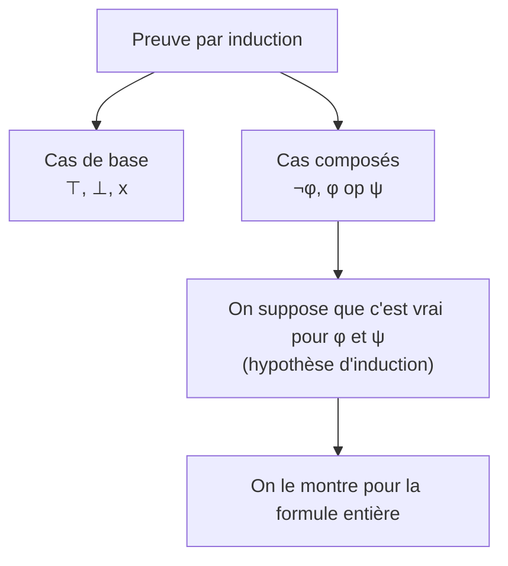

# Chapitre 3 — Transformer une formule (les équivalences)

> **Objectif** : savoir réécrire une formule en une autre qui veut dire **exactement la même chose**, avec les lois de la logique.

---

## 3.1 Deux phrases, un seul sens

*« Il n'est pas vrai que je prends le bus **ou** le métro »* et *« Je ne prends **ni** le bus **ni** le métro »* : ces deux phrases sont différentes, mais elles disent la même chose.

En logique : `¬(b ∨ m)` et `¬b ∧ ¬m` ont **la même table de vérité**. On dit qu'elles sont **équivalentes** et on écrit :

> `φ ≡ ψ` : dans **toutes** les situations, `φ` et `ψ` ont la même valeur.

Deux façons de le vérifier :

| Méthode | Quand l'utiliser |
|---|---|
| comparer les tables de vérité | peu de variables (2 ou 3) |
| calculer avec les lois (ci-dessous) | formules plus grandes |

Lien avec le chapitre 2 : `φ ≡ ψ` revient à dire que `φ ⇔ ψ` est une tautologie.

---

## 3.2 Remplacer un morceau par un morceau équivalent

L'équivalence se comporte comme l'égalité en calcul : si `2 + 2 = 4`, alors dans `3 × (2 + 2)` on peut remplacer `2 + 2` par `4`.

C'est pareil ici : si `φ ≡ ψ`, on peut remplacer `φ` par `ψ` **n'importe où** dans une formule, le résultat reste équivalent. (On dit que `≡` est une **congruence** : elle est réflexive, symétrique, transitive, et compatible avec tous les connecteurs.)

---

## 3.3 La boîte à outils

### Les lois qui ressemblent au calcul

| Loi | Avec `∨` | Avec `∧` | En calcul… |
|---|---|---|---|
| Commutativité | `φ ∨ ψ ≡ ψ ∨ φ` | `φ ∧ ψ ≡ ψ ∧ φ` | `a + b = b + a` |
| Associativité | `(φ ∨ ψ) ∨ θ ≡ φ ∨ (ψ ∨ θ)` | `(φ ∧ ψ) ∧ θ ≡ φ ∧ (ψ ∧ θ)` | `(a + b) + c = a + (b + c)` |
| Distributivité | `φ ∨ (ψ ∧ θ) ≡ (φ ∨ ψ) ∧ (φ ∨ θ)` | `φ ∧ (ψ ∨ θ) ≡ (φ ∧ ψ) ∨ (φ ∧ θ)` | `a × (b + c) = a×b + a×c` |
| Identité | `φ ∨ ⊥ ≡ φ` | `φ ∧ ⊤ ≡ φ` | `a + 0 = a` |
| Zéro | `φ ∨ ⊤ ≡ ⊤` | `φ ∧ ⊥ ≡ ⊥` | `a × 0 = 0` |

> 💡 Différence avec le calcul : en logique, **les deux** distributivités marchent. (En calcul, `a + (b × c) ≠ (a + b) × (a + c)`.)

### Les lois propres à la logique

| Loi | Formule | Exemple de la vie |
|---|---|---|
| Idempotence | `φ ∨ φ ≡ φ`, `φ ∧ φ ≡ φ` | « il pleut et il pleut » = « il pleut » |
| Absorption | `φ ∨ (φ ∧ ψ) ≡ φ`, `φ ∧ (φ ∨ ψ) ≡ φ` | « j'ai faim, ou j'ai faim et soif » = « j'ai faim » |
| Complémentation | `φ ∨ ¬φ ≡ ⊤`, `φ ∧ ¬φ ≡ ⊥` | « il pleut ou il ne pleut pas » est toujours vrai |
| Double négation | `¬¬φ ≡ φ` | « ce n'est pas faux » = « c'est vrai » |
| **De Morgan** | `¬(φ ∨ ψ) ≡ ¬φ ∧ ¬ψ` | « pas (bus ou métro) » = « ni bus ni métro » |
| **De Morgan** | `¬(φ ∧ ψ) ≡ ¬φ ∨ ¬ψ` | « pas (pizza et burger) » = « pas de pizza, ou pas de burger » |

> 💡 **De Morgan** : la négation **rentre** dans la parenthèse et **retourne** le connecteur (`∧` devient `∨` et inversement).

### Se débarrasser de `⇒` et `⇔`

| Loi | Formule |
|---|---|
| Définition de `⇒` | `φ ⇒ ψ ≡ ¬φ ∨ ψ` |
| Définition de `⇔` | `φ ⇔ ψ ≡ (φ ⇒ ψ) ∧ (ψ ⇒ φ) ≡ (¬φ ∨ ψ) ∧ (φ ∨ ¬ψ)` |
| Négation de `⇒` | `¬(φ ⇒ ψ) ≡ φ ∧ ¬ψ` |

`φ ⇒ ψ ≡ ¬φ ∨ ψ` se comprend bien : *« s'il pleut, je prends le bus »* = *« soit il ne pleut pas, soit je prends le bus »*.

### La contraposée (très utile)

*« S'il pleut, le sol est mouillé »* veut dire la même chose que *« si le sol n'est pas mouillé, alors il ne pleut pas »*.

> `φ ⇒ ψ ≡ ¬ψ ⇒ ¬φ` ✅

Mais *« si le sol est mouillé, alors il pleut »* (la **réciproque** `ψ ⇒ φ`) n'est **pas** équivalente : le sol peut être mouillé parce qu'on a arrosé. ❌

---

## 3.4 Un calcul complet

Simplifions `¬(a ⇒ b) ∨ b`, en écrivant une loi par ligne :

| Formule | Loi utilisée |
|---|---|
| `¬(a ⇒ b) ∨ b` | départ |
| `¬(¬a ∨ b) ∨ b` | définition de `⇒` |
| `(¬¬a ∧ ¬b) ∨ b` | De Morgan |
| `(a ∧ ¬b) ∨ b` | double négation |
| `(a ∨ b) ∧ (¬b ∨ b)` | distributivité |
| `(a ∨ b) ∧ ⊤` | complémentation |
| `a ∨ b` | identité |

Ces lois suffisent toujours : si deux formules sont équivalentes, on peut **toujours** passer de l'une à l'autre avec elles (**complétude équationnelle**).

---

## 3.5 Peut-on se passer de certains connecteurs ?

Sur un vieux téléphone, avec seulement quelques touches, on arrivait quand même à écrire tous les mots. Ici, c'est pareil : avec **peu de connecteurs**, on peut tout exprimer.

> Un ensemble de connecteurs est un **système complet** si toute formule est équivalente à une formule qui n'utilise que ces connecteurs.

Systèmes complets vus en cours : **`{¬, ∨}`**, **`{¬, ∧}`**, **`{¬, ⇒}`**, **`{⇒, ⊥}`**.

**Exemple : tout écrire avec `¬` et `∨`**

| On veut… | On écrit… | Grâce à… |
|---|---|---|
| `⊤` | `x ∨ ¬x` | complémentation |
| `⊥` | `¬(x ∨ ¬x)` | complémentation |
| `φ ∧ ψ` | `¬(¬φ ∨ ¬ψ)` | De Morgan + double négation |
| `φ ⇒ ψ` | `¬φ ∨ ψ` | définition |
| `φ ⇔ ψ` | `¬(¬(¬φ ∨ ψ) ∨ ¬(¬ψ ∨ φ))` | définition + De Morgan |

**Comment on le prouve ?** Par **induction** sur la formule : on vérifie que ça marche pour les briques de base (`⊤`, `⊥`, `x`), puis que si ça marche pour les morceaux `φ` et `ψ`, ça marche pour `¬φ`, `φ ∧ ψ`, etc. C'est comme une récurrence, mais sur des arbres.

> 💡 Pour aller plus loin : en électronique, on construit tous les circuits avec une seule porte, NAND (`¬(a ∧ b)`), car `{NAND}` est aussi un système complet.

---

## Ce qu'il faut retenir

- `φ ≡ ψ` : même table de vérité. On peut remplacer l'un par l'autre partout.
- Les lois indispensables : **De Morgan**, **double négation**, **définition de ⇒**, **distributivité**.
- Contraposée ✅ (`¬ψ ⇒ ¬φ`), réciproque ❌ (`ψ ⇒ φ`).
- `{¬, ∨}` suffit à tout écrire.

---

✏️ S'entraîner : [exercices proposés, partie C](../../02-TD-TP/1-Logique-propositionnelle/enonces-proposes.md)
⬅️ [Chapitre 2 — Sémantique](2-Semantique.md) · ➡️ [Chapitre 4 — Formes normales](4-Formes-normales.md)
