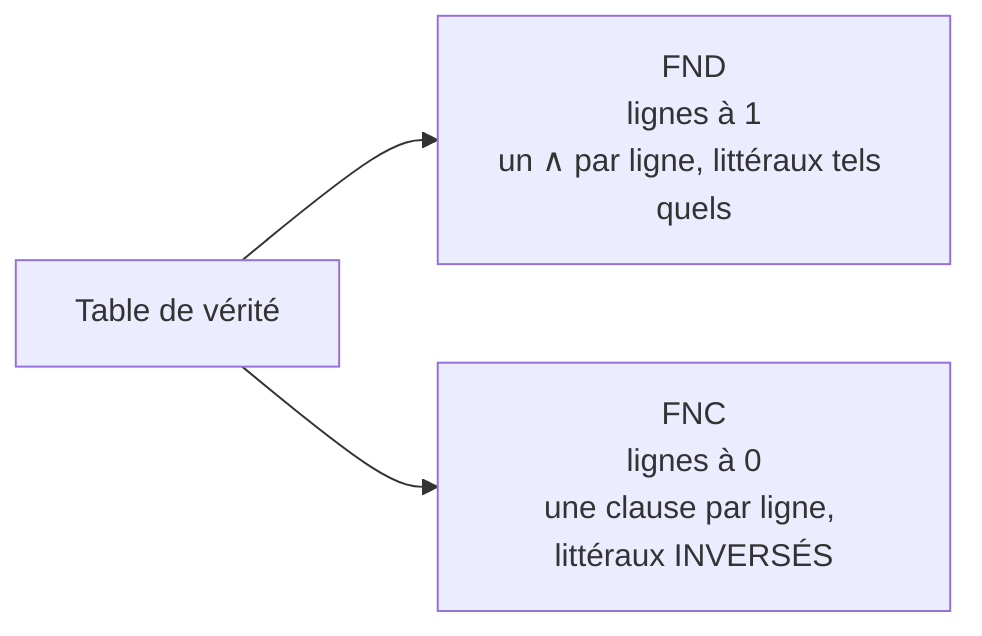
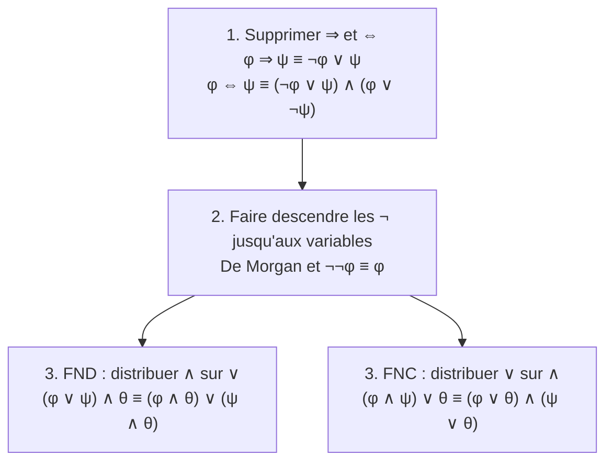

# Chapitre 4 — Les formes normales (FND et FNC)

> **Objectif** : savoir réécrire n'importe quelle formule sous une forme « standard », soit comme une **liste de scénarios** (FND), soit comme une **liste de règles** (FNC).

---

## 4.1 Deux façons de décrire la même chose

Imagine que tu organises un **pique-nique**. Tu peux décrire ce qui est acceptable de deux façons.

**Façon 1 : la liste des scénarios qui marchent.**
*« C'est bon si (il fait beau **et** Léa vient) **ou** (il fait beau **et** Sam vient). »*
→ un **OU** de **ET** : c'est la **forme normale disjonctive (FND)**.

**Façon 2 : la liste des règles à respecter.**
*« Il faut qu'il fasse beau. **Et** il faut que Léa **ou** Sam vienne. »*
→ un **ET** de **OU** : c'est la **forme normale conjonctive (FNC)**.

Avec `b` = il fait beau, `l` = Léa vient, `s` = Sam vient :

| | Formule | Structure |
|---|---|---|
| FND | `(b ∧ l) ∨ (b ∧ s)` | OU de ET |
| FNC | `b ∧ (l ∨ s)` | ET de OU |

Ces deux formules sont **équivalentes** : elles décrivent exactement les mêmes situations.

> 💡 **Mnémo** : FN**D** → **D**isjonction (`∨`) à l'extérieur. FN**C** → **C**onjonction (`∧`) à l'extérieur.

---

## 4.2 Le vocabulaire

| Mot | Définition | Exemple |
|---|---|---|
| **littéral** | une variable ou sa négation | `l`, `¬s` |
| **clause** | des littéraux reliés par `∨` | `l ∨ s` |
| **FND** | des groupes « `∧` de littéraux » reliés par `∨` | `(a ∧ ¬b) ∨ (¬c ∧ d)` |
| **FNC** | des **clauses** reliées par `∧` | `(a ∨ ¬b) ∧ (¬c ∨ d)` |

À quoi servent-elles ?

- la **FND** montre directement **les situations où la formule est vraie** ;
- la **FNC** présente la formule comme **une liste de contraintes**, chacune devant être respectée. C'est le format qu'utilisent les **solveurs SAT** (chapitre suivant).

---

## 4.3 Méthode 1 : à partir de la table de vérité

### La FND : on décrit les lignes où c'est vrai

Pour chaque ligne qui vaut **1**, on écrit la « carte d'identité » de la ligne avec des `∧` : variable à 1 → `x`, variable à 0 → `¬x`. Puis on relie toutes ces cartes par des `∨`.

**Exemple** : `φ = a ∧ (b ∨ ¬c)`

| a | b | c | φ | Carte d'identité de la ligne |
|:-:|:-:|:-:|:-:|---|
| 0 | 0 | 0 | 0 | |
| 0 | 0 | 1 | 0 | |
| 0 | 1 | 0 | 0 | |
| 0 | 1 | 1 | 0 | |
| 1 | 0 | 0 | **1** | `a ∧ ¬b ∧ ¬c` |
| 1 | 0 | 1 | 0 | |
| 1 | 1 | 0 | **1** | `a ∧ b ∧ ¬c` |
| 1 | 1 | 1 | **1** | `a ∧ b ∧ c` |

**FND** : `(a ∧ ¬b ∧ ¬c) ∨ (a ∧ b ∧ ¬c) ∨ (a ∧ b ∧ c)`

### La FNC : on interdit les lignes où c'est faux

Pour chaque ligne qui vaut **0**, on écrit une clause qui dit *« on n'est pas dans cette ligne »*. Il faut donc **inverser** : variable à 0 → `x`, variable à 1 → `¬x`. Puis on relie toutes les clauses par des `∧`.

**Exemple** : `ψ = (¬p ∧ q) ∨ r`

| p | q | r | ψ | Clause « pas cette ligne » |
|:-:|:-:|:-:|:-:|---|
| 0 | 0 | 0 | **0** | `p ∨ q ∨ r` |
| 0 | 0 | 1 | 1 | |
| 0 | 1 | 0 | 1 | |
| 0 | 1 | 1 | 1 | |
| 1 | 0 | 0 | **0** | `¬p ∨ q ∨ r` |
| 1 | 0 | 1 | 1 | |
| 1 | 1 | 0 | **0** | `¬p ∨ ¬q ∨ r` |
| 1 | 1 | 1 | 1 | |

**FNC** : `(p ∨ q ∨ r) ∧ (¬p ∨ q ∨ r) ∧ (¬p ∨ ¬q ∨ r)`

---

## 4.4 Méthode 2 : par le calcul

Quand il y a beaucoup de variables, la table devient énorme (`2ⁿ` lignes). On utilise alors les lois du chapitre 3, toujours dans le même ordre :

> 🔑 Les étapes 1 et 2 sont identiques pour FND et FNC. Seule l'étape 3 change.

### Exemple vers la FND : `¬(a ⇒ b) ∨ ¬(c ∨ ¬(d ⇒ a))`

| Formule | Ce qu'on fait |
|---|---|
| `¬(a ⇒ b) ∨ ¬(c ∨ ¬(d ⇒ a))` | départ |
| `¬(¬a ∨ b) ∨ ¬(c ∨ ¬(¬d ∨ a))` | on supprime les `⇒` |
| `(¬¬a ∧ ¬b) ∨ ¬(c ∨ ¬(¬d ∨ a))` | De Morgan sur la partie gauche |
| `(a ∧ ¬b) ∨ ¬(c ∨ ¬(¬d ∨ a))` | double négation |
| `(a ∧ ¬b) ∨ (¬c ∧ ¬¬(¬d ∨ a))` | De Morgan sur la partie droite |
| `(a ∧ ¬b) ∨ (¬c ∧ (¬d ∨ a))` | double négation |
| `(a ∧ ¬b) ∨ (¬c ∧ ¬d) ∨ (¬c ∧ a)` | on distribue `¬c ∧` sur `(¬d ∨ a)` ✅ |

### Exemple vers la FNC : `(¬p ∧ ¬q) ∨ (r ∧ ¬s)`

Pour distribuer, chaque clause prend **un littéral dans chaque bloc** :

`(¬p ∨ r) ∧ (¬p ∨ ¬s) ∧ (¬q ∨ r) ∧ (¬q ∨ ¬s)`

> ⚠️ **L'explosion** : avec 3 blocs de 2 littéraux, on obtient `2 × 2 × 2 = 8` clauses ; avec 10 blocs, 1024 clauses ! La mise sous forme normale peut rendre la formule **exponentiellement** plus grande. Le chapitre sur Tseitin donne une solution.

### Vérifier son résultat

Choisis une ou deux situations au hasard et calcule la formule de départ **et** ton résultat. Ils doivent donner la même valeur. Si ce n'est pas le cas, il y a une erreur.

---

## 4.5 Pourquoi c'est important

Avec les lois (associativité, commutativité, idempotence, identité, zéro, complémentation), on peut toujours transformer une FND jusqu'à ce qu'elle liste **exactement** les situations qui rendent la formule vraie. Deux formules équivalentes aboutissent à la même liste. C'est ce qui prouve que les lois du chapitre 3 suffisent à démontrer **toute** équivalence.

Et surtout : la **FNC** est le langage des solveurs SAT. C'est la suite du cours.

---

## Ce qu'il faut retenir

- **FND** = OU de ET = la liste des scénarios gagnants.
- **FNC** = ET de OU = la liste des règles à respecter.
- Par la table : FND avec les lignes à **1**, FNC avec les lignes à **0** et littéraux **inversés**.
- Par le calcul : supprimer `⇒`/`⇔`, descendre les `¬`, distribuer.
- La forme normale peut **exploser** en taille.

---

✏️ S'entraîner : [exercices proposés, partie D](../../02-TD-TP/1-Logique-propositionnelle/enonces-proposes.md) · [TD2 fourni, exercices 1 et 2](../../02-TD-TP/2-FNC-et-SAT/TD2-enonce-fourni.md)
⬅️ [Chapitre 3 — Équivalences](3-Equivalences.md) · ➡️ [Partie SAT — Chapitre 5](../02-SAT/5-Probleme-SAT.md)
