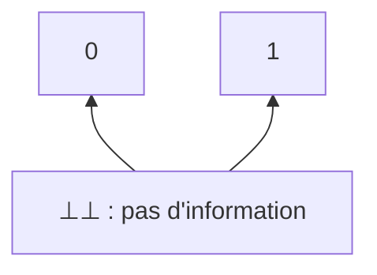

# Chapitre 10 — Les opérateurs logiques dans les programmes

> **Objectif** : comprendre pourquoi `and` / `or` (ou `&&` / `||`) dans un programme ne se comportent pas exactement comme `∧` / `∨` en logique.

---

## 10.1 Dans la vraie vie, on ne vérifie pas tout

Tu veux savoir si tu peux entrer dans une salle : *« la porte est ouverte **et** la lumière est allumée »*. Si la porte est fermée, tu ne vas pas vérifier la lumière : la réponse est déjà « non ».

Les programmes font pareil. Mais ça a une conséquence étonnante : **l'ordre compte**.

---

## 10.2 Un programme ne répond pas toujours

En logique, une formule vaut toujours 0 ou 1. Un programme, lui, peut :

| Comportement | Exemple |
|---|---|
| renvoyer une valeur | `return True` |
| planter (erreur, exception) | `1 / 0` |
| **ne jamais s'arrêter** | la fonction ci-dessous |

```python
def mal_construit(b):
    while True:
        b = not b
    return b      # jamais atteint
```

On ajoute donc une troisième valeur, **`⊥⊥`** (« indéfini »), pour représenter *« pas de réponse »*.

Les valeurs sont rangées par **quantité d'information** : `⊥⊥` ne dit rien, `0` et `1` disent quelque chose.



Un algorithme est **monotone** : plus on lui donne d'information en entrée, plus sa réponse est précise. Si `v₁ ⊑ v₂`, alors `f(v₁) ⊑ f(v₂)`.

---

## 10.3 `&&` et `||` regardent d'abord à gauche

Ces opérateurs sont **séquentiels à gauche** : ils calculent d'abord l'argument de gauche, et ne regardent la droite **que si c'est nécessaire**.

| a | b | `!a` | `a && b` | `a \|\| b` |
|:-:|:-:|:-:|:-:|:-:|
| 0 | 0 | 1 | 0 | 0 |
| 0 | 1 | 1 | 0 | 1 |
| 0 | ⊥⊥ | 1 | **0** (on ne regarde pas `b`) | ⊥⊥ |
| 1 | 0 | 0 | 0 | 1 |
| 1 | 1 | 0 | 1 | 1 |
| 1 | ⊥⊥ | 0 | ⊥⊥ | **1** (on ne regarde pas `b`) |
| ⊥⊥ | 0 | ⊥⊥ | ⊥⊥ | ⊥⊥ |
| ⊥⊥ | 1 | ⊥⊥ | ⊥⊥ | ⊥⊥ |
| ⊥⊥ | ⊥⊥ | ⊥⊥ | ⊥⊥ | ⊥⊥ |

> 🔑 `0 && …` vaut 0 et `1 || …` vaut 1 **sans calculer la droite**. Mais si la **gauche** plante, tout plante.

### Pourquoi c'est pratique

Éviter une division par zéro :

```python
if x == 0 or y / x > 0.5:     # si x == 0, la division n'est jamais calculée
    ...
```

Éviter une erreur sur un objet absent :

```python
if utilisateur is not None and utilisateur.age >= 18:
    ...
```

Tester un palindrome sans sortir de la chaîne :

```python
def palindrome(s):
    return len(s) < 2 or \
           s[0] == s[-1] and palindrome(s[1:-1])
```

> ⚠️ Si on inverse l'ordre (`y / x > 0.5 or x == 0`), le programme **plante** quand `x = 0`. En logique, `∨` est commutatif ; en programmation, `or` ne l'est pas tout à fait.

---

## 10.4 Et un « ou » qui regarde des deux côtés ?

On aimerait parfois que `⊥⊥ || 1` vaille `1` (la droite suffit à décider) et que `⊥⊥ && 0` vaille `0`.

| a | b | `&&` idéal | `\|\|` idéal |
|:-:|:-:|:-:|:-:|
| ⊥⊥ | 0 | **0** | ⊥⊥ |
| ⊥⊥ | 1 | ⊥⊥ | **1** |

Pour ça, il faudrait calculer `a` et `b` **en même temps** et s'arrêter dès que l'un des deux suffit.

> **Théorème (Plotkin, 1972)** : avoir de tels opérateurs revient exactement à disposer du **calcul parallèle**.

---

## Ce qu'il faut retenir

- Un programme peut ne pas répondre : on le note `⊥⊥`.
- `&&` et `||` sont **séquentiels à gauche** : l'ordre des conditions compte.
- On s'en sert pour protéger un calcul dangereux (`x != 0 and …`).
- Des opérateurs « parallèles » nécessitent du calcul parallèle (Plotkin).

---

✏️ S'entraîner : [exercices proposés SAT, partie D](../../02-TD-TP/2-FNC-et-SAT/enonces-proposes.md)
⬅️ [Chapitre 9 — DPLL](9-DPLL.md) · ➡️ [Partie Termes — Chapitre 11](../03-Termes/11-Termes.md)
