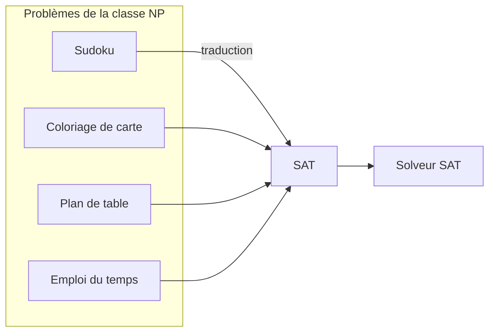

# Chapitre 5 — Le problème SAT

> **Objectif** : comprendre ce qu'est le problème SAT, pourquoi il est difficile, et pourquoi il est pourtant si utile.

---

## 5.1 Une question très concrète

Tu dois construire l'**emploi du temps** de ta promo : chaque cours doit avoir une salle et un créneau, deux cours ne peuvent pas être dans la même salle au même moment, un prof ne peut pas être à deux endroits à la fois…

La question n'est pas *« cet emploi du temps est-il bon ? »* (facile à vérifier), mais *« **existe-t-il** un emploi du temps qui respecte toutes les règles ? »* (difficile à trouver).

C'est exactement le problème de la **satisfiabilité** :

> Étant donné une formule `φ`, **existe-t-il** une valuation qui la rend vraie ?

---

## 5.2 Vérifier, c'est facile. Trouver, c'est dur.

Pense au **Sudoku** :

- quelqu'un te donne une grille remplie : tu vérifies en une minute qu'elle est correcte ;
- on te donne une grille vide : tu peux chercher pendant une heure.

SAT, c'est pareil. Vérifier qu'une valuation marche est rapide. Mais pour en **trouver** une, on ne connaît aucune méthode qui soit rapide dans tous les cas : dans le pire cas, on doit presque essayer les `2ⁿ` valuations. Avec 100 variables, `2¹⁰⁰ ≈ 10³⁰` : même à un milliard d'essais par seconde, il faudrait plus de mille fois l'âge de l'univers !

---

## 5.3 NP-complet : le « boss final » des problèmes

En 1971, **Cook et Levin** ont montré que SAT est **NP-complet**. Ça veut dire deux choses :

| Mot | Signification simple |
|---|---|
| **NP** | si on avait un « devin » qui choisit toujours la bonne valeur pour chaque variable, on résoudrait SAT rapidement (il ne resterait qu'à vérifier) |
| **complet** | **tous** les problèmes de ce genre (Sudoku, emploi du temps, coloriage de cartes…) peuvent être **traduits** en SAT |

Le « devin » s'appelle un **algorithme non déterministe** : il a une instruction magique `choisir entre : code1 et : code2` qui tombe toujours sur le bon choix.

Conséquence géniale : **un seul bon programme pour SAT permet de résoudre tous ces problèmes**. C'est pour ça que Donald Knuth appelle SAT une « *killer app* ».

> 🏆 Personne ne sait s'il existe un algorithme rapide pour SAT (c'est la question « P = NP ? »). Celui qui répond gagne **1 million de dollars**. La plupart des chercheurs pensent que non.

---

## 5.4 Le format de SAT : la FNC

Les solveurs ne prennent pas n'importe quelle formule : ils veulent une **FNC** (chapitre 4), c'est-à-dire une **liste de clauses**.

> **SAT** : trouver une valuation qui rend vraies **toutes les clauses** de
> `(l₁,₁ ∨ … ∨ l₁,ₙ₁) ∧ … ∧ (lₚ,₁ ∨ … ∨ lₚ,ₙₚ)`

Une clause, c'est une **règle**. Une règle est respectée dès qu'**au moins une** de ses options est vraie.

**Exemple** : organiser une sortie avec 3 amis.

| Règle | Clause |
|---|---|
| Au moins un ami vient | `a ∨ b ∨ c` |
| Si Alice vient, Bob vient | `¬a ∨ b` |
| Bob et Chloé ne viennent pas ensemble | `¬b ∨ ¬c` |

Une solution : `a = 1, b = 1, c = 0` (Alice et Bob viennent). Chaque règle a au moins une option vraie ✅.

---

## 5.5 SAT comme langage de programmation

Au lieu d'écrire un algorithme pour chaque problème, on **décrit** le problème en clauses, et un **solveur SAT** cherche la solution à notre place.

Les solveurs modernes sont impressionnants : ils résolvent des problèmes à **plusieurs millions** de variables. Mais certains petits problèmes « pièges » de quelques dizaines de variables peuvent les bloquer.

---

## Ce qu'il faut retenir

- SAT : existe-t-il une valuation qui rend vraies toutes les clauses ?
- Vérifier une solution est facile, en trouver une est difficile (exponentiel dans le pire cas).
- SAT est **NP-complet** (Cook-Levin, 1971) : tous les problèmes de NP s'y ramènent.
- Entrée d'un solveur = une **FNC**.

---

✏️ S'entraîner : [exercices proposés SAT](../../02-TD-TP/2-FNC-et-SAT/enonces-proposes.md)
⬅️ [Chapitre 4 — Formes normales](../01-Logique-propositionnelle/4-Formes-normales.md) · ➡️ [Chapitre 6 — Modéliser avec SAT](6-Modeliser-avec-SAT.md)
