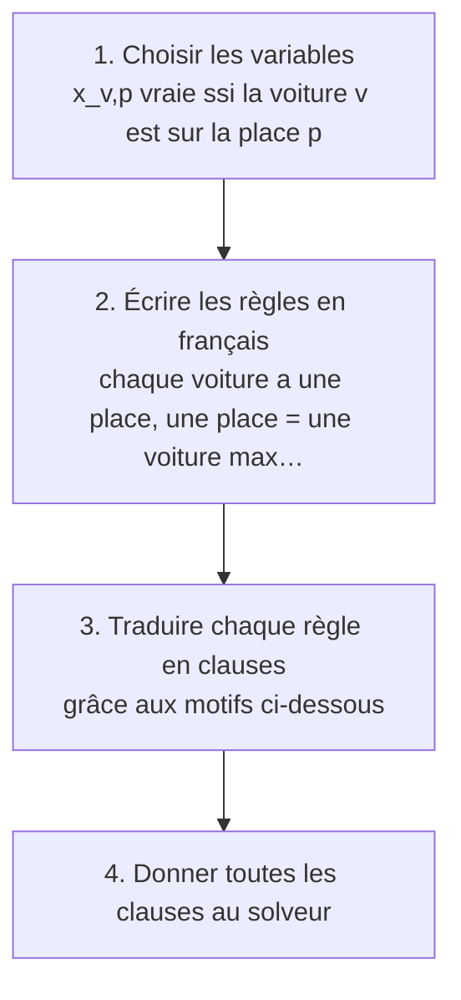
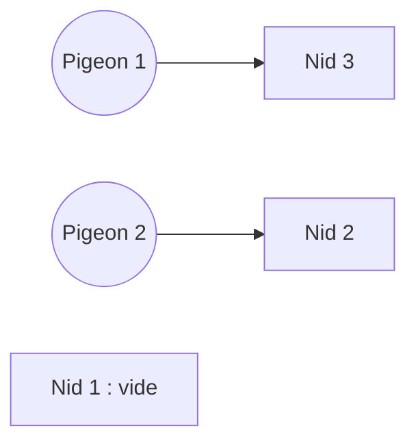
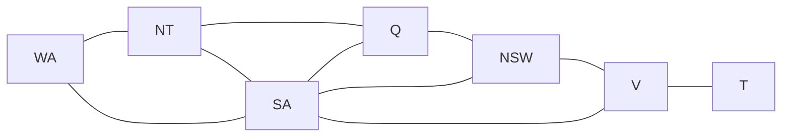

# Chapitre 6 — Modéliser un problème avec SAT

> **Objectif** : savoir transformer un problème de la vie réelle (planning, placement, coloriage…) en une liste de clauses.

---

## 6.1 La recette en 4 étapes

Prenons un exemple simple : **attribuer une place de parking** à chaque voiture d'une petite entreprise.

> ⚠️ L'étape 1 est la plus importante. Écris toujours la phrase complète : *« `x_{v,p}` est vraie **si et seulement si** … »*. Si tu ne sais pas dire ce que veut dire ta variable, le reste sera faux.

---

## 6.2 Lire les grands symboles `⋀` et `⋁`

Quand il y a beaucoup de clauses, on les écrit en abrégé, comme `Σ` pour les sommes en maths :

| Notation | Se lit | Comme… |
|---|---|---|
| `⋀_{e ∈ E} φₑ` | **pour tout** `e` de `E`, `φₑ` | un grand `∧` : `φ₁ ∧ φ₂ ∧ …` |
| `⋁_{e ∈ E} φₑ` | **il existe** `e` dans `E` tel que `φₑ` | un grand `∨` : `φ₁ ∨ φ₂ ∨ …` |

Par exemple `⋀_{v} ⋁_{p} x_{v,p}` se lit : *« pour toute voiture `v`, il existe une place `p` où elle est garée »*.

---

## 6.3 ⭐ Les motifs à connaître par cœur

Presque tous les exercices se résolvent avec ces quelques motifs.

| En français | En clauses | Exemple de la vie |
|---|---|---|
| **Au moins un** parmi `x₁ … xₙ` | `x₁ ∨ x₂ ∨ … ∨ xₙ` (1 clause) | chaque voiture a au moins une place |
| **Au plus un** parmi `x₁ … xₙ` | `¬xᵢ ∨ ¬xⱼ` pour chaque paire `i < j` | une place accueille au plus une voiture |
| **Exactement un** | au moins un **et** au plus un | chaque élève a exactement un binôme |
| **Pas les deux** `a` et `b` | `¬a ∨ ¬b` | deux rivaux pas à la même table |
| **Si** `a` **alors** `b` | `¬a ∨ b` | si Élise vient, Charles vient |
| `a` **seulement si** `b` | `¬a ∨ b` | Alice vient seulement si Bob vient |
| `a` **imposé** | `a` (clause d'un seul littéral) | le directeur a la place n°1 |
| `a` **interdit** | `¬a` | la place 3 est en travaux |

> 💡 « Au plus un » = « **aucune paire** n'est vraie en même temps ». Pour `n` variables, il faut `n(n−1)/2` clauses (3 variables → 3 clauses, 9 variables → 36 clauses).

---

## 6.4 Exemple du cours : les pigeons

> `m` pigeons cherchent un nid parmi `n` nids. Chaque pigeon a un nid, et deux pigeons ne partagent pas un nid.

C'est le même problème que *« 5 étudiants et 4 chaises : chacun peut-il s'asseoir seul ? »* (réponse : non !).

**Variables** : `pᵢ,ⱼ` vraie ssi **le pigeon `i` est dans le nid `j`**.

| Règle | Formule | Avec 2 pigeons et 3 nids |
|---|---|---|
| chaque pigeon a **au moins** un nid | `⋀ᵢ ⋁ⱼ pᵢ,ⱼ` | `(p₁,₁ ∨ p₁,₂ ∨ p₁,₃) ∧ (p₂,₁ ∨ p₂,₂ ∨ p₂,₃)` |
| chaque nid a **au plus** un pigeon | `⋀ⱼ ⋀_{i<k} (¬pᵢ,ⱼ ∨ ¬pₖ,ⱼ)` | `(¬p₁,₁ ∨ ¬p₂,₁) ∧ (¬p₁,₂ ∨ ¬p₂,₂) ∧ (¬p₁,₃ ∨ ¬p₂,₃)` |
| chaque pigeon a **au plus** un nid | `⋀ᵢ ⋀_{j<k} (¬pᵢ,ⱼ ∨ ¬pᵢ,ₖ)` | `(¬p₁,₁ ∨ ¬p₁,₂) ∧ (¬p₁,₁ ∨ ¬p₁,₃) ∧ (¬p₁,₂ ∨ ¬p₁,₃) ∧ …` (6 clauses) |

Au total : 6 variables et 11 clauses. Le solveur trouve par exemple `p₁,₃ = 1` et `p₂,₂ = 1`.

> ⚠️ Sans la 3ᵉ règle, le solveur a le droit de mettre un pigeon dans deux nids à la fois. **Le solveur fait exactement ce que tu écris, rien de plus.** Il faut penser à toutes les règles « évidentes ».

---

## 6.5 Exemple du cours : colorier l'Australie

> Peut-on colorier la carte de l'Australie avec 3 couleurs, sans que deux états voisins aient la même couleur ?

Ce problème est très réel : c'est le même que **attribuer des fréquences** à des antennes radio (deux antennes proches ne doivent pas avoir la même fréquence) ou **des créneaux d'examen** (deux examens qui ont des étudiants en commun ne peuvent pas être au même moment).

| Ensemble | Contenu |
|---|---|
| Couleurs `C` | rouge `r`, vert `v`, bleu `b` |
| États `E` | WA, NT, Q, SA, NSW, V, T |
| Voisins `L` | les paires d'états qui se touchent (graphe ci-dessous) |

**Variables** : `xₑ,c` vraie ssi **l'état `e` est colorié en `c`**.

| Règle | Formule |
|---|---|
| chaque état a **au moins** une couleur | `⋀_{e∈E} ⋁_{c∈C} xₑ,c` |
| chaque état a **au plus** une couleur | `⋀_{e∈E} ⋀_{c₁≠c₂} (¬xₑ,c₁ ∨ ¬xₑ,c₂)` |
| deux voisins n'ont **pas** la même couleur | `⋀_{(e₁,e₂)∈L} ⋀_{c∈C} (¬xₑ₁,c ∨ ¬xₑ₂,c)` |

**Solution trouvée** : WA rouge, NT vert, Q rouge, SA bleu, NSW vert, V rouge, T vert.

---

## 6.6 Exemple du cours : le plan de table d'un mariage

> `k` tables rondes de `n` places, `m = k × n` invités. Certains ne veulent pas être **à la même table** (ensemble `T`), d'autres pas **côte à côte** (ensemble `V`).

**Variables** : `x_{j,i,p}` vraie ssi **l'invité `j` est à la table `i`, à la place `p`**.

| Règle | Formule |
|---|---|
| chaque invité a **au moins** une place | `⋀_{j} ⋁_{i} ⋁_{p} x_{j,i,p}` |
| chaque invité a **au plus** une place | `⋀_{j} ⋀_{(i₁,p₁)≠(i₂,p₂)} (¬x_{j,i₁,p₁} ∨ ¬x_{j,i₂,p₂})` |
| chaque place a **au moins** un invité | `⋀_{i} ⋀_{p} ⋁_{j} x_{j,i,p}` |
| chaque place a **au plus** un invité | `⋀_{i} ⋀_{p} ⋀_{j₁≠j₂} (¬x_{j₁,i,p} ∨ ¬x_{j₂,i,p})` |
| les paires de `V` ne sont pas côte à côte | `⋀_{i} ⋀_{(j₁,j₂)∈V} [ ⋀_{p=1}^{n−1} (¬x_{j₁,i,p} ∨ ¬x_{j₂,i,p+1}) ∧ (¬x_{j₁,i,n} ∨ ¬x_{j₂,i,1}) ]` |
| les paires de `T` ne sont pas à la même table | `⋀_{i} ⋀_{(j₁,j₂)∈T} ⋀_{p₁≠p₂} (¬x_{j₁,i,p₁} ∨ ¬x_{j₂,i,p₂})` |

> ⚠️ **Table ronde** : la dernière place `n` est voisine de la place `1`. C'est un oubli classique en DS !
> ⚠️ « Côte à côte » marche dans les deux sens : il faut que `V` contienne `(j₁, j₂)` **et** `(j₂, j₁)`, ou écrire les deux clauses.

---

## Ce qu'il faut retenir

- La recette : **variables** (avec leur phrase), **règles** en français, **motifs**, **clauses**.
- Les motifs : au moins un (une grande clause), au plus un (toutes les paires), si… alors (`¬a ∨ b`).
- N'oublie pas les règles « évidentes » ni les cas au bord (la table ronde).

---

✏️ S'entraîner : [TD2 fourni, exercices 3 à 7](../../02-TD-TP/2-FNC-et-SAT/TD2-enonce-fourni.md) · [exercices proposés SAT](../../02-TD-TP/2-FNC-et-SAT/enonces-proposes.md)
⬅️ [Chapitre 5 — Le problème SAT](5-Probleme-SAT.md) · ➡️ [Chapitre 7 — SAT en Python](7-SAT-en-Python.md)
