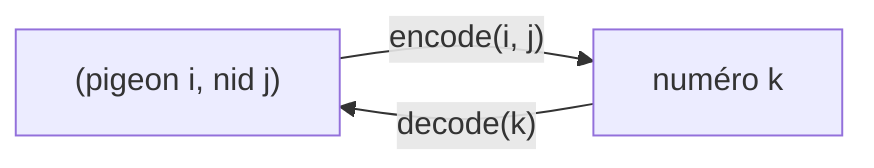

# Chapitre 7 — Utiliser un solveur SAT en Python

> **Objectif** : savoir écrire des clauses en Python, les donner à un solveur et relire la solution.

---

## 7.1 Les solveurs ne connaissent que des numéros

Un solveur SAT ne comprend pas « le pigeon 2 est dans le nid 3 ». Il ne connaît que des **numéros**. C'est comme au vestiaire d'une boîte de nuit : on te donne un **ticket n°17**, et c'est grâce à ce ticket qu'on retrouve ton manteau.

| En logique | Pour le solveur |
|---|---|
| la variable `xₖ` | le nombre `k` (toujours > 0) |
| le littéral `¬xₖ` | le nombre `-k` |
| la clause `x₁ ∨ ¬x₂ ∨ x₃` | la liste `[1, -2, 3]` |
| la formule (le `∧` des clauses) | une liste de listes `[[1, -2, 3], [2, 5, -1]]` |

On utilise deux fonctions pour passer de l'un à l'autre :



- `encode` donne un numéro **différent** à chaque couple (elle est injective) ;
- `decode` fait l'inverse, pour relire la solution.

---

## 7.2 Le format DIMACS

C'est le format de fichier standard des solveurs :

```text
p cnf 5 2      ← "problème en FNC, 5 variables, 2 clauses"
1 -5 0         ← x₁ ∨ ¬x₅        (le 0 marque la fin de la clause)
2 5 -1 0       ← x₂ ∨ x₅ ∨ ¬x₁
```

**Les pigeons** (2 pigeons, 3 nids) avec la numérotation `p₁,₁ → 1, p₁,₂ → 2, p₁,₃ → 3, p₂,₁ → 4, p₂,₂ → 5, p₂,₃ → 6` :

```text
p cnf 6 11
1 2 3 0
4 5 6 0
-1 -4 0
-2 -5 0
-3 -6 0
-1 -2 0
-1 -3 0
-2 -3 0
-4 -5 0
-4 -6 0
-5 -6 0
```

Le solveur répond `SAT -1 -2 3 -4 5 -6`. On garde les positifs : `3` et `5`, soit `p₁,₃` et `p₂,₂`. Pigeon 1 au nid 3, pigeon 2 au nid 2.

---

## 7.3 Les listes en compréhension : écrire les maths en Python

En maths, on écrit `{x ∈ l | x > 0}`. En Python, on écrit presque pareil : `[x for x in l if x > 0]`.

| Maths | Python |
|---|---|
| `l₁ × l₂` (toutes les paires) | `[(x, y) for x in l1 for y in l2]` |
| `l₁ ∩ l₂` | `[x for x in l1 if x in l2]` |
| `l₁ − l₂` | `[x for x in l1 if not x in l2]` |
| `{x ∈ l ∣ p(x)}` | `[x for x in l if p(x)]` |

### De la formule au code : la règle de traduction

| Dans la formule | Dans le code |
|---|---|
| `⋀` (pour tout…, plusieurs clauses) | la boucle `for` **extérieure** |
| `⋁` (une seule clause) | la liste **intérieure** `[ … ]` |
| `¬` | le signe `-` |
| une condition (`i < k`, `c₁ ≠ c₂`) | un `if` |

```python
pigeons = [1, 2]
nids = [1, 2, 3]

# ⋀ᵢ ⋁ⱼ pᵢ,ⱼ : chaque pigeon a au moins un nid
phi1 = [[encode(i, j) for j in nids] for i in pigeons]

# ⋀ⱼ ⋀_{i<k} (¬pᵢ,ⱼ ∨ ¬pₖ,ⱼ) : chaque nid a au plus un pigeon
phi2 = [[-encode(i, j), -encode(k, j)]
        for i in pigeons for k in pigeons for j in nids if i < k]

# ⋀ᵢ ⋀_{j<k} (¬pᵢ,ⱼ ∨ ¬pᵢ,ₖ) : chaque pigeon a au plus un nid
phi3 = [[-encode(i, j), -encode(i, k)]
        for i in pigeons for j in nids for k in nids if j < k]
```

---

## 7.4 Exemple complet : colorier l'Australie

```python
from pysat.solvers import Minisat22

etats = ["Western Australia", "Northern Territory", "Queensland",
         "South Australia", "New South Wales", "Victoria", "Tasmania"]
couleurs = ["rouge", "vert", "bleu"]
voisins = [("Western Australia", "Northern Territory"),
           ("Western Australia", "South Australia"),
           ("Northern Territory", "Queensland"),
           ("Northern Territory", "South Australia"),
           ("South Australia", "Queensland"),
           ("Queensland", "New South Wales"),
           ("South Australia", "New South Wales"),
           ("South Australia", "Victoria"),
           ("New South Wales", "Victoria"),
           ("Victoria", "Tasmania")]

# chaque état a au moins une couleur
phi1 = [[encode(e, c) for c in couleurs] for e in etats]

# chaque état a au plus une couleur
phi2 = [[-encode(e, c1), -encode(e, c2)]
        for e in etats for c1 in couleurs for c2 in couleurs if c1 < c2]

# deux voisins n'ont pas la même couleur
psi = [[-encode(e1, c), -encode(e2, c)]
       for (e1, e2) in voisins for c in couleurs]

with Minisat22(bootstrap_with=phi1 + phi2 + psi) as m:
    if m.solve():
        # on garde seulement les variables vraies (numéros positifs)
        model = [decode(v) for v in m.get_model() if v > 0]
        for (e, c) in model:
            print(e, "->", c)
```

Ce qui affiche :

```text
Western Australia  -> rouge
Queensland         -> rouge
Victoria           -> rouge
Northern Territory -> vert
New South Wales    -> vert
Tasmania           -> vert
South Australia    -> bleu
```

---

## 7.5 Installer `python-sat`

À faire une seule fois, dans le dossier `02-TD-TP/` :

```bash
python3 -m venv .venv          # créer un environnement Python local
source .venv/bin/activate      # l'activer
pip install python-sat         # installer le paquet
```

Ensuite, à chaque séance :

```bash
source .venv/bin/activate
python 2-FNC-et-SAT/code/table_ronde.py
deactivate                     # quand tu as fini
```

> Le sujet du TD utilise `python -m venv .` ; `.venv` revient au même mais garde le dossier plus propre.

---

## Ce qu'il faut retenir

- Variable = numéro positif, négation = numéro négatif, clause = liste, formule = liste de listes.
- `⋀` → boucle extérieure, `⋁` → liste intérieure, `¬` → `-`, condition → `if`.
- On garde les numéros **positifs** du modèle et on les décode.

---

✏️ S'entraîner : [TD2 fourni, exercices 5 et 6](../../02-TD-TP/2-FNC-et-SAT/TD2-enonce-fourni.md) · [exercices proposés SAT](../../02-TD-TP/2-FNC-et-SAT/enonces-proposes.md)
⬅️ [Chapitre 6 — Modéliser](6-Modeliser-avec-SAT.md) · ➡️ [Chapitre 8 — Tseitin](8-Tseitin.md)
