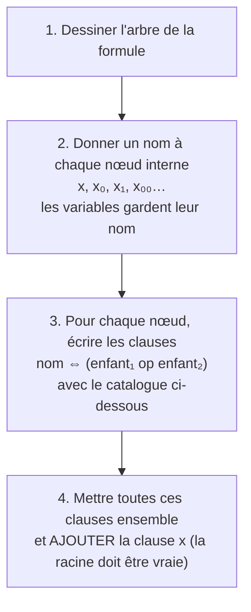
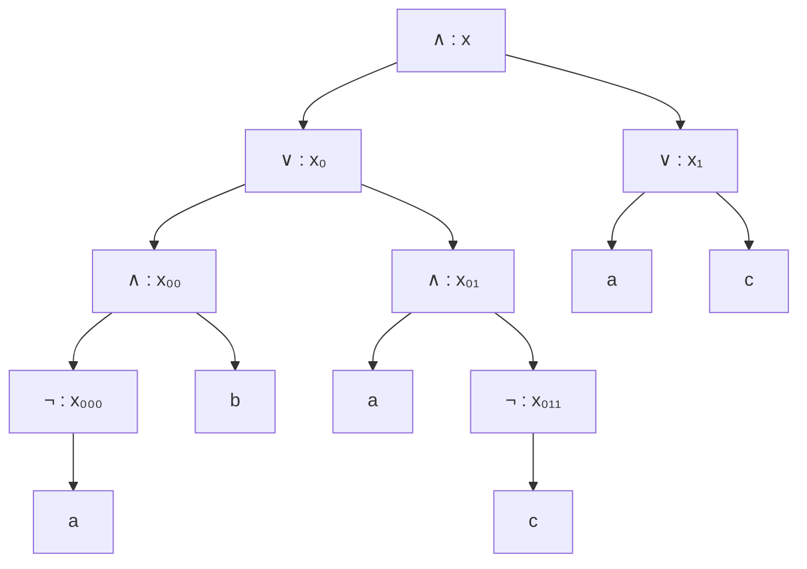

# Chapitre 8 — La transformation de Tseitin

> **Objectif** : savoir transformer n'importe quelle formule en FNC **sans qu'elle explose en taille**, pour pouvoir la donner à un solveur.

---

## 8.1 Le problème : l'explosion

Au chapitre 4, on a vu que mettre une formule en FNC par distributivité peut la rendre **énorme** : `(a₁ ∧ b₁) ∨ (a₂ ∧ b₂) ∨ … ∨ (a₁₀ ∧ b₁₀)` donne `2¹⁰ = 1024` clauses. Avec 100 blocs, on aurait environ `10³⁰` clauses : bien plus que tout ce que les ordinateurs du monde entier peuvent stocker.

On a donc besoin d'une autre méthode.

---

## 8.2 L'idée : donner des noms aux résultats intermédiaires

Tu fais un calcul compliqué sur ta calculatrice : `((3 + 5) × 2 − (4 × 7)) / 2`. Au lieu de tout faire d'un coup, tu notes des résultats intermédiaires :

```
r1 = 3 + 5
r2 = r1 × 2
r3 = 4 × 7
r4 = r2 − r3
résultat = r4 / 2
```

En programmation, c'est ce que tu fais avec des variables. **Tseitin, c'est exactement ça** : on donne un nom (une **nouvelle variable**) à chaque sous-formule, et on écrit des petites clauses qui disent *« ce nom vaut bien ce calcul »*.



Formellement :

| Cas | `tseitin(…)` |
|---|---|
| une variable `x` | `⊤` (rien à ajouter) |
| `φ₁ op φ₂` | `tseitin(φ₁) ∧ tseitin(φ₂) ∧ θ`, avec `θ` = FNC de `(x₁ op x₂) ⇔ x` |
| `¬φ` | `tseitin(φ) ∧ θ`, avec `θ` = FNC de `¬y ⇔ x` |

Et le problème donné au solveur est **`tseitin(φ) ∧ x`**.

---

## 8.3 ⭐ Le catalogue (à connaître)

`x` est le nom du nœud, `x₁` et `x₂` (ou `y`) les noms de ses enfants.

| Le nœud dit… | Clauses à écrire |
|---|---|
| `x ⇔ (x₁ ∧ x₂)` | `(¬x₁ ∨ ¬x₂ ∨ x) ∧ (¬x ∨ x₁) ∧ (¬x ∨ x₂)` |
| `x ⇔ (x₁ ∨ x₂)` | `(x₁ ∨ x₂ ∨ ¬x) ∧ (¬x₁ ∨ x) ∧ (¬x₂ ∨ x)` |
| `x ⇔ (x₁ ⇒ x₂)` | `(¬x₁ ∨ x₂ ∨ ¬x) ∧ (x ∨ x₁) ∧ (x ∨ ¬x₂)` |
| `x ⇔ ¬y` | `(x ∨ y) ∧ (¬x ∨ ¬y)` |

### Comment les retrouver sans les apprendre par cœur

Prenons le `∧` et coupons le `⇔` en deux implications :

- `x ⇒ (x₁ ∧ x₂)` : « si `x` est vrai, les deux enfants le sont » → `(¬x ∨ x₁) ∧ (¬x ∨ x₂)`
- `(x₁ ∧ x₂) ⇒ x` : « si les deux enfants sont vrais, `x` l'est » → `¬(x₁ ∧ x₂) ∨ x` = `¬x₁ ∨ ¬x₂ ∨ x`

Pour le `¬` : `x ⇔ ¬y` veut dire « `x` et `y` ont des valeurs opposées » : pas les deux à 0 (`x ∨ y`), pas les deux à 1 (`¬x ∨ ¬y`).

---

## 8.4 Exemple complet

Formule : `φ = ((¬a ∧ b) ∨ (a ∧ ¬c)) ∧ (a ∨ c)`

**Étapes 1 et 2** : l'arbre avec un nom par nœud.



**Étape 3** : les clauses de chaque nœud, du bas vers le haut.

| Nœud | Clauses |
|---|---|
| `x₀₀₀ ⇔ ¬a` | `(x₀₀₀ ∨ a) ∧ (¬x₀₀₀ ∨ ¬a)` |
| `x₀₀ ⇔ (x₀₀₀ ∧ b)` | `(¬x₀₀₀ ∨ ¬b ∨ x₀₀) ∧ (¬x₀₀ ∨ x₀₀₀) ∧ (¬x₀₀ ∨ b)` |
| `x₀₁₁ ⇔ ¬c` | `(x₀₁₁ ∨ c) ∧ (¬x₀₁₁ ∨ ¬c)` |
| `x₀₁ ⇔ (a ∧ x₀₁₁)` | `(¬a ∨ ¬x₀₁₁ ∨ x₀₁) ∧ (¬x₀₁ ∨ a) ∧ (¬x₀₁ ∨ x₀₁₁)` |
| `x₀ ⇔ (x₀₀ ∨ x₀₁)` | `(x₀₀ ∨ x₀₁ ∨ ¬x₀) ∧ (¬x₀₀ ∨ x₀) ∧ (¬x₀₁ ∨ x₀)` |
| `x₁ ⇔ (a ∨ c)` | `(a ∨ c ∨ ¬x₁) ∧ (¬a ∨ x₁) ∧ (¬c ∨ x₁)` |
| `x ⇔ (x₀ ∧ x₁)` | `(¬x₀ ∨ ¬x₁ ∨ x) ∧ (¬x ∨ x₀) ∧ (¬x ∨ x₁)` |

**Étape 4** : on ajoute la clause **`x`**.

Chaque nœud ajoute **au plus 3 clauses** : la taille reste **proportionnelle** à la formule de départ.

---

## 8.5 Est-ce que c'est la même formule ?

**Non**, et c'est important : la nouvelle formule a plus de variables (`x`, `x₀`…), donc elle n'est pas équivalente à `φ`. Mais elle a la propriété qui nous intéresse :

| Propriété | Ce que ça veut dire |
|---|---|
| Lemme | dans toute valuation qui satisfait `tseitin(φ)`, la variable `x` a la même valeur que `φ` |
| Conséquence | si le solveur trouve une solution de `tseitin(φ) ∧ x`, elle rend aussi `φ` vraie |
| Donc | `φ` est satisfiable **si et seulement si** `tseitin(φ) ∧ x` l'est : on dit qu'elles sont **équisatisfiables** |

| | Distributivité | Tseitin |
|---|---|---|
| Taille | peut exploser (exponentielle) | **linéaire** |
| Résultat | équivalent | **équisatisfiable** |
| Nouvelles variables | non | oui |

---

## Ce qu'il faut retenir

- Tseitin = nommer chaque sous-formule, comme des variables intermédiaires en programmation.
- 2 ou 3 clauses par nœud (catalogue), **plus la clause `x`** pour la racine.
- Taille linéaire, résultat **équisatisfiable** (pas équivalent).

---

✏️ S'entraîner : [exercices proposés SAT](../../02-TD-TP/2-FNC-et-SAT/enonces-proposes.md)
⬅️ [Chapitre 7 — SAT en Python](7-SAT-en-Python.md) · ➡️ [Chapitre 9 — DPLL](9-DPLL.md)
