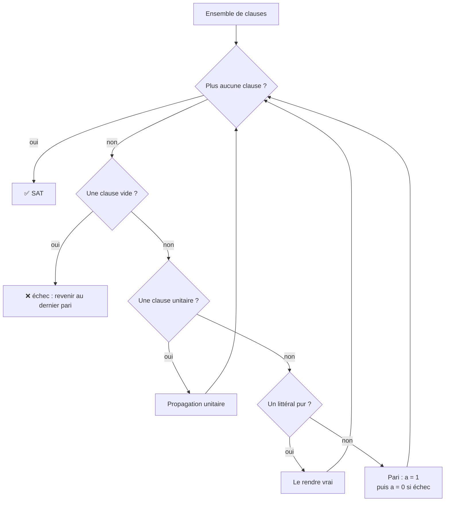
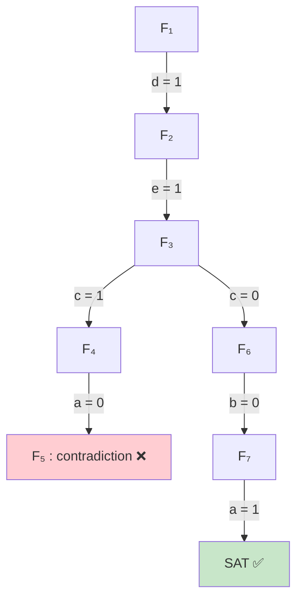

# Chapitre 9 — L'algorithme DPLL

> **Objectif** : savoir résoudre un problème SAT à la main avec l'algorithme DPLL, et dessiner son arbre de recherche.

---

## 9.1 Tu connais déjà DPLL : c'est comme un Sudoku

Quand tu fais un Sudoku :

1. tu remplis d'abord les cases **évidentes** (il ne reste qu'un chiffre possible) ;
2. chaque case remplie en rend d'autres évidentes, tu continues ;
3. quand plus rien n'est évident, tu **paries** sur une case, au crayon ;
4. si ça mène à une contradiction, tu **gommes** et tu essaies l'autre possibilité.

L'algorithme **DPLL** (Davis, Putnam, Logemann, Loveland) fait exactement ça avec des clauses. Les solveurs SAT modernes sont des versions améliorées de DPLL : par exemple, ils **retiennent la cause** d'une contradiction pour ne pas refaire la même erreur (apprentissage de clauses).

---

## 9.2 Ce qui se passe quand on fixe une variable

Si on décide que le littéral `l` est **vrai** :

| La clause contient… | Ce qu'on fait | Pourquoi |
|---|---|---|
| `l` | on **supprime** la clause | elle est respectée |
| son contraire `l̄` | on **retire** `l̄` de la clause | cette option est fausse, il en reste d'autres |
| ni l'un ni l'autre | rien | |

Exemple : avec `a = 1`, la clause `a ∨ b` disparaît et `¬a ∨ c` devient `c`.

| Situation | Conclusion |
|---|---|
| il n'y a plus aucune clause | **SAT** ✅ toutes les règles sont respectées |
| une clause est devenue **vide** (plus aucune option) | **contradiction** ❌, il faut revenir en arrière |

---

## 9.3 Les 4 règles de DPLL

| # | Règle | Quand ? | Ce qu'on fait | Au Sudoku… |
|---|---|---|---|---|
| 1 | **Simplification** | une clause contient `a` **et** `¬a` | on la supprime (elle est toujours vraie) | |
| 2 | **Propagation unitaire** | une clause n'a **plus qu'un** littéral `l` | `l` doit être vrai : on le fixe | une case où un seul chiffre est possible |
| 3 | **Littéral pur** | une variable n'apparaît **qu'avec un seul signe** (toujours `a`, ou toujours `¬a`) | on rend ce littéral vrai, ça ne peut pas gêner | |
| 4 | **Recherche par cas** | plus rien d'autre à faire | on choisit une variable, on essaie `1`, et si ça échoue on essaie `0` | le pari au crayon |

> 🔑 Toujours dans cet ordre : d'abord les règles « gratuites » (1, 2, 3), le pari (4) **en dernier**.



---

## 9.4 Un exemple complet

```
F₁ = (a ∨ b) ∧ (¬a ∨ ¬c) ∧ d ∧ (d ∨ ¬a) ∧ (¬d ∨ e ∨ f)
     ∧ (¬b ∨ ¬c ∨ ¬d) ∧ (¬b ∨ c ∨ e ∨ ¬f) ∧ (¬b ∨ c)
```

| Étape | Règle | Choix | Ce qu'il reste |
|---|---|---|---|
| F₁ → F₂ | propagation unitaire (la clause `d`) | `d = 1` | `(a ∨ b) ∧ (¬a ∨ ¬c) ∧ (e ∨ f) ∧ (¬b ∨ ¬c) ∧ (¬b ∨ c ∨ e ∨ ¬f) ∧ (¬b ∨ c)` |
| F₂ → F₃ | littéral pur (`e` n'apparaît jamais avec `¬`) | `e = 1` | `(a ∨ b) ∧ (¬a ∨ ¬c) ∧ (¬b ∨ ¬c) ∧ (¬b ∨ c)` |
| F₃ → F₄ | **pari** | `c = 1` | `(a ∨ b) ∧ ¬a ∧ ¬b` |
| F₄ → F₅ | propagation unitaire | `a = 0` | `b ∧ ¬b` |
| F₅ | `b` et `¬b` ensemble | | **contradiction** ❌ on gomme le pari |
| F₃ → F₆ | **autre branche du pari** | `c = 0` | `(a ∨ b) ∧ ¬b` |
| F₆ → F₇ | propagation unitaire | `b = 0` | `a` |
| F₇ | propagation unitaire | `a = 1` | plus rien : **SAT** ✅ |

L'**arbre de recherche** garde la trace des paris :



**Solution** : `a = 1, b = 0, c = 0, d = 1, e = 1` (`f` peut valoir n'importe quoi).

> ⚠️ Avant de conclure « insatisfiable », vérifie que **toutes** les branches des paris ont échoué.

---

## Ce qu'il faut retenir

- DPLL = remplir les cases évidentes, parier quand on est bloqué, gommer en cas de contradiction.
- Ordre : simplification → unitaire → pur → pari.
- Fixer `l` : on supprime les clauses avec `l`, on retire `l̄` des autres.
- On présente la résolution en **tableau** et on dessine l'**arbre**.

---

✏️ S'entraîner : [exercices proposés SAT](../../02-TD-TP/2-FNC-et-SAT/enonces-proposes.md)
⬅️ [Chapitre 8 — Tseitin](8-Tseitin.md) · ➡️ [Chapitre 10 — Les opérateurs en programmation](10-Operateurs-en-programmation.md)
