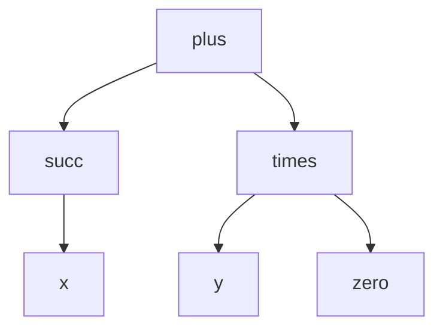

# Chapitre 11 — Les termes : écrire des objets

> **Objectif** : savoir ce qu'est un terme, le lire comme un arbre et calculer ses variables.
>
> 📌 *Chapitre préparé à l'avance à partir du programme de l'UE (« termes : syntaxe, sémantique, F-algèbres, substitution, unification »). Compare-le avec le CM quand il aura lieu et complète-le si besoin.*

---

## 11.1 Pourquoi les termes ?

Jusqu'ici, nos formules parlaient de choses **vraies ou fausses** : « il pleut », « j'ai cours ». Mais en informatique, on manipule surtout des **objets** : des nombres, des listes, des dates, des fichiers…

Un **terme** est une expression qui **désigne un objet**, sans dire s'il est vrai ou faux :

| Terme | Désigne |
|---|---|
| `(2 + x) × 3` | un nombre |
| `date(30, 10, 2026)` | une date |
| `cons(1, cons(2, nil))` | la liste `[1, 2]` |
| `pere(pere(Habiba))` | le grand-père paternel de Habiba |

> 💡 Une **formule** répond à « est-ce vrai ? ». Un **terme** répond à « de quel objet parle-t-on ? ».

---

## 11.2 Les ingrédients : la signature

Pour écrire des termes, on se donne une **signature** `F` : une liste de **symboles de fonction**, chacun avec son **arité** (son nombre d'arguments).

| Symbole | Arité | Rôle |
|---|---|---|
| `zero`, `nil`, `Habiba` | 0 | **constantes** : des objets de base |
| `succ`, `pere` | 1 | prend un objet, en donne un autre |
| `plus`, `cons`, `×` | 2 | prend deux objets |
| `date` | 3 | prend trois objets |

On se donne aussi un ensemble `X` de **variables** (`x`, `y`, `z`…) qui représentent des objets **inconnus**.

### La définition

Les termes sur `F` et `X` (ensemble noté `T(F, X)`) se construisent ainsi :

1. toute **variable** `x ∈ X` est un terme ;
2. toute **constante** `c` (arité 0) est un terme ;
3. si `f` est d'arité `n` et `t₁, …, tₙ` sont des termes, alors **`f(t₁, …, tₙ)`** est un terme.

C'est encore une définition **récursive**, comme pour les formules du chapitre 1.

**Exemple** avec `F = { zero/0, succ/1, plus/2 }` (le `/n` indique l'arité) :

| Expression | Terme ? |
|---|---|
| `zero` | ✅ constante |
| `succ(succ(zero))` | ✅ (représente 2) |
| `plus(x, succ(zero))` | ✅ (représente x + 1) |
| `succ(zero, zero)` | ❌ `succ` attend **un** argument |
| `plus(zero)` | ❌ `plus` attend **deux** arguments |

> ⚠️ Respecter l'arité est la première chose à vérifier.

---

## 11.3 Un terme est un arbre

Comme les formules, un terme se dessine en arbre : les symboles de fonction sont les nœuds, les constantes et variables sont les feuilles.

`plus(succ(x), times(y, zero))` (c'est-à-dire `(x + 1) + (y × 0)`) :

> 💡 Les formules propositionnelles du chapitre 1 sont en fait des termes particuliers : la signature est `{ ⊤/0, ⊥/0, ¬/1, ∧/2, ∨/2, ⇒/2, ⇔/2 }` et les variables sont les variables propositionnelles.

---

## 11.4 Calculs sur les termes

Toujours le même principe : on définit une fonction **cas par cas**.

### Les variables d'un terme : `Var(t)`

| Cas | Résultat |
|---|---|
| `x` variable | `{x}` |
| `c` constante | `∅` |
| `f(t₁, …, tₙ)` | `Var(t₁) ∪ … ∪ Var(tₙ)` |

Exemple : `Var(plus(succ(x), times(y, zero))) = {x, y}`.

Un terme **sans variable** est dit **clos** (ou fermé) : `succ(succ(zero))` est clos, il désigne un objet bien précis.

### La taille et la hauteur

| | Définition | Pour `plus(succ(x), times(y, zero))` |
|---|---|---|
| taille | nombre de symboles (nœuds + feuilles) | 6 |
| hauteur | nombre d'étages sous la racine | `h(x) = 0`, `h(succ(x)) = 1`, `h(times(y, zero)) = 1`, `h = 2` |

Règle de la hauteur : `h(x) = h(c) = 0` et `h(f(t₁, …, tₙ)) = 1 + max(h(t₁), …, h(tₙ))`.

---

## 11.5 Les termes en programmation

Tu as déjà manipulé des termes sans le savoir :

| En logique | En Python |
|---|---|
| `cons(1, cons(2, nil))` | `[1, 2]` |
| `date(30, 10, 2026)` | `datetime.date(2026, 10, 30)` |
| l'arbre d'un terme | un arbre d'objets (classes `Noeud`, `Feuille`) |

Les **types de données algébriques** (en OCaml, Haskell, Rust…) sont exactement des signatures : chaque constructeur est un symbole de fonction avec une arité.

---

## Ce qu'il faut retenir

- Un **terme** désigne un **objet** ; une **formule** est vraie ou fausse.
- Signature = symboles de fonction **avec leur arité** (arité 0 = constante).
- Terme : variable, constante, ou `f(t₁, …, tₙ)` avec exactement `n` arguments.
- Un terme est un arbre ; terme **clos** = sans variable.

---

✏️ S'entraîner : [exercices proposés Termes, partie A](../../02-TD-TP/3-Termes/enonces-proposes.md)
⬅️ [Chapitre 10](../02-SAT/10-Operateurs-en-programmation.md) · ➡️ [Chapitre 12 — Le sens des termes](12-Semantique-F-algebres.md)
