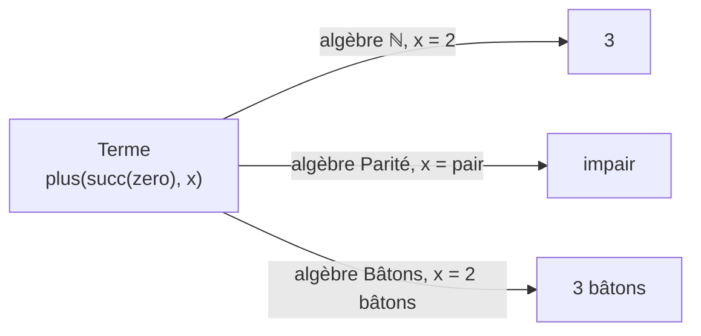

# Chapitre 12 — Le sens des termes : les F-algèbres

> **Objectif** : savoir donner un sens (une valeur) à un terme, et comprendre qu'un même terme peut avoir des sens différents.
>
> 📌 *Chapitre préparé à l'avance à partir du programme de l'UE. Compare-le avec le CM et complète-le si besoin.*

---

## 12.1 Une partition, plusieurs instruments

Une **partition de musique** est une suite de symboles. Jouée au piano, elle donne un son ; jouée à la guitare, un autre son. La partition est la **syntaxe**, le son est la **sémantique**, et l'instrument est ce qui fait le lien.

Pour les termes, c'est pareil :

- le terme `plus(succ(zero), x)` est la partition ;
- l'« instrument » s'appelle une **F-algèbre** ;
- le résultat est un **objet** (un nombre, un mot, …).

---

## 12.2 Ce qu'est une F-algèbre

Une **F-algèbre** `A` donne un sens à chaque symbole de la signature `F` :

| Il faut choisir | Notation |
|---|---|
| un ensemble d'objets, le **domaine** | `D_A` |
| pour chaque constante `c`, un objet | `c_A ∈ D_A` |
| pour chaque symbole `f` d'arité `n`, une **fonction** | `f_A : D_Aⁿ → D_A` |

### Un même terme, trois algèbres

Signature : `F = { zero/0, succ/1, plus/2 }`.

| Symbole | Algèbre **ℕ** (nombres) | Algèbre **Parité** | Algèbre **Bâtons** (mots) |
|---|---|---|---|
| domaine | `{0, 1, 2, …}` | `{pair, impair}` | les mots faits de `\|` |
| `zero` | `0` | `pair` | `""` (mot vide) |
| `succ(n)` | `n + 1` | change pair ↔ impair | ajoute un `\|` |
| `plus(n, m)` | `n + m` | pair+pair = pair, pair+impair = impair, impair+impair = pair | colle les deux mots |

---

## 12.3 Calculer la valeur d'un terme

Un terme peut contenir des **variables**. Pour le calculer, il faut dire ce que vaut chaque variable : c'est un **environnement** `ρ` (« rhô »), l'équivalent de la valuation du chapitre 2.

> La valeur `⟦t⟧ρ` d'un terme se calcule **des feuilles vers la racine** :
> - `⟦x⟧ρ = ρ(x)` (on lit la valeur de la variable)
> - `⟦c⟧ρ = c_A` (on lit la valeur de la constante)
> - `⟦f(t₁, …, tₙ)⟧ρ = f_A(⟦t₁⟧ρ, …, ⟦tₙ⟧ρ)` (on calcule les arguments, puis on applique `f_A`)

**Exemple** : `t = plus(succ(zero), x)`

| Algèbre | Environnement | Calcul | Valeur |
|---|---|---|---|
| ℕ | `x = 2` | `plus(succ(0), 2) = (0 + 1) + 2` | `3` |
| Parité | `x = pair` | `succ(pair) = impair`, `plus(impair, pair)` | `impair` |
| Bâtons | `x = "\|\|"` | `succ("") = "\|"`, collé à `"\|\|"` | `"\|\|\|"` |

Les trois résultats sont cohérents : 3 est impair et s'écrit avec 3 bâtons. Mais chaque algèbre ne garde qu'une partie de l'information (la parité oublie la valeur exacte).

> 💡 Un terme **clos** (sans variable) n'a pas besoin d'environnement : `succ(succ(zero))` vaut toujours `2` dans ℕ.

---

## 12.4 Égaux en syntaxe, égaux en sémantique

Les termes `plus(x, zero)` et `x` sont **différents** (ce ne sont pas les mêmes arbres). Pourtant, dans ℕ, ils ont **la même valeur** pour tout `x`, car `x + 0 = x`.

| | `plus(x, zero)` et `x` |
|---|---|
| Égaux **syntaxiquement** (même arbre) ? | ❌ non |
| Égaux dans l'algèbre ℕ (même valeur pour tout `ρ`) ? | ✅ oui |

C'est la même idée que `φ ≡ ψ` au chapitre 3 : deux écritures différentes, un même sens.

---

## 12.5 L'algèbre des termes

Il existe une algèbre un peu spéciale : celle où **les objets sont les termes eux-mêmes**. Le symbole `succ` y est interprété par la fonction qui… construit l'arbre `succ(t)`. Rien n'est calculé, tout est gardé tel quel.

C'est exactement ce que fait un programme qui manipule des **arbres de syntaxe** (un compilateur, un interpréteur) : il construit et transforme des termes sans les évaluer.

---

## Ce qu'il faut retenir

- Une **F-algèbre** = un domaine + une fonction pour chaque symbole (respectant l'arité).
- Pour évaluer un terme : un **environnement** `ρ` pour les variables, puis on calcule des feuilles vers la racine.
- Un même terme a des valeurs différentes selon l'algèbre choisie.
- Deux termes différents peuvent avoir la même valeur dans une algèbre.

---

✏️ S'entraîner : [exercices proposés Termes, partie B](../../02-TD-TP/3-Termes/enonces-proposes.md)
⬅️ [Chapitre 11 — Les termes](11-Termes.md) · ➡️ [Chapitre 13 — Substitution](13-Substitution.md)
