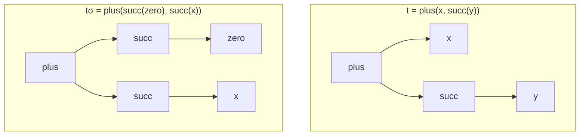

# Chapitre 13 — La substitution

> **Objectif** : savoir remplacer des variables par des termes, et composer deux substitutions.
>
> 📌 *Chapitre préparé à l'avance à partir du programme de l'UE. Compare-le avec le CM et complète-le si besoin.*

---

## 13.1 Le publipostage

Tu envoies la même lettre à 100 personnes : *« Bonjour `{prénom}`, votre rendez-vous est le `{date}`. »* Pour chaque personne, le logiciel **remplace** `{prénom}` et `{date}` par les bonnes valeurs.

C'est une **substitution** : on remplace des **variables** par des **termes**.

---

## 13.2 Définition et notation

Une **substitution** `σ` associe à certaines variables un terme. On l'écrit comme une liste de remplacements :

> `σ = { x ↦ succ(zero), y ↦ plus(z, z) }`
> se lit : « `x` devient `succ(zero)`, `y` devient `plus(z, z)` ». Les autres variables ne bougent pas.

Appliquer `σ` à un terme `t` se note `tσ` (ou `σ(t)`). On remplace **toutes les occurrences en même temps** :

| Cas | Résultat |
|---|---|
| `x` avec `x ↦ u` dans `σ` | `u` |
| `x` qui n'est pas dans `σ` | `x` (inchangé) |
| une constante `c` | `c` |
| `f(t₁, …, tₙ)` | `f(t₁σ, …, tₙσ)` |

**Exemple** : `t = plus(x, succ(y))` et `σ = { x ↦ succ(zero), y ↦ x }`

`tσ = plus(succ(zero), succ(x))`

> ⚠️ Le `x` qui apparaît **grâce** à `y ↦ x` n'est **pas** remplacé à son tour : tout est remplacé en une seule fois, sur le terme de départ.

En arbre, on « greffe » un sous-arbre à la place de chaque feuille-variable :

---

## 13.3 Instance

Si `t' = tσ` pour une certaine substitution `σ`, on dit que `t'` est une **instance** de `t` (ou que `t` est **plus général** que `t'`).

| Terme général | Instance | Substitution |
|---|---|---|
| `date(j, m, 2026)` | `date(30, 10, 2026)` | `{ j ↦ 30, m ↦ 10 }` |
| `plus(x, y)` | `plus(zero, succ(zero))` | `{ x ↦ zero, y ↦ succ(zero) }` |
| `plus(x, x)` | `plus(zero, zero)` | `{ x ↦ zero }` |
| `plus(x, x)` | `plus(zero, succ(zero))` | ❌ impossible : `x` ne peut pas valoir deux choses |

> 💡 C'est le principe du **filtrage** (*pattern matching*) en programmation : le motif `date(j, m, 2026)` « attrape » toutes les dates de 2026.

---

## 13.4 Composer deux substitutions

On peut appliquer une substitution `σ`, **puis** une substitution `τ` (« tau ») : `(tσ)τ`. Le résultat est une seule substitution, notée `στ`, telle que `t(στ) = (tσ)τ`.

**Comment la calculer** :

1. appliquer `τ` à **chaque terme** de `σ` ;
2. ajouter les remplacements de `τ` pour les variables **que `σ` ne touche pas** ;
3. retirer les remplacements inutiles du type `x ↦ x`.

**Exemple** : `σ = { x ↦ f(y) }` et `τ = { y ↦ a, z ↦ b }`

| Étape | Résultat |
|---|---|
| 1. `τ` appliquée dans `σ` | `x ↦ f(a)` |
| 2. ajouter `τ` pour les variables hors de `σ` | `y ↦ a`, `z ↦ b` |
| `στ` | `{ x ↦ f(a), y ↦ a, z ↦ b }` |

Vérification avec `t = g(x, y)` : `tσ = g(f(y), y)`, puis `(tσ)τ = g(f(a), a)`. Et directement `t(στ) = g(f(a), a)` ✅.

> ⚠️ L'ordre compte : en général `στ ≠ τσ`.

---

## Ce qu'il faut retenir

- Substitution = « rechercher / remplacer » des variables par des termes, **toutes en même temps**.
- `t'` est une **instance** de `t` si `t' = tσ` pour une substitution `σ`.
- Composition `στ` : appliquer `τ` dans les termes de `σ`, puis ajouter le reste de `τ`.

---

✏️ S'entraîner : [exercices proposés Termes, partie C](../../02-TD-TP/3-Termes/enonces-proposes.md)
⬅️ [Chapitre 12 — F-algèbres](12-Semantique-F-algebres.md) · ➡️ [Chapitre 14 — Unification](14-Unification.md)
