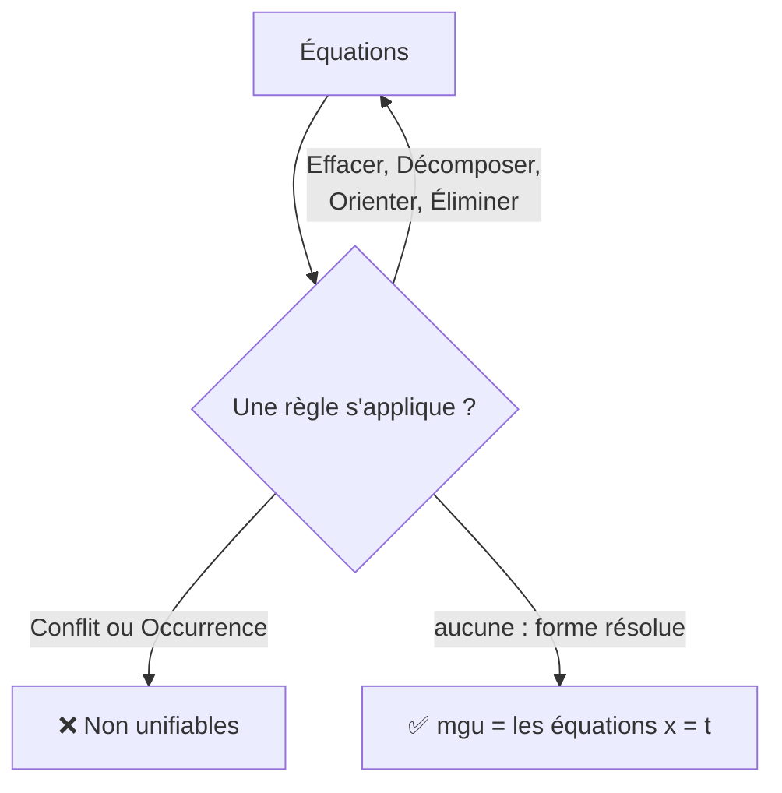

# Chapitre 14 — L'unification

> **Objectif** : savoir trouver la substitution qui rend deux termes identiques (ou montrer qu'il n'y en a pas), avec un algorithme pas à pas.
>
> 📌 *Chapitre préparé à l'avance à partir du programme de l'UE. Compare-le avec le CM et complète-le si besoin (les noms des règles peuvent varier).*

---

## 14.1 Le problème : faire coïncider deux motifs

Tu cherches un créneau commun avec une amie :

- toi : `rdv(lundi, h)` (lundi, n'importe quelle heure `h`)
- elle : `rdv(j, 14h)` (n'importe quel jour `j`, à 14h)

Pour vous mettre d'accord, il faut `j = lundi` et `h = 14h`. Les deux deviennent `rdv(lundi, 14h)`.

Tu viens de faire une **unification** : trouver une substitution `σ` telle que **`sσ = tσ`**.

| Mot | Sens |
|---|---|
| **unificateur** de `s` et `t` | une substitution `σ` telle que `sσ = tσ` |
| **unifiables** | il existe au moins un unificateur |
| **unificateur le plus général** (*mgu*) | l'unificateur qui fixe **le moins de choses possible** ; tous les autres en sont des cas particuliers |

**Exemple** : `plus(x, succ(zero))` et `plus(succ(y), z)`

- `σ₁ = { x ↦ succ(y), z ↦ succ(zero) }` est un unificateur : les deux deviennent `plus(succ(y), succ(zero))`.
- `σ₂ = { x ↦ succ(zero), y ↦ zero, z ↦ succ(zero) }` en est un aussi, mais il fixe `y = zero` **sans raison**.
- `σ₁` est le plus général : `σ₂` s'obtient en ajoutant `y ↦ zero` après `σ₁`.

---

## 14.2 Où sert l'unification ?

| Domaine | Exemple |
|---|---|
| **Prolog** | la question `pere(X, habiba)` est unifiée avec les faits connus pour trouver `X` |
| **Inférence de types** (OCaml, Haskell, Rust) | une fonction attend `(int, 'a list)`, on lui donne `('b, bool list)` : le compilateur trouve `'b = int`, `'a = bool` |
| **Démonstration automatique** | pour appliquer une règle générale à un cas particulier |

---

## 14.3 L'algorithme : des règles de simplification

On part d'un ensemble d'**équations** `{ s = t }` et on applique les règles suivantes tant qu'on peut.

| Règle | Si on a… | On le remplace par… | Exemple |
|---|---|---|---|
| **Effacer** | `t = t` | rien (on supprime) | `a = a` disparaît |
| **Décomposer** | `f(s₁, …, sₙ) = f(t₁, …, tₙ)` | `s₁ = t₁, …, sₙ = tₙ` | `g(x, a) = g(b, y)` → `x = b, a = y` |
| **Conflit** | `f(…) = g(…)` avec `f ≠ g` | **ÉCHEC** | `succ(x) = zero` |
| **Orienter** | `t = x` avec `t` qui n'est pas une variable | `x = t` | `a = y` → `y = a` |
| **Occurrence** | `x = t` avec `x` **dans** `t` (et `t ≠ x`) | **ÉCHEC** | `x = succ(x)` |
| **Éliminer** | `x = t` avec `x` absent de `t` | on remplace `x` par `t` **dans les autres équations** (on garde `x = t`) | |

On s'arrête quand toutes les équations sont de la forme `x = t`, avec chaque `x` qui n'apparaît **nulle part ailleurs**. Ces équations forment le **mgu**.

> 💡 Pourquoi `x = succ(x)` échoue ? Il faudrait un terme égal à son propre successeur : `x = succ(succ(succ(…)))` à l'infini. Ce n'est pas un terme (un terme est un arbre **fini**).

---

## 14.4 Exemples déroulés

### Exemple 1 : succès

Unifier `f(x, g(y))` et `f(a, g(x))` :

| Équations | Règle appliquée |
|---|---|
| `f(x, g(y)) = f(a, g(x))` | départ |
| `x = a`, `g(y) = g(x)` | décomposer `f` |
| `x = a`, `g(y) = g(a)` | éliminer `x` |
| `x = a`, `y = a` | décomposer `g` |

Forme résolue. **mgu = `{ x ↦ a, y ↦ a }`**.
Vérification : les deux termes deviennent `f(a, g(a))` ✅.

### Exemple 2 : conflit

Unifier `f(x, a)` et `f(b, c)` (avec `a`, `b`, `c` des constantes différentes) :

| Équations | Règle |
|---|---|
| `x = b`, `a = c` | décomposer |
| `a = c` | **conflit** : deux constantes différentes ❌ |

### Exemple 3 : occurrence

Unifier `g(x, x)` et `g(y, f(y))` :

| Équations | Règle |
|---|---|
| `x = y`, `x = f(y)` | décomposer |
| `x = y`, `y = f(y)` | éliminer `x` |
| `y = f(y)` | **occurrence** : `y` est dans `f(y)` ❌ |

---

## Ce qu'il faut retenir

- Unifier `s` et `t` = trouver `σ` avec `sσ = tσ`.
- Le **mgu** est l'unificateur le plus général : il ne fixe que ce qui est nécessaire.
- 6 règles : effacer, décomposer, conflit ❌, orienter, occurrence ❌, éliminer.
- Toujours **vérifier** en appliquant le mgu aux deux termes.

---

✏️ S'entraîner : [exercices proposés Termes, partie D](../../02-TD-TP/3-Termes/enonces-proposes.md)
⬅️ [Chapitre 13 — Substitution](13-Substitution.md) · ➡️ [Partie Premier ordre — Chapitre 15](../04-Logique-premier-ordre/15-Syntaxe-premier-ordre.md)
