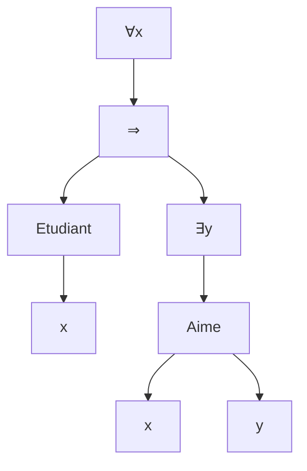

# Chapitre 15 — La logique du premier ordre : écrire

> **Objectif** : savoir écrire des formules avec « pour tout » (`∀`) et « il existe » (`∃`), et repérer les variables libres et liées.
>
> 📌 *Chapitre préparé à l'avance à partir du programme de l'UE (« la quantification et sa sémantique, la modélisation en logique du premier ordre »). Compare-le avec le CM et complète-le si besoin.*

---

## 15.1 Ce que la logique propositionnelle ne sait pas dire

Essaie de traduire : *« Tous les étudiants de la promo ont une carte d'étudiant. »*

En logique propositionnelle, il faudrait une variable par étudiant : `c_Habiba ∧ c_Lucas ∧ c_Inès ∧ …`. Avec 200 étudiants, 200 variables. Et si un nouvel étudiant arrive, il faut changer la formule !

Ce qu'on veut, c'est dire **une seule fois** : *« pour tout `x`, si `x` est étudiant, alors `x` a une carte »*.

> `∀x (Etudiant(x) ⇒ ACarte(x))`

C'est la **logique du premier ordre** : on ajoute des **objets**, des **propriétés** et des **quantificateurs**.

---

## 15.2 Les ingrédients

| Ingrédient | Rôle | Exemples |
|---|---|---|
| **termes** (chapitre 11) | désignent des **objets** | `x`, `Habiba`, `pere(x)` |
| **prédicats** (avec une arité) | disent quelque chose des objets : **vrai ou faux** | `Etudiant(x)` (arité 1), `Aime(x, y)` (arité 2) |
| **connecteurs** | comme avant | `¬ ∧ ∨ ⇒ ⇔` |
| **quantificateurs** | « pour tout », « il existe » | `∀x`, `∃x` |

> 💡 **Fonction ou prédicat ?**
> - `pere(x)` est un **objet** (une personne) : c'est une **fonction**, elle donne un terme.
> - `Etudiant(x)` est **vrai ou faux** : c'est un **prédicat**, il donne une formule.
> On met souvent une minuscule aux fonctions et une majuscule aux prédicats.

### La définition des formules

1. Si `P` est un prédicat d'arité `n` et `t₁, …, tₙ` des termes, alors `P(t₁, …, tₙ)` est une formule (**formule atomique**).
2. Si `φ` et `ψ` sont des formules : `¬φ`, `φ ∧ ψ`, `φ ∨ ψ`, `φ ⇒ ψ`, `φ ⇔ ψ` sont des formules.
3. Si `φ` est une formule et `x` une variable : **`∀x φ`** et **`∃x φ`** sont des formules.

| Formule | Se lit |
|---|---|
| `∀x Mortel(x)` | tout le monde est mortel |
| `∃x Malade(x)` | quelqu'un est malade |
| `∀x ∃y Aime(x, y)` | tout le monde aime quelqu'un |
| `∀x (Etudiant(x) ⇒ Aime(x, pere(x)))` | tout étudiant aime son père |

---

## 15.3 L'arbre d'une formule

`∀x (Etudiant(x) ⇒ ∃y Aime(x, y))` : « tout étudiant aime quelqu'un ».

Le quantificateur `∀x` porte sur tout ce qui est **en dessous** de lui dans l'arbre : c'est sa **portée**. On utilise des parenthèses pour bien la délimiter.

---

## 15.4 Variables libres et variables liées

Dans *« **il existe** une personne `y` que `x` aime »* (`∃y Aime(x, y)`) :

- `y` est **liée** : elle est « attrapée » par `∃y`, c'est une variable interne (on peut la renommer sans changer le sens : `∃z Aime(x, z)` dit la même chose) ;
- `x` est **libre** : rien ne la quantifie, c'est un « trou » à remplir. Le sens dépend de qui est `x`.

> 💡 C'est comme en programmation : dans `sum(i for i in range(n))`, `i` est liée (variable de boucle), `n` est libre (elle doit venir d'ailleurs).

**Calcul des variables libres** `VL(φ)` :

| Formule | `VL` |
|---|---|
| `P(t₁, …, tₙ)` | toutes les variables des `tᵢ` |
| `¬φ` | `VL(φ)` |
| `φ op ψ` | `VL(φ) ∪ VL(ψ)` |
| `∀x φ` ou `∃x φ` | `VL(φ) − {x}` |

Une formule **sans variable libre** est dite **close** : c'est une vraie affirmation, qui sera vraie ou fausse.

**Exemple** : `φ = ∀x (P(x, y) ∧ ∃y Q(y))`

- dans `P(x, y)` : `x` est liée par `∀x`, `y` est **libre** ;
- dans `Q(y)` : ce `y`-là est lié par `∃y`.
- `VL(φ) = {y}` : la formule n'est pas close.

> ⚠️ Une même lettre peut être libre à un endroit et liée à un autre. Pour éviter les confusions, renomme : `∀x (P(x, y) ∧ ∃z Q(z))`.

---

## Ce qu'il faut retenir

- Premier ordre = termes (objets) + prédicats (vrai/faux) + `∀` et `∃`.
- Fonction → objet ; prédicat → vrai ou faux.
- Variable **liée** = attrapée par un quantificateur ; **libre** sinon. Formule **close** = sans variable libre.

---

✏️ S'entraîner : [exercices proposés Premier ordre, partie A](../../02-TD-TP/4-Premier-ordre/enonces-proposes.md)
⬅️ [Chapitre 14 — Unification](../03-Termes/14-Unification.md) · ➡️ [Chapitre 16 — Vrai ou faux au premier ordre](16-Semantique-premier-ordre.md)
