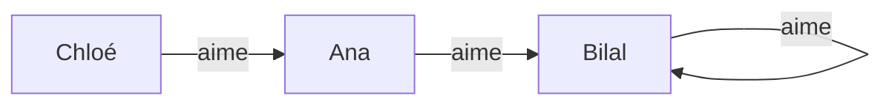

# Chapitre 16 — Vrai ou faux au premier ordre (la sémantique)

> **Objectif** : savoir dire si une formule avec `∀` et `∃` est vraie dans une situation donnée, et connaître les règles de négation des quantificateurs.
>
> 📌 *Chapitre préparé à l'avance à partir du programme de l'UE. Compare-le avec le CM et complète-le si besoin.*

---

## 16.1 Une situation = une structure

Au chapitre 2, une situation était une valuation (chaque variable vaut 0 ou 1). Au premier ordre, une situation est plus riche : c'est un **petit monde** avec des objets et des relations entre eux. On l'appelle une **structure** (ou **interprétation**).

| Il faut préciser | Exemple : un groupe de TD |
|---|---|
| le **domaine** `D` : les objets qui existent | `D = {Ana, Bilal, Chloé}` |
| pour chaque **fonction** : une vraie fonction sur `D` (comme une F-algèbre, chapitre 12) | `binome(Ana) = Bilal`, … |
| pour chaque **prédicat** d'arité `n` : la liste des `n`-uplets pour lesquels il est vrai | `Etudiant = {Ana, Bilal}` |
| | `Aime = {(Ana, Bilal), (Bilal, Bilal), (Chloé, Ana)}` |

On peut dessiner `Aime` comme un graphe (une flèche `x → y` veut dire « `x` aime `y` ») :

---

## 16.2 Le sens de `∀` et `∃`

| Formule | Est vraie quand… | Comme en Python |
|---|---|---|
| `∀x φ` | `φ` est vraie **pour chaque** objet `d` du domaine mis à la place de `x` | `all(phi(d) for d in D)` |
| `∃x φ` | `φ` est vraie pour **au moins un** objet `d` du domaine | `any(phi(d) for d in D)` |

Les variables libres sont remplies grâce à un **environnement** `ρ`, comme pour les termes. Les connecteurs `¬ ∧ ∨ ⇒ ⇔` gardent exactement le sens du chapitre 2.

### Vérifions dans notre groupe de TD

**`∀x (Etudiant(x) ⇒ ∃y Aime(x, y))`** : « tout étudiant aime quelqu'un ».

| `x` | `Etudiant(x)` | `∃y Aime(x, y)` | `⇒` |
|---|:-:|---|:-:|
| Ana | 1 | oui, Bilal | 1 |
| Bilal | 1 | oui, Bilal | 1 |
| Chloé | 0 | (pas besoin) | 1 |

Vraie pour chaque `x` → la formule est **vraie** ✅.

---

## 16.3 L'ordre des quantificateurs compte !

| Formule | En français | Dans notre groupe |
|---|---|---|
| `∀x ∃y Aime(x, y)` | **chacun** aime **quelqu'un** (pas forcément le même) | ✅ vrai : Ana → Bilal, Bilal → Bilal, Chloé → Ana |
| `∃y ∀x Aime(x, y)` | il y a **une personne** que **tout le monde** aime | ❌ faux : personne n'est aimé par les trois |

> 💡 « Tout le monde a une mère » (`∀x ∃y Mere(y, x)`) est vrai. « Il existe une mère de tout le monde » (`∃y ∀x Mere(y, x)`) est faux. Inverser `∀` et `∃` change complètement le sens.

En revanche, deux quantificateurs **du même type** s'échangent sans problème : `∀x ∀y φ ≡ ∀y ∀x φ` et `∃x ∃y φ ≡ ∃y ∃x φ`.

---

## 16.4 ⭐ Nier une phrase avec un quantificateur

*« Tous les étudiants ont validé »* est faux. Qu'est-ce que ça veut dire ? Pas que *personne* n'a validé, mais qu'**au moins un étudiant n'a pas validé**.

| Négation | Équivalent | Exemple |
|---|---|---|
| `¬∀x φ` | `∃x ¬φ` | « pas tous ont validé » = « quelqu'un n'a pas validé » |
| `¬∃x φ` | `∀x ¬φ` | « personne n'est absent » = « chacun est présent » |

> 💡 C'est De Morgan version quantificateurs : la négation **traverse** le quantificateur et le **retourne** (`∀` ↔ `∃`). Normal : `∀` est un grand `∧`, `∃` un grand `∨`.

**Exemple complet** : nier `∀x (Etudiant(x) ⇒ ACarte(x))`

| Formule | Règle |
|---|---|
| `¬∀x (Etudiant(x) ⇒ ACarte(x))` | départ |
| `∃x ¬(Etudiant(x) ⇒ ACarte(x))` | négation de `∀` |
| `∃x (Etudiant(x) ∧ ¬ACarte(x))` | négation de `⇒` |

« Il existe un étudiant qui n'a pas de carte. » ✅

---

## 16.5 Ce qui se distribue (et ce qui ne se distribue pas)

| Équivalence | Vraie ? | Pourquoi |
|---|---|---|
| `∀x (φ ∧ ψ) ≡ ∀x φ ∧ ∀x ψ` | ✅ | « tous sont grands et bruns » = « tous sont grands » et « tous sont bruns » |
| `∃x (φ ∨ ψ) ≡ ∃x φ ∨ ∃x ψ` | ✅ | |
| `∀x (φ ∨ ψ) ≡ ∀x φ ∨ ∀x ψ` | ❌ | tout entier est pair **ou** impair, mais les entiers ne sont pas tous pairs, ni tous impairs |
| `∃x (φ ∧ ψ) ≡ ∃x φ ∧ ∃x ψ` | ❌ | il existe un entier pair et il existe un entier impair, mais aucun n'est les deux |

---

## 16.6 Valide, satisfiable

| La formule close est… | Ça veut dire |
|---|---|
| **valide** (`⊨ φ`) | vraie dans **toutes** les structures (l'équivalent des tautologies) |
| **satisfiable** | vraie dans **au moins une** structure ; cette structure s'appelle un **modèle** |
| **insatisfiable** | vraie dans **aucune** structure |

Exemple valide : `∀x P(x) ⇒ ∃x P(x)`. Si tous les objets ont la propriété, au moins un l'a, car un domaine n'est **jamais vide**.

> ⚠️ **Grande différence avec le propositionnel** : il y a une infinité de structures possibles (et des domaines infinis), on ne peut plus faire de table de vérité. Church et Turing (1936) ont montré qu'**aucun algorithme** ne peut décider, pour toute formule, si elle est valide : la logique du premier ordre est **indécidable** (voir l'[introduction](../00-Introduction.md)).

---

## Ce qu'il faut retenir

- Une structure = un domaine + le sens des fonctions + le sens des prédicats.
- `∀` = « pour chaque objet » (`all`), `∃` = « pour au moins un » (`any`).
- **L'ordre `∀∃` / `∃∀` change le sens.**
- `¬∀x φ ≡ ∃x ¬φ` et `¬∃x φ ≡ ∀x ¬φ`.
- `∀` se distribue sur `∧`, `∃` sur `∨`, pas l'inverse.

---

✏️ S'entraîner : [exercices proposés Premier ordre, partie B](../../02-TD-TP/4-Premier-ordre/enonces-proposes.md)
⬅️ [Chapitre 15 — Syntaxe](15-Syntaxe-premier-ordre.md) · ➡️ [Chapitre 17 — Modéliser](17-Modeliser-premier-ordre.md)
