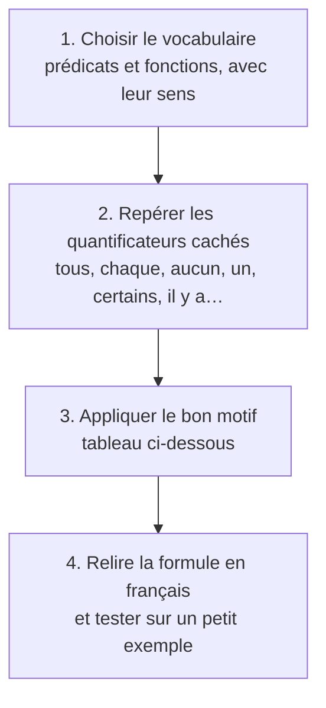

# Chapitre 17 — Modéliser en logique du premier ordre

> **Objectif** : savoir traduire des phrases du français en formules avec `∀` et `∃`, sans tomber dans les pièges classiques.
>
> 📌 *Chapitre préparé à l'avance à partir du programme de l'UE. Compare-le avec le CM et complète-le si besoin.*

---

## 17.1 La méthode



Comme pour SAT, l'étape 1 est capitale : écris toujours la phrase, par exemple *« `Inscrit(x, c)` est vrai ssi l'étudiant `x` est inscrit au cours `c` »*.

---

## 17.2 ⭐ Les motifs à connaître

| Phrase | Formule | Piège à éviter |
|---|---|---|
| **Tous** les A sont B | `∀x (A(x) ⇒ B(x))` | ❌ `∀x (A(x) ∧ B(x))` dirait que **tout le monde** est A |
| **Certains** A sont B / **il y a** un A qui est B | `∃x (A(x) ∧ B(x))` | ❌ `∃x (A(x) ⇒ B(x))` est vrai dès qu'il existe un non-A |
| **Aucun** A n'est B | `∀x (A(x) ⇒ ¬B(x))` ou `¬∃x (A(x) ∧ B(x))` | |
| **Seuls** les A sont B | `∀x (B(x) ⇒ A(x))` | le sens de la flèche est inversé ! |
| **Pas tous** les A sont B | `∃x (A(x) ∧ ¬B(x))` | |

> 🔑 **Règle d'or** : `∀` va avec `⇒`, `∃` va avec `∧`.

### Pourquoi `∀` va avec `⇒` ?

*« Tous les chats sont noirs »* parle **seulement des chats**. Avec `∀x (Chat(x) ⇒ Noir(x))`, pour un objet qui n'est pas un chat (une chaise), `Chat(x)` est faux, donc l'implication est vraie : la chaise ne gêne pas. Avec `∧`, on affirmerait que la chaise est un chat noir !

### Pourquoi `∃` va avec `∧` ?

*« Il y a un chat noir »* : il faut un objet qui est **à la fois** chat **et** noir. Avec `∃x (Chat(x) ⇒ Noir(x))`, il suffirait d'une chaise (l'implication est vraie car `Chat(chaise)` est faux) : la formule serait vraie même sans aucun chat !

---

## 17.3 Phrases avec plusieurs quantificateurs

Vocabulaire : `Etudiant(x)`, `Cours(c)`, `Inscrit(x, c)`, `Valide(x, c)`.

| Phrase | Formule |
|---|---|
| Chaque étudiant est inscrit à au moins un cours | `∀x (Etudiant(x) ⇒ ∃c (Cours(c) ∧ Inscrit(x, c)))` |
| Il y a un cours auquel tous les étudiants sont inscrits | `∃c (Cours(c) ∧ ∀x (Etudiant(x) ⇒ Inscrit(x, c)))` |
| Personne ne valide un cours sans y être inscrit | `∀x ∀c (Valide(x, c) ⇒ Inscrit(x, c))` |
| Un étudiant a validé tous ses cours | `∃x (Etudiant(x) ∧ ∀c (Inscrit(x, c) ⇒ Valide(x, c)))` |

> 💡 Lis de gauche à droite en remplaçant `∀x` par « pour chaque `x` » et `∃c` par « il y a un `c` ». La phrase doit redevenir naturelle.

---

## 17.4 Compter : « au moins deux », « exactement un »

Si on dispose de l'**égalité** `=` :

| Phrase | Formule |
|---|---|
| Il y a **au moins deux** A | `∃x ∃y (x ≠ y ∧ A(x) ∧ A(y))` |
| Il y a **au plus un** A | `∀x ∀y ((A(x) ∧ A(y)) ⇒ x = y)` |
| Il y a **exactement un** A | `∃x (A(x) ∧ ∀y (A(y) ⇒ y = x))` |

> 💡 « Au plus un » : *si j'en trouve deux, c'est en fait le même*. On retrouve l'idée du motif « au plus un » de SAT, mais en une seule formule au lieu d'une clause par paire.

---

## 17.5 Définir de nouvelles notions : la famille

Avec `Parent(x, y)` (« `x` est parent de `y` ») et `Femme(x)` :

| Notion | Définition |
|---|---|
| `x` est grand-parent de `z` | `∃y (Parent(x, y) ∧ Parent(y, z))` |
| `x` est la mère de `y` | `Femme(x) ∧ Parent(x, y)` |
| `x` et `y` sont frères/sœurs | `x ≠ y ∧ ∃p (Parent(p, x) ∧ Parent(p, y))` |
| tout le monde a un parent | `∀y ∃x Parent(x, y)` |

---

## 17.6 Lien avec les bases de données

Une requête SQL est une formule du premier ordre ! *« Les étudiants inscrits à au moins un cours de L2 »* :

```sql
SELECT e.nom FROM Etudiant e
WHERE EXISTS (SELECT * FROM Inscrit i JOIN Cours c ON i.cours = c.id
              WHERE i.etudiant = e.id AND c.niveau = 'L2');
```

correspond à `{ x | Etudiant(x) ∧ ∃c (Inscrit(x, c) ∧ L2(c)) }`. Le `EXISTS` de SQL est le `∃` de la logique.

---

## Ce qu'il faut retenir

- Méthode : vocabulaire → quantificateurs cachés → motif → relecture.
- **`∀` avec `⇒`, `∃` avec `∧`.** C'est le piège n°1 en DS.
- « Seuls les A sont B » : la flèche va de B vers A.
- Compter demande l'égalité `=`.

---

✏️ S'entraîner : [exercices proposés Premier ordre, partie C](../../02-TD-TP/4-Premier-ordre/enonces-proposes.md)
⬅️ [Chapitre 16 — Sémantique](16-Semantique-premier-ordre.md) · 🏠 [Accueil](../../README.md)
