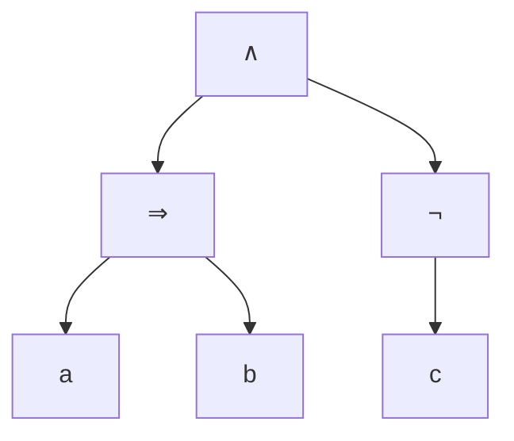

# Partie 1 — Logique propositionnelle : corrections des énoncés proposés

> Corrections de [enonces-proposes.md](enonces-proposes.md). Pour chaque exercice : la réponse, puis **pourquoi**.

---

## Partie A — Syntaxe

### A1. Traduire des phrases

| # | Variables | Formule | Pourquoi |
|---|---|---|---|
| 1 | `g` = il y a grève, `v` = je prends le vélo, `m` = je marche | `g ⇒ (v ∨ m)` | « si… alors… », et « ou » inclusif |
| 2 | `c` = je vais au cinéma, `d` = j'ai fini mes devoirs | `c ⇒ d` | « A **que si** B » = « A seulement si B » = `A ⇒ B`. Aller au cinéma **implique** d'avoir fini |
| 3 | `s` = je sors, `l` = Léa sort, `d` = j'ai un DS demain | `(l ∧ ¬d) ⇒ s` | la condition est « Léa sort et pas de DS » |
| 4 | `p` = Paul est venu, `m` = Marie est venue | `¬p ∧ ¬m` | « ni… ni… » = « pas l'un **et** pas l'autre » (ou `¬(p ∨ m)`) |

> ⚠️ Le piège classique est le n°2 : beaucoup écrivent `d ⇒ c`. Or finir ses devoirs ne force pas à aller au cinéma.

### A2. Ajouter les parenthèses

1. `((¬p) ∨ (q ∧ r)) ⇒ s` : `¬` d'abord, puis `∧`, puis `∨`, et `⇒` en dernier.
2. `(a ∧ b) ∨ ((¬c) ∧ d)` : comme `a×b + c×d` en calcul.
3. `p ⇒ (q ⇒ (r ∧ s))` : `∧` est plus fort ; `⇒` se regroupe **à droite**.

### A3. Arbre, variables, hauteur

**`(a ⇒ b) ∧ ¬c`** : racine `∧`, à gauche `⇒(a, b)`, à droite `¬(c)`.

`Var = {a, b, c}`, `h = 2` (les deux sous-arbres ont une hauteur de 1).

**`¬¬(p ∨ (q ∧ ¬r))`** : `h(r) = 0`, `h(¬r) = 1`, `h(q ∧ ¬r) = 2`, `h(p ∨ …) = 3`, `h(¬…) = 4`, `h(¬¬…) = 5`.
`Var = {p, q, r}`, **`h = 5`**.

### A4. Substitution

On remplace **en même temps** chaque `a` par `b ∧ c` et chaque `b` par `¬a` :

`subst(φ, σ) = ((b ∧ c) ⇒ ¬a) ∨ ¬(b ∧ c)`

> ⚠️ Le `b` qui apparaît dans `b ∧ c` n'est **pas** remplacé à son tour, et le `a` de `¬a` non plus.

### A5. Nombre de connecteurs

| Cas | `nc` |
|---|---|
| `⊤`, `⊥`, une variable | `0` |
| `¬φ` | `nc(φ) + 1` |
| `φ op ψ` | `nc(φ) + nc(ψ) + 1` |

`nc(r ⇒ (¬b ∨ c)) = nc(r) + nc(¬b ∨ c) + 1 = 0 + (1 + 0 + 1) + 1 = 3` (les connecteurs `⇒`, `∨`, `¬`).

> Différence avec `h` : la hauteur prend le **max** des deux côtés, `nc` fait la **somme**.

---

## Partie B — Sémantique

### B1. Évaluer

`¬a = 1`, `a ∧ b = 0 ∧ 1 = 0`, donc `1 ⇒ 0 = ` **`0`**.

### B2. La promesse

Le parent n'a menti que si **tu as rangé** (`r = 1`) **et tu n'as pas eu l'argent** (`g = 0`). C'est la seule ligne où `r ⇒ g` vaut 0. Si tu n'as pas rangé, il n'avait rien promis.

### B3. Table de vérité

| p | q | p ⇒ q | q ⇒ p | (p ⇒ q) ∧ (q ⇒ p) | p ⇔ q |
|:-:|:-:|:-:|:-:|:-:|:-:|
| 0 | 0 | 1 | 1 | **1** | **1** |
| 0 | 1 | 1 | 0 | **0** | **0** |
| 1 | 0 | 0 | 1 | **0** | **0** |
| 1 | 1 | 1 | 1 | **1** | **1** |

Les deux dernières colonnes sont identiques : les formules sont **équivalentes** (c'est la définition de `⇔`).

### B4. Table à 3 variables

| a | b | c | a ∨ b | a ∧ c | (a ∨ b) ⇒ (a ∧ c) |
|:-:|:-:|:-:|:-:|:-:|:-:|
| 0 | 0 | 0 | 0 | 0 | **1** |
| 0 | 0 | 1 | 0 | 0 | **1** |
| 0 | 1 | 0 | 1 | 0 | **0** |
| 0 | 1 | 1 | 1 | 0 | **0** |
| 1 | 0 | 0 | 1 | 0 | **0** |
| 1 | 0 | 1 | 1 | 1 | **1** |
| 1 | 1 | 0 | 1 | 0 | **0** |
| 1 | 1 | 1 | 1 | 1 | **1** |

**Satisfiable** (il y a des 1), **pas une tautologie** (il y a des 0).

### B5. Classer

| # | Formule | Classe | Pourquoi |
|---|---|---|---|
| 1 | `p ∨ ¬p` | tautologie | l'un des deux est toujours vrai |
| 2 | `p ∧ ¬p` | insatisfiable | les deux ne peuvent pas être vrais ensemble |
| 3 | `(p ⇒ q) ∨ (q ⇒ p)` | tautologie | `p ⇒ q` n'est faux que si `p = 1, q = 0`, et alors `q ⇒ p = 1` |
| 4 | `p ⇒ q` | satisfiable, pas tautologie | vaut 0 pour `p = 1, q = 0`, 1 ailleurs |
| 5 | `(p ∧ q) ∧ ¬(p ∨ q)` | insatisfiable | `p ∧ q` vrai force `p ∨ q` vrai, donc `¬(p ∨ q)` faux |

### B6. Raisonnements

1. **Correct.** Supposons une situation où `p ⇒ m` et `m ⇒ g` sont vraies mais `p ⇒ g` fausse. Alors `p = 1` et `g = 0`. Comme `p ⇒ m` est vraie et `p = 1`, on a `m = 1`. Mais alors `m ⇒ g = 1 ⇒ 0 = 0` : contradiction. Une telle situation n'existe pas, donc **`p ⇒ m, m ⇒ g ⊨ p ⇒ g`**.
2. **Incorrect.** Contre-exemple : `p = 0`, `m = 1` (il ne pleut pas, mais on a arrosé). Les hypothèses `p ⇒ m` et `m` sont vraies, la conclusion `p` est fausse. C'est l'erreur classique qui confond une implication avec sa **réciproque**.

### B7. Chevaliers et menteurs

- A dit « B est un menteur » : `a ⇔ ¬b`
- B dit « A et moi sommes du même type » : `b ⇔ (a ⇔ b)`

Formule : `(a ⇔ ¬b) ∧ (b ⇔ (a ⇔ b))`

| a | b | a ⇔ ¬b | a ⇔ b | b ⇔ (a ⇔ b) | tout |
|:-:|:-:|:-:|:-:|:-:|:-:|
| 0 | 0 | 0 | 1 | 0 | 0 |
| 0 | 1 | 1 | 0 | 0 | 0 |
| 1 | 0 | 1 | 0 | 1 | **1** |
| 1 | 1 | 0 | 1 | 1 | 0 |

**A est chevalier, B est menteur.** Vérification : A dit vrai (B ment bien) ; B dit « nous sommes du même type », ce qui est faux, normal pour un menteur.

---

## Partie C — Équivalences

### C1. Simplifier

| Formule | Résultat | Étapes |
|---|---|---|
| `¬(¬a ∨ b)` | `a ∧ ¬b` | De Morgan → `¬¬a ∧ ¬b`, double négation |
| `a ∨ (a ∧ b)` | `a` | absorption |
| `(a ∧ b) ∨ (a ∧ ¬b)` | `a` | distributivité → `a ∧ (b ∨ ¬b)` → `a ∧ ⊤` → `a` |

### C2. Nier en français

1. « Il **ne** pleut **pas** **ou** il **ne** fait **pas** froid. » (`¬(p ∧ f) ≡ ¬p ∨ ¬f`)
2. « Je **ne** prends **ni** le bus **ni** le tram. » (`¬(b ∨ t) ≡ ¬b ∧ ¬t`)
3. « Tu travailles **et** tu ne réussis pas. » (`¬(t ⇒ r) ≡ t ∧ ¬r`)

> ⚠️ La négation de « si tu travailles, tu réussis » n'est **pas** « si tu ne travailles pas, tu ne réussis pas ». C'est « tu as travaillé et pourtant tu as échoué ».

### C3. Contraposée et réciproque

- **Contraposée** : « Si je ne suis pas en France, alors je ne suis pas à Lille. » ✅ toujours vraie (équivalente à la phrase de départ).
- **Réciproque** : « Si je suis en France, alors je suis à Lille. » ❌ fausse (je peux être à Paris).

### C4. Prouver par le calcul

| Formule | Loi |
|---|---|
| `(a ⇒ b) ∧ (a ⇒ c)` | départ |
| `(¬a ∨ b) ∧ (¬a ∨ c)` | définition de `⇒` (deux fois) |
| `¬a ∨ (b ∧ c)` | distributivité de `∨` sur `∧` (lue de droite à gauche) |
| `a ⇒ (b ∧ c)` | définition de `⇒` ✅ |

En français : « si A alors B, et si A alors C » = « si A alors B et C ».

### C5. Systèmes complets

1. `a ∨ b ≡ ¬(¬a ∧ ¬b)` (De Morgan + double négation)
2. `a ∧ b ≡ ¬(¬a ∨ ¬b) ≡ ¬(a ⇒ ¬b)` (car `a ⇒ ¬b ≡ ¬a ∨ ¬b`)
3. `¬a ≡ a ⇒ ⊥` (vrai exactement quand `a` est faux), puis `a ∨ b ≡ ¬a ⇒ b ≡ (a ⇒ ⊥) ⇒ b`

---

## Partie D — Formes normales

### D1. Échauffement

1. `p ⇒ (q ∧ r) ≡ ¬p ∨ (q ∧ r) ≡` **`(¬p ∨ q) ∧ (¬p ∨ r)`**
2. `(p ∨ q) ∧ r ≡` **`(p ∧ r) ∨ (q ∧ r)`**

### D2. La boîte de nuit

- **FNC** (liste de règles) : `m ∧ (i ∨ e) ∧ ¬s` (trois clauses : `m`, `i ∨ e`, `¬s`)
- **FND** (liste de profils acceptés) : `(m ∧ i ∧ ¬s) ∨ (m ∧ e ∧ ¬s)`

On voit bien la différence : le videur vérifie **des règles** (FNC) ; la FND liste **les profils** qui peuvent entrer.

### D3. `a ⇔ b` par la table

| a | b | a ⇔ b | FND (lignes à 1) | FNC (lignes à 0, inversé) |
|:-:|:-:|:-:|---|---|
| 0 | 0 | 1 | `¬a ∧ ¬b` | |
| 0 | 1 | 0 | | `a ∨ ¬b` |
| 1 | 0 | 0 | | `¬a ∨ b` |
| 1 | 1 | 1 | `a ∧ b` | |

- **FND** : `(¬a ∧ ¬b) ∨ (a ∧ b)`
- **FNC** : `(a ∨ ¬b) ∧ (¬a ∨ b)`

### D4. « Exactement un »

| a | b | c | exactement un ? |
|:-:|:-:|:-:|:-:|
| 0 | 0 | 0 | 0 |
| 0 | 0 | 1 | 1 |
| 0 | 1 | 0 | 1 |
| 0 | 1 | 1 | 0 |
| 1 | 0 | 0 | 1 |
| 1 | 0 | 1 | 0 |
| 1 | 1 | 0 | 0 |
| 1 | 1 | 1 | 0 |

1. **FND** : `(¬a ∧ ¬b ∧ c) ∨ (¬a ∧ b ∧ ¬c) ∨ (a ∧ ¬b ∧ ¬c)`
2. **FNC** (5 lignes à 0) :
   `(a ∨ b ∨ c) ∧ (a ∨ ¬b ∨ ¬c) ∧ (¬a ∨ b ∨ ¬c) ∧ (¬a ∨ ¬b ∨ c) ∧ (¬a ∨ ¬b ∨ ¬c)`
3. On utilise `(X ∨ c) ∧ (X ∨ ¬c) ≡ X` (distributivité puis complémentation), et on peut dupliquer la clause `(¬a ∨ ¬b ∨ ¬c)` (idempotence) :
   - `(¬a ∨ ¬b ∨ c) ∧ (¬a ∨ ¬b ∨ ¬c) ≡ ¬a ∨ ¬b`
   - `(¬a ∨ b ∨ ¬c) ∧ (¬a ∨ ¬b ∨ ¬c) ≡ ¬a ∨ ¬c`
   - `(a ∨ ¬b ∨ ¬c) ∧ (¬a ∨ ¬b ∨ ¬c) ≡ ¬b ∨ ¬c`

   Résultat : `(a ∨ b ∨ c) ∧ (¬a ∨ ¬b) ∧ (¬a ∨ ¬c) ∧ (¬b ∨ ¬c)`.
   C'est le motif **« au moins un » + « au plus un »** du [chapitre 6 (SAT)](../../01-Cours/02-SAT/6-Modeliser-avec-SAT.md) !

### D5. Par le calcul

1. `¬(a ∧ (b ∨ ¬c))`
   `≡ ¬a ∨ ¬(b ∨ ¬c)` (De Morgan)
   `≡ ¬a ∨ (¬b ∧ c)` (De Morgan + double négation)
   `≡` **`(¬a ∨ ¬b) ∧ (¬a ∨ c)`** (distributivité)
2. `(a ⇔ b) ∨ c`
   `≡ ((¬a ∨ b) ∧ (a ∨ ¬b)) ∨ c` (définition de `⇔`)
   `≡` **`(¬a ∨ b ∨ c) ∧ (a ∨ ¬b ∨ c)`** (distributivité)
