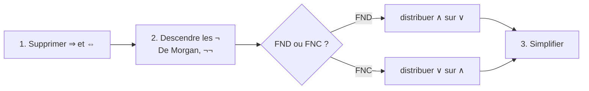

# TD 2 : FNC et SAT — correction de l'énoncé fourni

> Correction de [TD2-enonce-fourni.md](TD2-enonce-fourni.md), rédigée pour réviser (ce n'est pas la correction officielle : compare avec celle vue en TD).
> Pour chaque question : une **piste** pour démarrer, puis la **correction expliquée**.

---

## Exercices 1 et 2 : FND et FNC

### La méthode (toujours la même)



Rappels utiles pour ce TD :

- `¬(A ⇒ B) ≡ A ∧ ¬B`
- `A ⇔ B ≡ (A ∧ B) ∨ (¬A ∧ ¬B)` (forme pratique pour une FND)
- `¬(A ⇔ B) ≡ (A ∧ ¬B) ∨ (¬A ∧ B)` (« les valeurs sont différentes »)

### Q 1.1

```
((p ∨ q) ⇒ (r ∧ ¬s)) ∨ (t ∧ ¬u)
≡ ¬(p ∨ q) ∨ (r ∧ ¬s) ∨ (t ∧ ¬u)        définition de ⇒
≡ (¬p ∧ ¬q) ∨ (r ∧ ¬s) ∨ (t ∧ ¬u)       De Morgan
```

✅ **FND** : `(¬p ∧ ¬q) ∨ (r ∧ ¬s) ∨ (t ∧ ¬u)`

### Q 1.2

```
((p ∨ ¬q) ∧ (r ∨ s)) ⇒ (t ∨ ¬u)
≡ ¬((p ∨ ¬q) ∧ (r ∨ s)) ∨ t ∨ ¬u        définition de ⇒
≡ ¬(p ∨ ¬q) ∨ ¬(r ∨ s) ∨ t ∨ ¬u         De Morgan
≡ (¬p ∧ q) ∨ (¬r ∧ ¬s) ∨ t ∨ ¬u         De Morgan + double négation
```

✅ **FND** : `(¬p ∧ q) ∨ (¬r ∧ ¬s) ∨ t ∨ ¬u` (un littéral seul compte comme un « ET » d'un seul élément).

### Q 1.3

**Piste** : `q ⇔ t` est vrai quand les deux ont la même valeur : `(q ∧ t) ∨ (¬q ∧ ¬t)`.

```
¬((p ∨ ¬q) ∨ (r ⇒ s)) ∨ (q ⇔ t)
≡ (¬p ∧ q ∧ ¬(r ⇒ s)) ∨ (q ⇔ t)          De Morgan
≡ (¬p ∧ q ∧ r ∧ ¬s) ∨ (q ⇔ t)            ¬(r ⇒ s) ≡ r ∧ ¬s
≡ (¬p ∧ q ∧ r ∧ ¬s) ∨ (q ∧ t) ∨ (¬q ∧ ¬t)
```

✅ **FND** : `(¬p ∧ q ∧ r ∧ ¬s) ∨ (q ∧ t) ∨ (¬q ∧ ¬t)`

### Q 1.4

**Piste** : `¬(A ⇔ B) ≡ (A ∧ ¬B) ∨ (¬A ∧ B)` avec `A = p ∨ q` et `B = r ∨ s`.

On traite les morceaux séparément :

- `A ∧ ¬B = (p ∨ q) ∧ ¬r ∧ ¬s ≡ (p ∧ ¬r ∧ ¬s) ∨ (q ∧ ¬r ∧ ¬s)`
- `¬A ∧ B = ¬p ∧ ¬q ∧ (r ∨ s) ≡ (¬p ∧ ¬q ∧ r) ∨ (¬p ∧ ¬q ∧ s)`
- `(t ∧ u) ⇒ (¬v ∨ w) ≡ ¬t ∨ ¬u ∨ ¬v ∨ w`

✅ **FND** :
`(p ∧ ¬r ∧ ¬s) ∨ (q ∧ ¬r ∧ ¬s) ∨ (¬p ∧ ¬q ∧ r) ∨ (¬p ∧ ¬q ∧ s) ∨ ¬t ∨ ¬u ∨ ¬v ∨ w`

### Q 2.1

```
¬(p ∧ (q ⇒ p))
≡ ¬p ∨ ¬(q ⇒ p)          De Morgan
≡ ¬p ∨ (q ∧ ¬p)          ¬(A ⇒ B) ≡ A ∧ ¬B
≡ ¬p                     absorption
```

✅ **FNC** : `¬p` (une seule clause, d'un seul littéral).

### Q 2.2

**Piste** : montre d'abord que `(p ∨ q) ⇒ r ≡ (p ⇒ r) ∧ (q ⇒ r)`.

`(p ∨ q) ⇒ r ≡ (¬p ∧ ¬q) ∨ r ≡ (¬p ∨ r) ∧ (¬q ∨ r) ≡ (p ⇒ r) ∧ (q ⇒ r)`

La formule est donc de la forme `X ∨ X`, qui vaut `X` (idempotence).

✅ **FNC** : `(¬p ∨ r) ∧ (¬q ∨ r)`

En français : « si p ou q, alors r » = « si p alors r, et si q alors r ».

### Q 2.3

```
(p ∨ (q ⇒ r)) ⇒ ((p ∨ q) ⇒ r)
≡ ¬(p ∨ ¬q ∨ r) ∨ ¬(p ∨ q) ∨ r            définition de ⇒ (trois fois)
≡ (¬p ∧ q ∧ ¬r) ∨ (¬p ∧ ¬q) ∨ r           De Morgan
≡ (¬p ∧ ((q ∧ ¬r) ∨ ¬q)) ∨ r              on factorise ¬p
≡ (¬p ∧ (¬q ∨ ¬r)) ∨ r                    (q ∧ ¬r) ∨ ¬q ≡ (q ∨ ¬q) ∧ (¬r ∨ ¬q) ≡ ¬q ∨ ¬r
≡ (¬p ∨ r) ∧ (¬q ∨ ¬r ∨ r)                distributivité
≡ (¬p ∨ r) ∧ ⊤                            ¬r ∨ r ≡ ⊤
≡ ¬p ∨ r
```

✅ **FNC** : `¬p ∨ r`

**Vérification** : avec `p = 1, r = 0`, l'hypothèse `p ∨ …` vaut 1 et la conclusion `(1 ∨ q) ⇒ 0` vaut 0, donc la formule vaut 0. C'est bien le seul cas où `¬p ∨ r` vaut 0.

### Q 2.4

Même formule que la Q 1.1. On part de la FND `(¬p ∧ ¬q) ∨ (r ∧ ¬s) ∨ (t ∧ ¬u)` et on distribue : chaque clause prend **un littéral dans chaque bloc**, ce qui donne `2 × 2 × 2 = 8` clauses.

✅ **FNC** :
```
(¬p ∨ r ∨ t) ∧ (¬p ∨ r ∨ ¬u) ∧ (¬p ∨ ¬s ∨ t) ∧ (¬p ∨ ¬s ∨ ¬u) ∧
(¬q ∨ r ∨ t) ∧ (¬q ∨ r ∨ ¬u) ∧ (¬q ∨ ¬s ∨ t) ∧ (¬q ∨ ¬s ∨ ¬u)
```

> On voit l'**explosion** annoncée en cours : 3 petits blocs donnent 8 clauses.

---

## Exercice 3 : la fête

**Piste** : une variable par personne ; « A ne vient que si B » se traduit `A ⇒ B`.

**Variables** : `a, b, c, d, e` vraies ssi Alice, Bob, Charles, Diana, Élise viennent.

| Règle | Formule | Clause |
|---|---|---|
| Alice ne vient que si Bob vient | `a ⇒ b` | `¬a ∨ b` |
| Charles et Diana pas tous les deux | `¬(c ∧ d)` | `¬c ∨ ¬d` |
| Si Élise vient, Charles vient | `e ⇒ c` | `¬e ∨ c` |
| Au moins une personne | | `a ∨ b ∨ c ∨ d ∨ e` |

`φ = (¬a ∨ b) ∧ (¬c ∨ ¬d) ∧ (¬e ∨ c) ∧ (a ∨ b ∨ c ∨ d ∨ e)`

- **Existe-t-il une combinaison valide ?** Oui, `φ` est satisfiable.
- **Exemples de listes valides** : `{Bob}`, `{Alice, Bob}`, `{Diana}`, `{Charles, Élise}`, `{Alice, Bob, Charles, Élise}`.
- **Si Charles et Diana viennent à coup sûr** : on ajoute les clauses `c` et `d`. La clause `¬c ∨ ¬d` devient fausse : la formule est **insatisfiable**, il n'y a plus aucune fête possible.

---

## Exercice 4 : les tours

**Piste** : c'est « exactement une tour » par ligne et par colonne, donc deux fois le motif « au moins un + au plus un ».

**Variables** : `xᵢ,ⱼ` vraie ssi **une tour est sur la ligne `i`, colonne `j`**.

**Q 4.1** (ligne 1 en haut, colonne 1 à gauche) : `x₁,₁ = x₂,₃ = x₃,₂ = x₄,₄ = 1`, les 12 autres variables valent 0.

**Q 4.2** : exactement une tour par ligne

- au moins une : `⋀ᵢ ⋁ⱼ xᵢ,ⱼ`
- au plus une : `⋀ᵢ ⋀_{j<k} (¬xᵢ,ⱼ ∨ ¬xᵢ,ₖ)`

**Q 4.3** : exactement une tour par colonne

- au moins une : `⋀ⱼ ⋁ᵢ xᵢ,ⱼ`
- au plus une : `⋀ⱼ ⋀_{i<k} (¬xᵢ,ⱼ ∨ ¬xₖ,ⱼ)`

---

## Exercice 5 : la table ronde

**Piste** : c'est le problème des pigeons (chevaliers = pigeons, places = nids), plus les rivalités.

**Q 5.1** : `x_{c,p}` vraie ssi **le chevalier `c` est assis à la place `p`** (`n²` variables).

| Q | Contrainte | Formule |
|---|---|---|
| 5.2 | chaque chevalier a au moins un siège | `⋀_{c∈C} ⋁_{p=1}^{n} x_{c,p}` |
| 5.3 | chaque chevalier a au plus un siège | `⋀_{c∈C} ⋀_{p<q} (¬x_{c,p} ∨ ¬x_{c,q})` |
| 5.4 | chaque place a au moins un chevalier | `⋀_{p=1}^{n} ⋁_{c∈C} x_{c,p}` |
| 5.5 | chaque place a au plus un chevalier | `⋀_{p} ⋀_{c<c'} (¬x_{c,p} ∨ ¬x_{c',p})` |

**Q 5.6** : la contrainte 5.5 **n'est pas nécessaire**. Avec 5.2 et 5.3, chacun des `n` chevaliers occupe exactement une place. Si deux chevaliers partageaient une place, les `n` chevaliers n'occuperaient au plus que `n − 1` places, et une place resterait vide : c'est contraire à 5.4. (C'est le **principe des tiroirs**.) Elle peut quand même aider le solveur à aller plus vite.

**Q 5.7** : on note `p⁺` la place à droite de `p` : `p⁺ = p + 1` si `p < n`, et `n⁺ = 1` (la table est ronde).

```
⋀_{(c,c')∈R} ⋀_{p=1}^{n} (¬x_{c,p} ∨ ¬x_{c',p⁺}) ∧ (¬x_{c',p} ∨ ¬x_{c,p⁺})
```

Les deux clauses couvrent les deux sens : `c` à gauche de `c'`, et `c'` à gauche de `c`.

**Squelette Python** (à adapter aux noms de `table_ronde.py`) :

```python
places = range(1, n + 1)
suiv = lambda p: p % n + 1          # la place n est suivie de la place 1
phi_rivaux = [[-encode(c1, p), -encode(c2, suiv(p))]
              for (c1, c2) in rivaux for p in places] + \
             [[-encode(c2, p), -encode(c1, suiv(p))]
              for (c1, c2) in rivaux for p in places]
```

---

## Exercice 6 : Sudoku

**Piste** : les mêmes motifs, appliqués à des cases, des lignes, des colonnes et des carrés.

| Q | Contrainte | Formule |
|---|---|---|
| 6.1 `phi1` | chaque case a au moins un chiffre | `⋀_{i,j} ⋁_k x_{i,j,k}` |
| 6.1 `phi2` | chaque case a au plus un chiffre | `⋀_{i,j} ⋀_{k<k'} (¬x_{i,j,k} ∨ ¬x_{i,j,k'})` |
| 6.2 `phi3` | chaque chiffre est dans chaque ligne | `⋀_{i,k} ⋁_j x_{i,j,k}` |
| 6.2 `phi4` | chaque chiffre est dans chaque colonne | `⋀_{j,k} ⋁_i x_{i,j,k}` |
| 6.3 `phi5` | chaque chiffre est dans chaque carré | `⋀_{k} ⋀_{a,b∈{0,1,2}} ⋁_{i∈[3a+1,3a+3]} ⋁_{j∈[3b+1,3b+3]} x_{i,j,k}` |
| 6.4 `phi6` | les chiffres de la grille | une clause d'un seul littéral `x_{i,j,k}` par case remplie |

> **Pourquoi « au moins une fois » suffit en 6.2 ?** Une ligne a 9 cases, chacune contient un seul chiffre (`phi2`). Si les 9 chiffres apparaissent, chacun apparaît forcément **exactement** une fois.

```python
R = range(1, 10)

phi1 = [[encode(i, j, k) for k in R] for i in R for j in R]
phi2 = [[-encode(i, j, k1), -encode(i, j, k2)]
        for i in R for j in R for k1 in R for k2 in R if k1 < k2]
phi3 = [[encode(i, j, k) for j in R] for i in R for k in R]
phi4 = [[encode(i, j, k) for i in R] for j in R for k in R]

def carre(i1, i2, j1, j2):
    return [(i, j) for i in range(i1, i2 + 1) for j in range(j1, j2 + 1)]

phi5 = [[encode(i, j, k) for (i, j) in carre(3*a + 1, 3*a + 3, 3*b + 1, 3*b + 3)]
        for a in range(3) for b in range(3) for k in R]

# grille lue de haut en bas, 0 = case vide
grille = [[0, 0, 0, 0, 2, 0, 0, 1, 7],
          [0, 3, 0, 0, 0, 7, 0, 0, 8],
          [0, 0, 0, 0, 9, 0, 6, 0, 0],
          [0, 8, 0, 9, 0, 2, 0, 6, 0],
          [4, 0, 6, 0, 0, 0, 3, 0, 2],
          [0, 2, 0, 6, 0, 3, 0, 7, 0],
          [0, 0, 7, 0, 6, 0, 0, 0, 0],
          [8, 0, 0, 7, 0, 0, 0, 5, 0],
          [2, 5, 0, 0, 3, 0, 0, 0, 0]]

# si la case (1,1) est en BAS à gauche dans sudoku.py, remplacer l + 1 par 9 - l
phi6 = [[encode(l + 1, c + 1, grille[l][c])]
        for l in range(9) for c in range(9) if grille[l][c] != 0]
```

**Q 6.5** : cherche par exemple « Arto Inkala Sudoku le plus difficile » ; un solveur SAT le résout en une fraction de seconde.

---

## Exercice 7 : Hidoku

**Piste pour Q 7.7** : « si `k` est en `(i, j)`, alors `k + 1` est dans une case voisine » s'écrit directement comme **une seule clause** : `¬x_{i,j,k} ∨ (le OU des voisins avec k + 1)`. Seul le **nombre de voisins** change selon la position.

**Q 7.1** : `x_{i,j,k}` vraie ssi **la case (ligne `i`, colonne `j`) contient le nombre `k`**, avec `i, j ∈ [1, n]` et `k ∈ [1, n²]`. Il y a `n⁴` variables.

| Q | Contrainte | Formule |
|---|---|---|
| 7.2 | chaque case a au moins un nombre | `⋀_{i,j} ⋁_{k} x_{i,j,k}` |
| 7.3 | chaque case a au plus un nombre | `⋀_{i,j} ⋀_{k<k'} (¬x_{i,j,k} ∨ ¬x_{i,j,k'})` |
| 7.4 | chaque nombre apparaît au moins une fois | `⋀_{k} ⋁_{i,j} x_{i,j,k}` |
| 7.5 | chaque nombre apparaît au plus une fois | `⋀_{k} ⋀_{(i,j)≠(i',j')} (¬x_{i,j,k} ∨ ¬x_{i',j',k})` |

**Q 7.6** : il y a `n²` cases et `n²` nombres. Chaque case contient exactement un nombre (7.2 + 7.3). Si chaque nombre apparaît au moins une fois (7.4), les `n²` nombres occupent les `n²` cases, donc chacun apparaît **exactement** une fois : 7.5 devient inutile. (Inversement, avec 7.5, on peut retirer 7.4.) C'est encore le principe des tiroirs.

**Q 7.7** : on note `V(i, j)` les voisins de la case `(i, j)` :
`V(i, j) = { (i', j') ≠ (i, j) | |i − i'| ≤ 1, |j − j'| ≤ 1, 1 ≤ i', j' ≤ n }`

```
⋀_{k=1}^{n²−1} ⋀_{i,j} ( ¬x_{i,j,k} ∨ ⋁_{(i',j')∈V(i,j)} x_{i',j',k+1} )
```

| Position de `k` | Nombre de voisins | Exemple de clause |
|---|---|---|
| coin `(1, 1)` | 3 | `¬x_{1,1,k} ∨ x_{1,2,k+1} ∨ x_{2,1,k+1} ∨ x_{2,2,k+1}` |
| bord `(1, j)` avec `1 < j < n` | 5 | `¬x_{1,j,k} ∨ x_{1,j−1,k+1} ∨ x_{1,j+1,k+1} ∨ x_{2,j−1,k+1} ∨ x_{2,j,k+1} ∨ x_{2,j+1,k+1}` |
| intérieur | 8 | `¬x_{i,j,k} ∨` (les 8 cases autour, avec `k + 1`) |

**Q 7.8** : on ajoute une **clause d'un seul littéral** par case déjà remplie. Pour la grille d'exemple (ligne 1 en haut, colonne 1 à gauche) :

```
x_{1,4,45} ∧ x_{2,1,49} ∧ x_{2,7,37} ∧ x_{3,1,30} ∧ x_{3,7,12} ∧ x_{4,4,16}
∧ x_{5,1,19} ∧ x_{5,7,40} ∧ x_{6,1,1} ∧ x_{6,7,7} ∧ x_{7,4,4}
```
