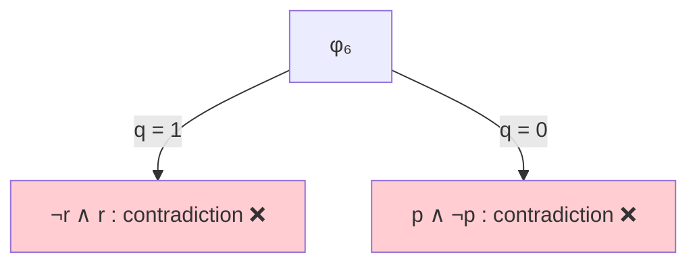
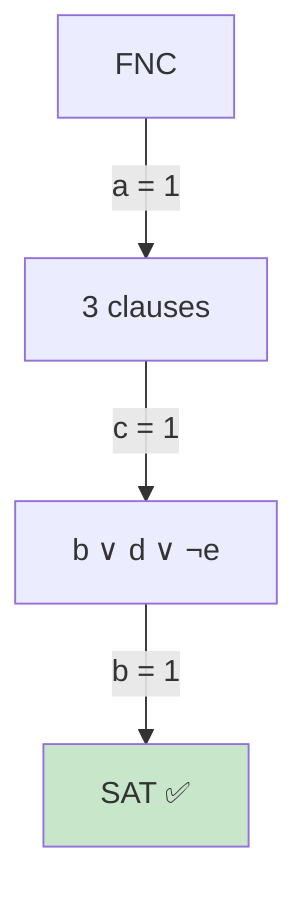
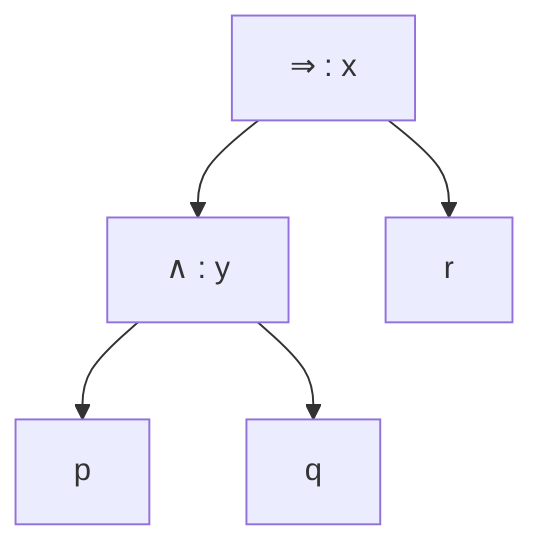
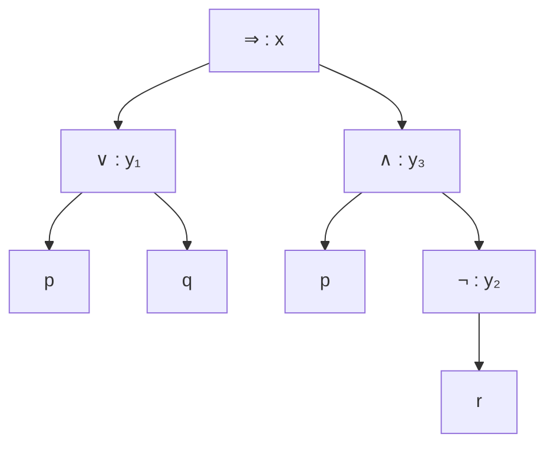
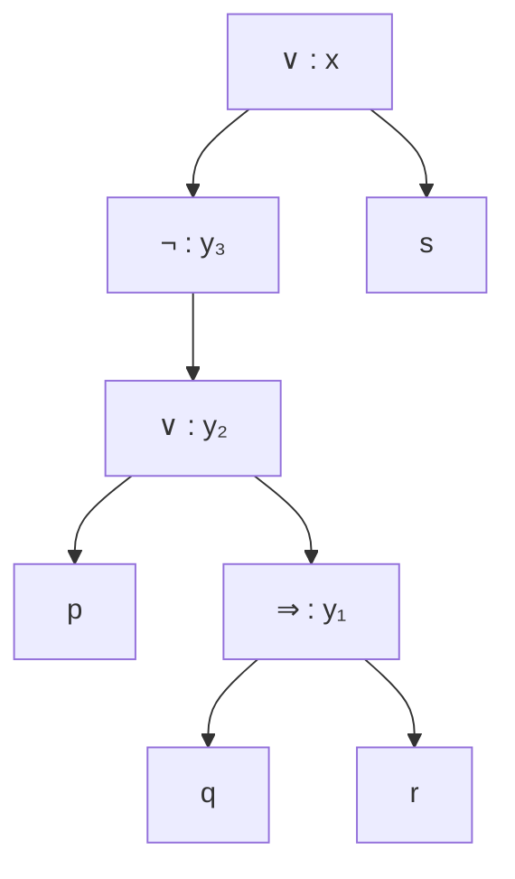

# TD 3 : DPLL et Tseitin — correction

> Correction de [TD3-enonce-fourni.md](TD3-enonce-fourni.md), rédigée pour réviser. Chaque résultat (SAT / insatisfiable, solutions, clauses de Tseitin) a été **vérifié par calcul** sur toutes les valuations.
> Rappel de l'ordre DPLL ([ch. 9](../../01-Cours/02-SAT/9-DPLL.md)) : **simplification → clause unitaire → littéral pur → pari**.

---

## Exercice 1 : DPLL

### Q 1.1 `φ₁ = p ∧ q ∧ r`

Trois clauses unitaires : propagation `p = 1`, `q = 1`, `r = 1`, plus aucune clause.
✅ **Satisfiable** : `p = q = r = 1`.

### Q 1.2 `φ₂ = (q ∨ ¬p) ∧ ¬q ∧ p ∧ (r ∨ ¬p)`

| Étape | Règle | Choix | Ce qu'il reste |
|---|---|---|---|
| 1 | unitaire `¬q` | `q = 0` | `¬p ∧ p ∧ (r ∨ ¬p)` |
| 2 | unitaire `p` | `p = 1` | la clause `¬p` devient **vide** |

❌ **Insatisfiable** : contradiction **sans aucun pari**, donc pas d'autre branche à essayer.

### Q 1.3 `φ₃ = (q ∨ p) ∧ (r ∨ q) ∧ ¬r ∧ ¬q`

| Étape | Règle | Choix | Ce qu'il reste |
|---|---|---|---|
| 1 | unitaire `¬r` | `r = 0` | `(q ∨ p) ∧ q ∧ ¬q` |
| 2 | unitaire `q` | `q = 1` | la clause `¬q` devient **vide** |

❌ **Insatisfiable**.

### Q 1.4 `φ₄ = p ∧ q ∧ (q ∨ ¬p) ∧ r`

Unitaires `p = 1`, `q = 1` (la clause `q ∨ ¬p` disparaît), `r = 1`.
✅ **Satisfiable** : `p = q = r = 1`.

### Q 1.5 `φ₅ = (q ∨ p) ∧ ¬q`

Unitaire `¬q` → `q = 0`, il reste `p` → `p = 1`.
✅ **Satisfiable** : `p = 1, q = 0`.

### Q 1.6 `φ₆ = (q ∨ p) ∧ (q ∨ ¬p) ∧ (¬r ∨ ¬q) ∧ (r ∨ ¬q)`

Aucune clause unitaire. Aucun littéral pur (`p`, `q`, `r` apparaissent tous avec les deux signes). On **parie** sur `q`.

| Étape | Règle | Choix | Ce qu'il reste |
|---|---|---|---|
| 1 | pari | `q = 1` | `¬r ∧ r` |
| 2 | unitaire | `r = 0` | la clause `r` devient vide ❌ → retour au pari |
| 3 | autre branche | `q = 0` | `p ∧ ¬p` |
| 4 | unitaire | `p = 1` | la clause `¬p` devient vide ❌ |



❌ **Insatisfiable** : les deux branches du pari échouent.

> 💡 Pourquoi parier sur `q` ? C'est la variable qui apparaît le plus souvent : chaque branche simplifie beaucoup. Parier sur `p` marche aussi, mais avec un arbre plus grand.

### Q 1.7 `φ₇ = (¬p ∨ t) ∧ (p ∨ ¬r) ∧ (q ∨ r) ∧ (¬q ∨ s)`

| Étape | Règle | Choix | Ce qu'il reste |
|---|---|---|---|
| 1 | littéral pur `t` (jamais `¬t`) | `t = 1` | `(p ∨ ¬r) ∧ (q ∨ r) ∧ (¬q ∨ s)` |
| 2 | littéral pur `s` | `s = 1` | `(p ∨ ¬r) ∧ (q ∨ r)` |
| 3 | littéral pur `p` (le `¬p` a disparu à l'étape 1) | `p = 1` | `q ∨ r` |
| 4 | littéral pur `q` | `q = 1` | plus rien ✅ |

✅ **Satisfiable** : `p = 1, q = 1, s = 1, t = 1` (`r` quelconque). Aucun pari n'a été nécessaire.

> 💡 Après chaque étape, **recherche à nouveau** les littéraux purs : en supprimant des clauses, on en fait apparaître de nouveaux (ici `p` à l'étape 3).

---

## Exercice 2 : Encore DPLL

### Q 2.1 `(a ∨ b ∧ ¬c) ⇔ (a ∧ (c ∨ ¬b))`

**Étape 1 : mise en FNC** (même formule que la [Q 6.2 de la préparation au DS1](../DS1-Preparation/DS1-correction.md)). Avec `X = b ∧ ¬c`, on a `c ∨ ¬b ≡ ¬X`, et :

```
(a ∨ X) ⇔ (a ∧ ¬X)
≡ ((¬a ∧ ¬X) ∨ (a ∧ ¬X)) ∧ (a ∨ X ∨ ¬a ∨ X)
≡ ¬X ∧ ⊤
≡ ¬b ∨ c
```

**Étape 2 : DPLL** sur la clause unique `¬b ∨ c` : le littéral `¬b` est pur → `b = 0`, plus de clauses.

✅ **Satisfiable** : par exemple `a = 0, b = 0, c = 0` (`a` et `c` quelconques dès que `b = 0`).

### Q 2.2 `(((b ⇒ ¬c) ∧ (d ⇒ e)) ∨ a) ∧ (c ∨ ((a ⇒ ¬f) ∧ (¬b ⇒ f))) ∧ (b ∨ d ∨ ¬e)`

**Étape 1 : mise en FNC** (même formule que la [Q 6.1 de la préparation au DS1](../DS1-Preparation/DS1-correction.md)) :

`(a ∨ ¬b ∨ ¬c) ∧ (a ∨ ¬d ∨ e) ∧ (¬a ∨ c ∨ ¬f) ∧ (b ∨ c ∨ f) ∧ (b ∨ d ∨ ¬e)`

**Étape 2 : DPLL.** Aucune clause unitaire ; aucun littéral pur (chaque variable apparaît avec les deux signes). On parie sur `a`, qui apparaît dans 3 clauses.

| Étape | Règle | Choix | Ce qu'il reste |
|---|---|---|---|
| 1 | pari | `a = 1` | `(c ∨ ¬f) ∧ (b ∨ c ∨ f) ∧ (b ∨ d ∨ ¬e)` |
| 2 | littéral pur `c` | `c = 1` | `b ∨ d ∨ ¬e` |
| 3 | littéral pur `b` | `b = 1` | plus rien ✅ |



✅ **Satisfiable** : `a = 1, b = 1, c = 1` (`d`, `e`, `f` quelconques). Vérification sur la formule de départ avec `d = e = f = 0` : les trois blocs valent 1 ✅.

---

## Exercice 3 : Tseitin

**Méthode** ([ch. 8](../../01-Cours/02-SAT/8-Tseitin.md)) : un nom par nœud interne, les clauses du catalogue pour chaque nœud, **plus la clause `x` de la racine**.

| Nœud | Clauses |
|---|---|
| `x ⇔ x₁ ∧ x₂` | `(¬x₁ ∨ ¬x₂ ∨ x) ∧ (¬x ∨ x₁) ∧ (¬x ∨ x₂)` |
| `x ⇔ x₁ ∨ x₂` | `(x₁ ∨ x₂ ∨ ¬x) ∧ (¬x₁ ∨ x) ∧ (¬x₂ ∨ x)` |
| `x ⇔ x₁ ⇒ x₂` | `(¬x₁ ∨ x₂ ∨ ¬x) ∧ (x ∨ x₁) ∧ (x ∨ ¬x₂)` |
| `x ⇔ ¬y` | `(x ∨ y) ∧ (¬x ∨ ¬y)` |

### Q 3.1 `(p ∧ q) ⇒ r`



| Nœud | Clauses |
|---|---|
| `y ⇔ (p ∧ q)` | `(¬p ∨ ¬q ∨ y) ∧ (¬y ∨ p) ∧ (¬y ∨ q)` |
| `x ⇔ (y ⇒ r)` | `(¬y ∨ r ∨ ¬x) ∧ (x ∨ y) ∧ (x ∨ ¬r)` |
| racine | `x` |

**7 clauses.**

### Q 3.2 `(p ∨ q) ⇒ (p ∧ ¬r)`



| Nœud | Clauses |
|---|---|
| `y₁ ⇔ (p ∨ q)` | `(p ∨ q ∨ ¬y₁) ∧ (¬p ∨ y₁) ∧ (¬q ∨ y₁)` |
| `y₂ ⇔ ¬r` | `(y₂ ∨ r) ∧ (¬y₂ ∨ ¬r)` |
| `y₃ ⇔ (p ∧ y₂)` | `(¬p ∨ ¬y₂ ∨ y₃) ∧ (¬y₃ ∨ p) ∧ (¬y₃ ∨ y₂)` |
| `x ⇔ (y₁ ⇒ y₃)` | `(¬y₁ ∨ y₃ ∨ ¬x) ∧ (x ∨ y₁) ∧ (x ∨ ¬y₃)` |
| racine | `x` |

**12 clauses.**

### Q 3.3 `¬(p ∨ (q ⇒ r)) ∨ s`



| Nœud | Clauses |
|---|---|
| `y₁ ⇔ (q ⇒ r)` | `(¬q ∨ r ∨ ¬y₁) ∧ (y₁ ∨ q) ∧ (y₁ ∨ ¬r)` |
| `y₂ ⇔ (p ∨ y₁)` | `(p ∨ y₁ ∨ ¬y₂) ∧ (¬p ∨ y₂) ∧ (¬y₁ ∨ y₂)` |
| `y₃ ⇔ ¬y₂` | `(y₃ ∨ y₂) ∧ (¬y₃ ∨ ¬y₂)` |
| `x ⇔ (y₃ ∨ s)` | `(y₃ ∨ s ∨ ¬x) ∧ (¬y₃ ∨ x) ∧ (¬s ∨ x)` |
| racine | `x` |

**12 clauses.**

> ⚠️ Erreurs fréquentes : oublier la clause `x` de la racine ; donner une variable fraîche à une **feuille** (`p`, `q`… gardent leur nom) ; se tromper de sens dans le catalogue de `⇒` (c'est `x₁` qui est « nié » dans la première clause).
