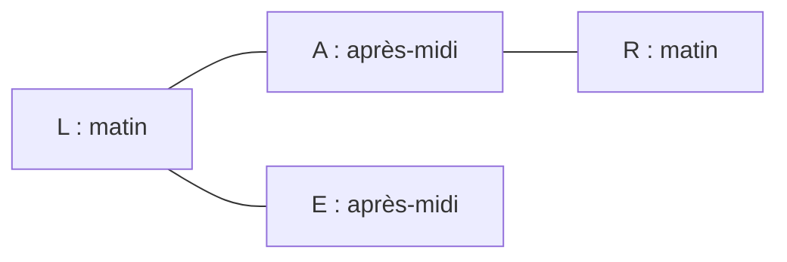
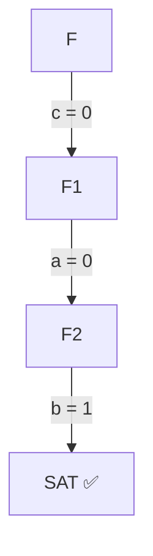
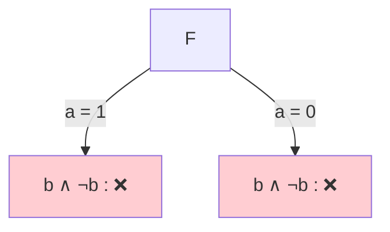
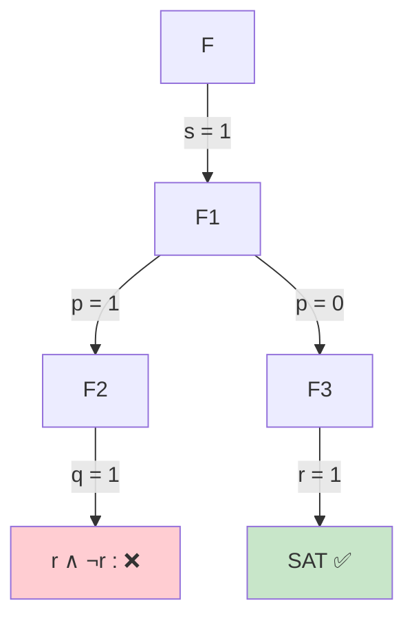

# Partie 2 — FNC et SAT : corrections des énoncés proposés

> Corrections de [enonces-proposes.md](enonces-proposes.md). Pour chaque exercice : la réponse, puis **pourquoi**.

---

## Partie A — Modéliser avec SAT

### A1. Les motifs

| # | Phrase | Clauses | Pourquoi |
|---|---|---|---|
| 1 | si `a`, alors `b` ou `c` | `¬a ∨ b ∨ c` | `a ⇒ (b ∨ c) ≡ ¬a ∨ b ∨ c` |
| 2 | `a` ssi `b` | `(¬a ∨ b) ∧ (a ∨ ¬b)` | `a ⇒ b` et `b ⇒ a` |
| 3 | au plus un parmi `a, b, c` | `(¬a ∨ ¬b) ∧ (¬a ∨ ¬c) ∧ (¬b ∨ ¬c)` | aucune paire vraie en même temps |
| 4 | au moins deux parmi `a, b, c` | `(a ∨ b) ∧ (a ∨ c) ∧ (b ∨ c)` | voir ci-dessous |
| 5 | au plus un parmi 10 | `10 × 9 / 2 = 45` clauses | une clause par paire |

**Pourquoi le n°4 ?** « Au moins deux vrais » = « **au plus un faux** » = « dans chaque paire, au moins un est vrai ». Si un seul était vrai (par exemple `a`), la paire `(b, c)` serait entièrement fausse et la clause `b ∨ c` serait violée.

### A2. Les tâches de la colocation

**1. Variables** : `x_{p,t}` vraie ssi **la personne `p` fait la tâche `t`**, avec `p ∈ {A, B, C}` (Ana, Ben, Clara) et `t ∈ {v, c, m}` (vaisselle, courses, ménage). 9 variables.

**2. Clauses**

| Règle | Clauses | Nombre |
|---|---|---|
| chaque tâche est faite par au moins une personne | `x_{A,t} ∨ x_{B,t} ∨ x_{C,t}` pour `t = v, c, m` | 3 |
| chaque tâche est faite par au plus une personne | `¬x_{A,t} ∨ ¬x_{B,t}`, `¬x_{A,t} ∨ ¬x_{C,t}`, `¬x_{B,t} ∨ ¬x_{C,t}` pour chaque `t` | 9 |
| chaque personne fait au moins une tâche | `x_{p,v} ∨ x_{p,c} ∨ x_{p,m}` pour `p = A, B, C` | 3 |
| Ben ne fait pas la vaisselle | `¬x_{B,v}` | 1 |
| si Ana fait le ménage, Clara fait la vaisselle | `¬x_{A,m} ∨ x_{C,v}` | 1 |

**3. Une solution** : Ana → vaisselle, Ben → courses, Clara → ménage.
Vérification : Ben ne fait pas la vaisselle ✅ ; Ana ne fait pas le ménage, donc la dernière règle est respectée ✅.
(Autre solution : Ana → ménage, Ben → courses, Clara → vaisselle.)

> 💡 3 tâches, 3 personnes, chacun au moins une tâche et chaque tâche à une seule personne : donc chacun fait **exactement** une tâche (principe des tiroirs).

### A3. Le planning des examens

**1. Variables** : `x_{e,c}` vraie ssi **l'examen `e` a lieu au créneau `c`** (`e ∈ {L, A, R, E}`, `c ∈ {1, 2}`).

| Règle | Clauses | Nombre |
|---|---|---|
| chaque examen a au moins un créneau | `x_{e,1} ∨ x_{e,2}` | 4 |
| chaque examen a au plus un créneau | `¬x_{e,1} ∨ ¬x_{e,2}` | 4 |
| deux examens en conflit pas au même créneau | `¬x_{e₁,c} ∨ ¬x_{e₂,c}` pour chaque conflit et chaque `c` | 3 × 2 = 6 |

**2. Un planning** : L et R le matin, A et E l'après-midi. Vérification : L–A ✅, A–R ✅, L–E ✅.



**3. Avec le conflit L–R** : L, A et R sont tous en conflit deux à deux (un triangle). Il faudrait 3 créneaux différents, on n'en a que 2 : **insatisfiable**. C'est le principe des tiroirs (3 examens dans 2 créneaux → deux partagent un créneau).

### A4. Trop de pigeons

**1.** `pᵢ,ⱼ` vraie ssi le pigeon `i` est dans le nid `j` (`i ∈ {1, 2, 3}`, `j ∈ {1, 2}`).

- chaque pigeon a un nid : `(p₁,₁ ∨ p₁,₂) ∧ (p₂,₁ ∨ p₂,₂) ∧ (p₃,₁ ∨ p₃,₂)`
- chaque nid a au plus un pigeon (pour `j = 1` puis `j = 2`) :
  `(¬p₁,ⱼ ∨ ¬p₂,ⱼ) ∧ (¬p₁,ⱼ ∨ ¬p₃,ⱼ) ∧ (¬p₂,ⱼ ∨ ¬p₃,ⱼ)`

Total : 3 + 6 = 9 clauses.

**2.** Chacun des 3 pigeons est dans l'un des 2 nids, donc deux pigeons au moins sont dans le même nid : une clause « au plus un » est forcément violée. **Insatisfiable.** (Fait amusant : les solveurs SAT ont beaucoup de mal avec ce problème quand le nombre de pigeons grandit, alors que la réponse est évidente pour un humain.)

---

## Partie B — Python et DIMACS

### B1. Format DIMACS

```text
p cnf 3 3
1 -2 0
2 3 0
-1 0
```

À la main : `¬x₁` impose `x₁ = 0` ; la clause `x₁ ∨ ¬x₂` devient `¬x₂`, donc `x₂ = 0` ; la clause `x₂ ∨ x₃` devient `x₃`, donc `x₃ = 1`.
Réponse du solveur : `SAT -1 -2 3`.

### B2. Lire la réponse

On garde les positifs : `1` et `4`, soit `p₁,₁` et `p₂,₂`. **Pigeon 1 dans le nid 1, pigeon 2 dans le nid 2.**

### B3. Du code vers la formule

`⋀_{i∈L} ⋀_{j,k∈C, j<k} (¬x_{i,j} ∨ ¬x_{i,k})`

En français : « chaque élément `i` de `L` est associé à **au plus un** élément de `C` ».

### B4. De la formule vers le code

```python
examens = ["L", "A", "R", "E"]
creneaux = [1, 2]
conflits = [("L", "A"), ("A", "R"), ("L", "E")]

au_moins_un = [[encode(e, c) for c in creneaux] for e in examens]
au_plus_un = [[-encode(e, c1), -encode(e, c2)]
              for e in examens for c1 in creneaux for c2 in creneaux if c1 < c2]
pas_ensemble = [[-encode(e1, c), -encode(e2, c)]
                for (e1, e2) in conflits for c in creneaux]

clauses = au_moins_un + au_plus_un + pas_ensemble
```

---

## Partie C — Tseitin

### C1. `¬a ∨ b`

| Nœud | Clauses |
|---|---|
| `y ⇔ ¬a` | `(y ∨ a) ∧ (¬y ∨ ¬a)` |
| `x ⇔ (y ∨ b)` | `(y ∨ b ∨ ¬x) ∧ (¬y ∨ x) ∧ (¬b ∨ x)` |
| racine | `x` |

6 clauses en tout.

### C2. `(a ∧ b) ⇒ c`

| Nœud | Clauses |
|---|---|
| `y ⇔ (a ∧ b)` | `(¬a ∨ ¬b ∨ y) ∧ (¬y ∨ a) ∧ (¬y ∨ b)` |
| `x ⇔ (y ⇒ c)` | `(¬y ∨ c ∨ ¬x) ∧ (x ∨ y) ∧ (x ∨ ¬c)` |
| racine | `x` |

**Vérification** : avec `x = 1`, il reste `¬y ∨ c`, c'est-à-dire `y ⇒ c`. Comme `y` vaut `a ∧ b`, on retrouve bien `(a ∧ b) ⇒ c`.

### C3. Retrouver le catalogue

- `x ⇒ (x₁ ∨ x₂)` donne `¬x ∨ x₁ ∨ x₂`
- `(x₁ ∨ x₂) ⇒ x` donne `¬(x₁ ∨ x₂) ∨ x ≡ (¬x₁ ∧ ¬x₂) ∨ x ≡ (¬x₁ ∨ x) ∧ (¬x₂ ∨ x)`

Résultat : `(x₁ ∨ x₂ ∨ ¬x) ∧ (¬x₁ ∨ x) ∧ (¬x₂ ∨ x)` ✅

### C4. Compter

3 clauses par connecteur binaire, 2 par négation, plus la clause de la racine : `3 × 10 + 2 × 5 + 1 = 41` clauses au maximum. La taille reste **proportionnelle** à la formule.

---

## Partie D — DPLL

### D1. `(a ∨ b) ∧ (¬a ∨ c) ∧ ¬c ∧ (b ∨ d)`

| Étape | Règle | Choix | Ce qu'il reste |
|---|---|---|---|
| 1 | propagation unitaire (`¬c`) | `c = 0` | `(a ∨ b) ∧ ¬a ∧ (b ∨ d)` |
| 2 | propagation unitaire (`¬a`) | `a = 0` | `b ∧ (b ∨ d)` |
| 3 | propagation unitaire (`b`) | `b = 1` | plus rien : **SAT** ✅ |



Solution : `a = 0, b = 1, c = 0` (`d` quelconque). Aucun pari n'a été nécessaire.

### D2. `(a ∨ b) ∧ (¬a ∨ b) ∧ (a ∨ ¬b) ∧ (¬a ∨ ¬b)`

Pas de clause unitaire, pas de littéral pur (chaque variable apparaît avec les deux signes). On parie.

| Étape | Règle | Choix | Ce qu'il reste |
|---|---|---|---|
| 1 | pari | `a = 1` | `b ∧ ¬b` |
| 2 | contradiction | | ❌ on revient en arrière |
| 3 | autre branche | `a = 0` | `b ∧ ¬b` |
| 4 | contradiction | | ❌ |



Les deux branches échouent : **insatisfiable**. (Normal : les 4 clauses interdisent chacune des 4 valuations possibles de `a, b`.)

### D3. `(p ∨ q ∨ r) ∧ (¬p ∨ q) ∧ (¬q ∨ r) ∧ (¬r ∨ ¬p) ∧ (s ∨ ¬t)`

| Étape | Règle | Choix | Ce qu'il reste |
|---|---|---|---|
| 1 | littéral pur (`s` toujours positif) | `s = 1` | `(p ∨ q ∨ r) ∧ (¬p ∨ q) ∧ (¬q ∨ r) ∧ (¬r ∨ ¬p)` |
| 2 | pas d'unitaire ni de pur → **pari** | `p = 1` | `q ∧ (¬q ∨ r) ∧ ¬r` |
| 3 | propagation unitaire | `q = 1` | `r ∧ ¬r` |
| 4 | contradiction | | ❌ on revient au pari |
| 5 | autre branche | `p = 0` | `(q ∨ r) ∧ (¬q ∨ r)` |
| 6 | littéral pur (`r` toujours positif) | `r = 1` | plus rien : **SAT** ✅ |



Solution : `p = 0, r = 1, s = 1` (`q` et `t` quelconques).

---

## Partie E — Les opérateurs dans les programmes

### E1.

| Expression | Valeur | Pourquoi |
|---|---|---|
| `⊥⊥ \|\| 1` | `⊥⊥` | on évalue d'abord la gauche, qui ne répond pas |
| `1 \|\| ⊥⊥` | `1` | la gauche suffit, la droite n'est pas évaluée |
| `0 && ⊥⊥` | `0` | la gauche suffit |
| `⊥⊥ && 0` | `⊥⊥` | la gauche ne répond pas |

### E2.

`and` évalue la gauche d'abord. Dans `x != 0 and 10 / x > 1`, si `x = 0`, la gauche est fausse et la division **n'est jamais calculée**. Dans `10 / x > 1 and x != 0`, la division est calculée **en premier** : `ZeroDivisionError`.

### E3.

Si `liste` est vide, `liste[0]` provoque une `IndexError` **avant** que `len(liste) > 0` soit testé. Il faut mettre la protection à gauche :

```python
def commence_par_5(liste):
    return len(liste) > 0 and liste[0] == 5
```
