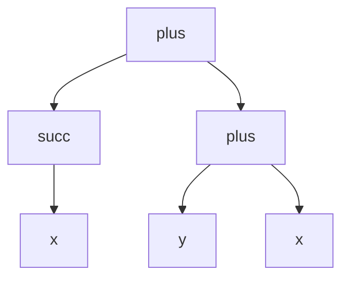
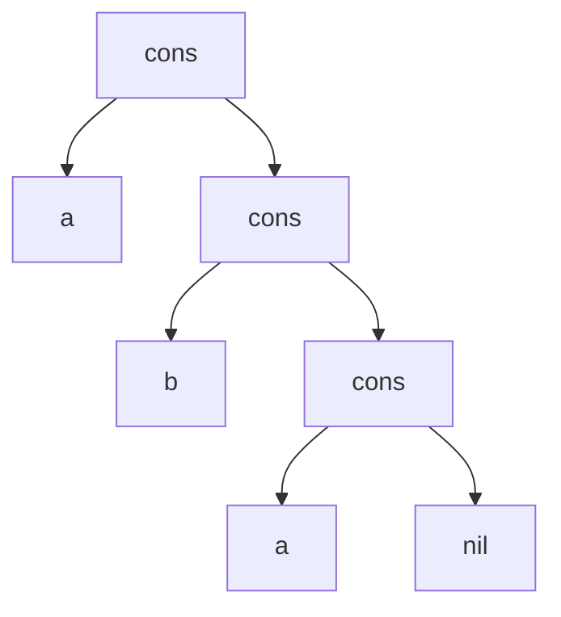

# Partie 3 — Termes : corrections des énoncés proposés

> Corrections de [enonces-proposes.md](enonces-proposes.md). Pour chaque exercice : la réponse, puis **pourquoi**.

---

## Partie A — Écrire des termes

### A1. Terme ou pas ?

| # | Expression | Terme ? | Pourquoi |
|---|---|---|---|
| 1 | `plus(zero)` | ❌ | `plus` attend **2** arguments |
| 2 | `succ(succ(x))` | ✅ | `succ` reçoit à chaque fois 1 argument |
| 3 | `plus(x, y, z)` | ❌ | 3 arguments au lieu de 2 |
| 4 | `succ` | ❌ | seules les constantes (arité 0) s'écrivent seules ; `succ` a besoin d'un argument |
| 5 | `x` | ✅ | toute variable est un terme |

### A2. Arbre et mesures

- `Var(t) = {x, y}` (on ne compte `x` qu'une fois : c'est un ensemble)
- taille = 6 (`plus`, `succ`, `x`, `plus`, `y`, `x`)
- hauteur = 2 (`succ(x)` et `plus(y, x)` ont une hauteur de 1)
- **pas clos** : il contient des variables

### A3. Les listes

`[a, b, a]` s'écrit `cons(a, cons(b, cons(a, nil)))`.

C'est exactement comme ça que les listes sont stockées en mémoire dans beaucoup de langages (listes chaînées).

### A4. Longueur

| Cas | `long` |
|---|---|
| `nil` | `0` |
| `cons(e, l)` | `1 + long(l)` |

`long(cons(a, cons(b, nil))) = 1 + long(cons(b, nil)) = 1 + 1 + long(nil) = 2`.

---

## Partie B — Donner un sens aux termes

### B1. Deux algèbres

| Algèbre | Calcul | Valeur |
|---|---|---|
| ℕ, `x = 3` | `succ(3) = 4`, `succ(succ(0)) = 2`, `plus(4, 2)` | **6** |
| Parité, `x = impair` | `succ(impair) = pair`, `succ(succ(pair)) = pair`, `plus(pair, pair)` | **pair** |

Cohérent : 3 est impair et 6 est pair. L'algèbre Parité garde moins d'information mais ne se contredit pas avec ℕ.

### B2. Une algèbre qui compte

`cons(a, cons(b, nil)) = 1 + (1 + 0) = 2`.

Cette algèbre calcule la **longueur** de la liste : chaque `cons` ajoute 1, et la valeur des éléments (`7`, `42`) est ignorée. C'est exactement la fonction `long` de l'exercice A4, vue comme une algèbre.

### B3. Pas commutatif

**Exemple 1** : domaine ℤ (entiers relatifs), `zero = 0`, `succ(n) = n + 1`, et `plus(n, m) = n − m`.
Avec `x = 1, y = 0` : `plus(x, y) = 1` mais `plus(y, x) = −1`.

**Exemple 2** : domaine = les mots, `zero = ""`, `succ(m)` ajoute `|` à la fin, `plus` = coller deux mots.
Avec `x = "a"`, `y = "b"` : `plus(x, y) = "ab"` mais `plus(y, x) = "ba"`.

> Le nom `plus` ne garantit rien : c'est l'**algèbre** qui donne le sens. Le symbole n'est que de la syntaxe.

### B4. Les booléens

- `x = 0` : `non(0) = 1`, `et(1, vrai) = et(1, 1) = 1`
- `x = 1` : `non(1) = 0`, `et(0, 1) = 0`

Le terme `et(non(x), vrai)` est la formule `¬x ∧ ⊤`, et l'algèbre `{0, 1}` est exactement la sémantique du [chapitre 2](../../01-Cours/01-Logique-propositionnelle/2-Semantique.md) ; l'environnement joue le rôle de la valuation. **Les formules propositionnelles sont des termes, et leur sémantique est une F-algèbre.**

---

## Partie C — Substitution

### C1. Appliquer

`tσ = f(a, g(h(x), a))`

Les deux `x` de `t` deviennent `a` ; `y` devient `h(x)`. Le `x` à l'intérieur de `h(x)` n'est **pas** remplacé (remplacement simultané).

### C2. Instance ou pas ?

1. **Oui**, avec `{ x ↦ g(a), y ↦ b }`.
2. **Non** : il faudrait `x = g(a)` et `x = b` en même temps.
3. **Oui**, avec `{ x ↦ a }`.

### C3. Composer

1. On applique `τ` dans les termes de `σ` : `x ↦ g(b)`. On ajoute les remplacements de `τ` pour les variables que `σ` ne touche pas : `y ↦ b` (mais **pas** `x ↦ c`, car `σ` s'occupe déjà de `x`).
   **`στ = { x ↦ g(b), y ↦ b }`**
2. `tσ = h(g(y), y)`, puis `(tσ)τ = h(g(b), b)`. Et `t(στ) = h(g(b), b)` ✅.
3. On applique `σ` dans les termes de `τ` : `b` et `c` ne contiennent pas `x`, ils ne changent pas. `σ` ne touche que `x`, déjà traité par `τ`.
   **`τσ = { y ↦ b, x ↦ c }`**. Avec `t = h(x, y)` : `t(τσ) = h(c, b) ≠ h(g(b), b)`.
   **Ce n'est pas la même chose** : l'ordre compte.

---

## Partie D — Unification

### D1. `f(x, b)` et `f(a, y)`

| Équations | Règle |
|---|---|
| `f(x, b) = f(a, y)` | départ |
| `x = a`, `b = y` | décomposer |
| `x = a`, `y = b` | orienter |

**mgu = `{ x ↦ a, y ↦ b }`** ; les deux termes deviennent `f(a, b)` ✅.

### D2. `g(x, h(x))` et `g(a, h(y))`

| Équations | Règle |
|---|---|
| `x = a`, `h(x) = h(y)` | décomposer |
| `x = a`, `h(a) = h(y)` | éliminer `x` |
| `x = a`, `a = y` | décomposer |
| `x = a`, `y = a` | orienter |

**mgu = `{ x ↦ a, y ↦ a }`** ; les deux termes deviennent `g(a, h(a))` ✅.

### D3. `f(x, x)` et `f(a, b)`

| Équations | Règle |
|---|---|
| `x = a`, `x = b` | décomposer |
| `x = a`, `a = b` | éliminer `x` |
| `a = b` | **conflit** ❌ |

**Échec** : `x` ne peut pas valoir `a` et `b` en même temps.

### D4. `f(x, g(x))` et `f(g(y), y)`

| Équations | Règle |
|---|---|
| `x = g(y)`, `g(x) = y` | décomposer |
| `x = g(y)`, `g(g(y)) = y` | éliminer `x` |
| `x = g(y)`, `y = g(g(y))` | orienter |
| | **occurrence** : `y` apparaît dans `g(g(y))` ❌ |

**Échec** : il faudrait un terme infini `y = g(g(g(g(…))))`.

### D5. Les types

| Équations | Règle |
|---|---|
| `paire(int, liste(α)) = paire(β, liste(bool))` | départ |
| `int = β`, `liste(α) = liste(bool)` | décomposer |
| `β = int`, `α = bool` | orienter, décomposer |

Le compilateur déduit **`β = int`** et **`α = bool`**. C'est exactement ce que fait OCaml (ou Haskell, Rust…) quand il devine les types tout seul.

### D6. Comme en Prolog

- `pere(X, habiba) = pere(ahmed, habiba)` : décomposer → `X = ahmed`, `habiba = habiba` (effacer). Réponse : **`X = ahmed`**.
- `pere(X, sara) = pere(ahmed, habiba)` : décomposer → `X = ahmed`, `sara = habiba` → **conflit** ❌. Le fait ne s'applique pas : Prolog répond **non** (`false`).
