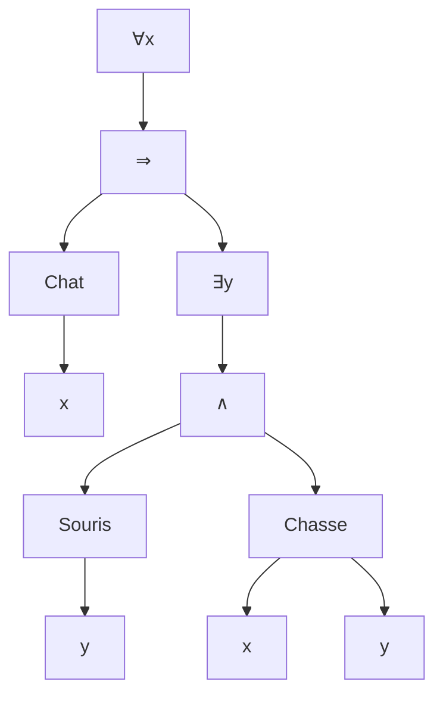
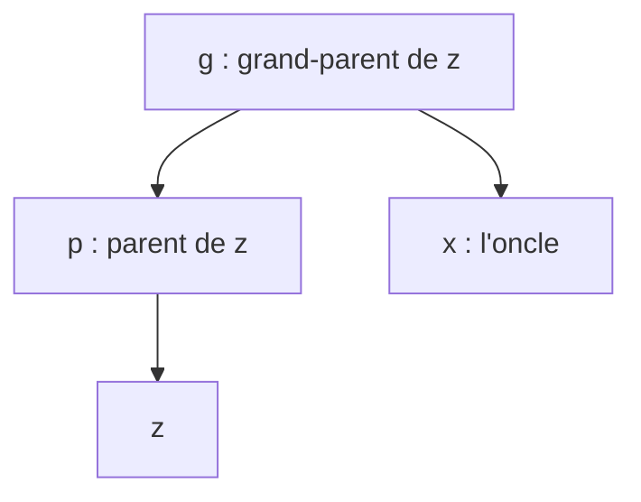

# Partie 4 — Logique du premier ordre : corrections des énoncés proposés

> Corrections de [enonces-proposes.md](enonces-proposes.md). Pour chaque exercice : la réponse, puis **pourquoi**.

---

## Partie A — Écrire des formules

### A1. Fonction ou prédicat ?

| # | Symbole | Type | Arité | Pourquoi |
|---|---|---|---|---|
| 1 | `age(x)` | fonction | 1 | donne un **objet** (un nombre) |
| 2 | `EstMajeur(x)` | prédicat | 1 | répond **vrai ou faux** |
| 3 | `mere(x)` | fonction | 1 | donne une **personne** (chacun a exactement une mère) |
| 4 | `Aime(x, y)` | prédicat | 2 | vrai ou faux |
| 5 | `capitale(p)` | fonction | 1 | donne une **ville** |

> Test simple : peut-on dire « `…` est vrai » ? Si oui, prédicat. Peut-on dire « `…` est une personne / un nombre / une ville » ? Si oui, fonction.

### A2. Variables libres et liées

| # | Formule | Variables libres | Close ? |
|---|---|---|---|
| 1 | `∀x (P(x) ⇒ Q(x, y))` | `{y}` | non |
| 2 | `(∃x P(x)) ∧ Q(x)` | `{x}` : le `x` de `Q(x)` est **hors** de la portée de `∃x` | non |
| 3 | `∀x ∃y R(x, y)` | `∅` | **oui** |
| 4 | `∃y (R(x, y) ∧ ∀x P(x))` | `{x}` : le `x` de `R(x, y)` n'est lié par rien ; celui de `P(x)` est lié par `∀x` | non |

> Pour les n°2 et n°4, la même lettre `x` désigne deux choses différentes. On les renommerait pour plus de clarté : `(∃z P(z)) ∧ Q(x)` et `∃y (R(x, y) ∧ ∀z P(z))`.

### A3. Arbre

« **Tout chat chasse au moins une souris.** »

---

## Partie B — Vrai ou faux dans une structure

### B1. Évaluer (domaine `{1, 2, 3}`, seul 2 est pair, `Inf` = `<`)

| # | Formule | Valeur | Justification |
|---|---|---|---|
| 1 | `∃x Pair(x)` | ✅ vraie | `x = 2` convient |
| 2 | `∀x Pair(x)` | ❌ fausse | `x = 1` n'est pas pair |
| 3 | `∀x ∃y Inf(x, y)` | ❌ fausse | pour `x = 3`, aucun `y` du domaine n'est plus grand que 3 |
| 4 | `∃x ∀y (x ≠ y ⇒ Inf(x, y))` | ✅ vraie | `x = 1` : il est plus petit que 2 et 3 (et pour `y = 1`, `x ≠ y` est faux donc l'implication est vraie) |
| 5 | `∀x (Pair(x) ⇒ ∃y Inf(y, x))` | ✅ vraie | seul `x = 2` est pair, et `y = 1 < 2` ; pour `x = 1` ou `3`, l'implication est vraie car `Pair(x)` est faux |

> 💡 La n°3 serait vraie dans ℕ (il y a toujours un nombre plus grand) : la valeur d'une formule **dépend de la structure**.

### B2. Nier

1. `¬∀x (Etudiant(x) ⇒ Reussi(x))`
   `≡ ∃x ¬(Etudiant(x) ⇒ Reussi(x))`
   `≡ ∃x (Etudiant(x) ∧ ¬Reussi(x))`
   « **Au moins un étudiant n'a pas réussi.** »
2. `¬∃c ∀x ¬Valide(x, c)`
   `≡ ∀c ¬∀x ¬Valide(x, c)`
   `≡ ∀c ∃x ¬¬Valide(x, c)`
   `≡ ∀c ∃x Valide(x, c)`
   « **Chaque cours a été validé par au moins une personne.** »

### B3. L'ordre des quantificateurs

1. `∀y ∃x Mere(x, y)` : « **chaque personne a une mère** » ✅ vrai.
2. `∃x ∀y Mere(x, y)` : « **il existe une personne qui est la mère de tout le monde** » (y compris d'elle-même !) ❌ faux.

### B4. Contre-exemple

Structure : `D = {1, 2}`, `P` vrai seulement pour `1`, `Q` vrai seulement pour `2`.

| Formule | Valeur | Pourquoi |
|---|---|---|
| `∀x (P(x) ∨ Q(x))` | ✅ vraie | 1 vérifie `P`, 2 vérifie `Q` |
| `∀x P(x)` | ❌ | 2 ne vérifie pas `P` |
| `∀x Q(x)` | ❌ | 1 ne vérifie pas `Q` |
| `(∀x P(x)) ∨ (∀x Q(x))` | ❌ fausse | |

Les deux formules ont des valeurs différentes dans cette structure : elles ne sont **pas équivalentes**.
(Image : « tout entier est pair ou impair » est vrai, mais « tous les entiers sont pairs, ou tous sont impairs » est faux.)

---

## Partie C — Modéliser

### C1. Les motifs de base

| # | Formule | Remarque |
|---|---|---|
| 1 | `∀x (Prof(x) ⇒ EnRetard(x))` | `∀` avec `⇒` |
| 2 | `∃x (Etudiant(x) ∧ EnRetard(x))` | `∃` avec `∧` |
| 3 | `∀x (Prof(x) ⇒ ¬EnRetard(x))` ou `¬∃x (Prof(x) ∧ EnRetard(x))` | les deux sont équivalentes |
| 4 | `∀x (Passe(x) ⇒ (Etudiant(x) ∧ ∃c (Cours(c) ∧ Inscrit(x, c))))` | « seuls les A sont B » : la flèche part de B (`Passe`) |

### C2. Trouver l'erreur

`∃x (Etudiant(x) ⇒ EnRetard(x))` est vraie **dès qu'il existe quelqu'un qui n'est pas étudiant** : pour lui, `Etudiant(x)` est faux, donc l'implication est vraie.

**Exemple** : `D = {Dupont, Ana}`, Dupont est prof, Ana est étudiante, **personne n'est en retard**. La phrase « il existe un étudiant en retard » est fausse. Mais avec `x = Dupont`, `Etudiant(Dupont) ⇒ EnRetard(Dupont)` vaut `0 ⇒ 0 = 1` : la formule est **vraie**. ❌

**Correction** : `∃x (Etudiant(x) ∧ EnRetard(x))`. Règle d'or : **`∃` va avec `∧`**.

### C3. Plusieurs quantificateurs

1. `∀c (Cours(c) ⇒ ∃x (Etudiant(x) ∧ Inscrit(x, c)))`
2. `∃x (Etudiant(x) ∧ ∀c (Cours(c) ⇒ Inscrit(x, c)))`
3. `∀x ∀c (Valide(x, c) ⇒ Inscrit(x, c))`
   (ou, de façon équivalente, `¬∃x ∃c (Valide(x, c) ∧ ¬Inscrit(x, c))` : « il n'y a personne qui valide un cours sans y être inscrit »)

> Compare 1 et 2 : dans la 1, l'étudiant **dépend** du cours (`∀c ∃x`) ; dans la 2, c'est **le même** étudiant pour tous les cours (`∃x ∀c`).

### C4. Compter

1. `∀c (Cours(c) ⇒ ∃x ∃y (x ≠ y ∧ Etudiant(x) ∧ Etudiant(y) ∧ Inscrit(x, c) ∧ Inscrit(y, c)))`
   Le `x ≠ y` est indispensable : sans lui, `x` et `y` pourraient être la même personne.
2. `∀y ∃x (Mere(x, y) ∧ ∀z (Mere(z, y) ⇒ z = x))`
   « Pour chaque `y`, il y a une mère `x`, et toute mère `z` de `y` est en fait `x`. »

### C5. L'oncle

`Oncle(x, z) := Homme(x) ∧ ∃p ∃g (Parent(p, z) ∧ Parent(g, p) ∧ Parent(g, x) ∧ x ≠ p)`

- `p` est un parent de `z` ;
- `g` est un parent commun de `p` et de `x`, donc `x` et `p` sont frère/sœur…
- …à condition que `x ≠ p` (sinon `x` serait simplement le parent de `z`) ;
- et `x` est un homme.
