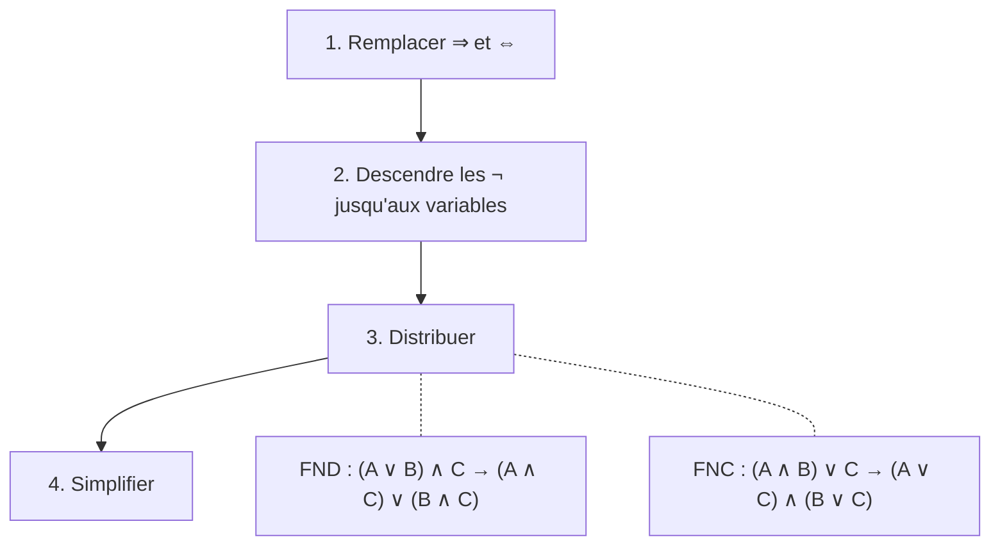
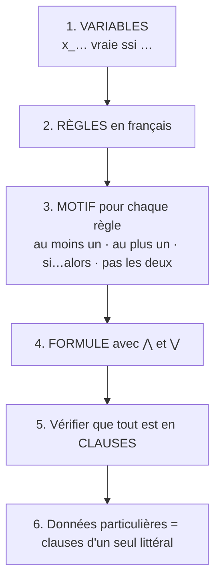

# 🛠️ Méthodes pas à pas

> Les **recettes** à appliquer en DS, pour chaque type de question, avec les pièges à éviter.

---

## M1 — Traduire une phrase en formule (propositionnel)

1. Repérer les petites affirmations vraies/fausses et leur donner une lettre (**écrire ce qu'elles veulent dire**).
2. Repérer les mots-clés : « et » → `∧`, « ou » → `∨`, « ne… pas » → `¬`, « si… alors » → `⇒`, « si et seulement si » → `⇔`.
3. « A **seulement si** B » / « A **que si** B » → `A ⇒ B`.
4. « ou » exclusif → `(a ∨ b) ∧ ¬(a ∧ b)`.

---

## M2 — Construire une table de vérité

1. Colonnes : variables, puis sous-formules (de la plus petite à la plus grande).
2. `2ⁿ` lignes, en comptant en binaire.
3. Remplir colonne par colonne.

> ⚠️ `1 ⇒ 0 = 0`, **tous** les autres cas de `⇒` valent 1.

---

## M3 — Prouver `φ ≡ ψ` ou `Γ ⊨ φ`

| Méthode | Quand ? |
|---|---|
| tables de vérité | 2 ou 3 variables |
| calcul avec les lois (**une loi nommée par ligne**) | formules plus grandes |
| par l'absurde : « supposons une situation où `Γ` est vrai et `φ` faux… » | pour `Γ ⊨ φ` |

Pour montrer que c'est **faux** : un seul **contre-exemple** suffit.

---

## M4 — Mettre sous FND / FNC



Par la table : FND = lignes à **1** ; FNC = lignes à **0** avec littéraux **inversés**.

**Vérifier** : tester une ou deux valuations sur la formule de départ et sur le résultat.

> ⚠️ `¬(a ⇒ b)` donne `a ∧ ¬b` (pas `¬a ⇒ ¬b`). `¬(a ⇔ b)` donne `(a ∧ ¬b) ∨ (¬a ∧ b)`.

---

## M5 — Modéliser un problème avec SAT



**Checklist**

- [ ] Chaque variable a sa phrase « … vraie ssi … » ?
- [ ] « Exactement un » = au moins un **+** au plus un ?
- [ ] Les **bords** (table ronde : `n` voisine de `1`, coins d'une grille) ?
- [ ] Une contrainte est-elle **redondante** (principe des tiroirs) ?

---

## M6 — Traduire une formule en Python

| Formule | Python |
|---|---|
| `⋀_{a ∈ A}` | `for a in A` dans la liste **extérieure** |
| `⋁_{b ∈ B}` | `[… for b in B]` = **une** clause |
| `¬x` | `-encode(…)` |
| `i < j`, `c₁ ≠ c₂` | `if i < j` |

```python
# ⋀_i ⋁_j x_{i,j}
[[encode(i, j) for j in J] for i in I]
# ⋀_i ⋀_{j<k} (¬x_{i,j} ∨ ¬x_{i,k})
[[-encode(i, j), -encode(i, k)] for i in I for j in J for k in J if j < k]
```

---

## M7 — Tseitin

1. Dessiner l'arbre, nommer chaque nœud interne.
2. Pour chaque nœud, recopier les clauses du catalogue ([fiche mémo](Fiche-memo.md)).
3. **Ne pas oublier** la clause `x` de la racine.

---

## M8 — Dérouler DPLL

À chaque étape, **dans cet ordre** : simplification → clause unitaire → littéral pur → pari.
Présenter un **tableau** (étape, règle, choix, résultat) **et** l'**arbre**.

> ⚠️ Retirer `l̄` des autres clauses ; essayer la **2ᵉ branche** avant de conclure « insatisfiable ».

---

## M9 — Unifier deux termes

1. Écrire l'équation `s = t`.
2. Appliquer les règles : effacer, décomposer, orienter, éliminer.
3. S'arrêter sur **conflit** (symboles différents) ou **occurrence** (`x = …x…`) : échec.
4. Sinon, lire le mgu dans les équations `x = t`.
5. **Vérifier** : appliquer le mgu aux deux termes, ils doivent devenir identiques.

---

## M10 — Modéliser en premier ordre

1. Fixer le vocabulaire (prédicats, fonctions) avec leur sens.
2. Repérer les quantificateurs cachés : « tous, chaque, aucun » → `∀` ; « un, certains, il existe » → `∃`.
3. **`∀` avec `⇒`, `∃` avec `∧`.**
4. Relire la formule en français, et la tester sur un petit exemple.

> ⚠️ « Seuls les A sont B » = `∀x (B(x) ⇒ A(x))`. « Au moins deux » nécessite `x ≠ y`.
