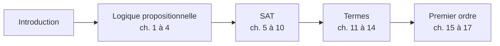
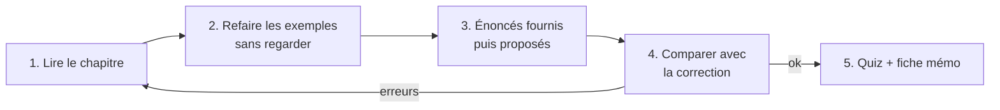

# Logique — L2 Informatique (2026-2027)

> Cours de **Sara Riva**, Université de Lille, Département Informatique.
> Portail pédagogique : <https://www.fil.univ-lille.fr/portail/index.php>

C'est la **seule page d'accueil** du dossier : tout part d'ici.

---

## Comment est rangé le dossier

```
LOGIQUE/
├── 01-Cours/                         ← les chapitres, à lire dans l'ordre
│   ├── 00-Introduction.md
│   ├── 01-Logique-propositionnelle/  (chapitres 1 à 4)
│   ├── 02-SAT/                       (chapitres 5 à 10)
│   ├── 03-Termes/                    (chapitres 11 à 14)
│   └── 04-Logique-premier-ordre/     (chapitres 15 à 17)
├── 02-TD-TP/                         ← un dossier par partie du cours
│   ├── 1-Logique-propositionnelle/   énoncés proposés + corrections
│   ├── 2-FNC-et-SAT/                 TD2 et TD3 fournis + corrections, énoncés proposés + corrections,
│   │                                 code/ (sudoku.py, table_ronde.py, hidoku.py du TD2)
│   ├── 3-Termes/                     énoncés proposés + corrections
│   ├── 4-Premier-ordre/              énoncés proposés + corrections
│   ├── DS1-Preparation/              feuille de préparation au DS1 + simulation d'examen, avec corrections
│   └── _Modele-TD/                   à copier pour ajouter un nouveau TD
└── 03-Revisions/                     ← fiche mémo, méthodes, quiz + correction
```

Dans chaque dossier d'exercices :

| Fichier | Contenu |
|---|---|
| `TDx-enonce-fourni.md` | le sujet **officiel** distribué en TD |
| `TDx-correction.md` | sa correction, dans un fichier **à part** |
| `enonces-proposes.md` | des exercices **supplémentaires** que j'ai préparés |
| `corrections-proposes.md` | leur correction, dans un fichier **à part** |
| `mes-reponses-TDx.md` | **ton** travail |
| `code/` | tes fichiers Python |

---

## Le parcours



| # | Chapitre | L'idée en une phrase | Exercices |
|---|---|---|---|
| 0 | [Introduction](01-Cours/00-Introduction.md) | pourquoi la logique est au cœur de l'informatique | |
| 1 | [Écrire une formule](01-Cours/01-Logique-propositionnelle/1-Syntaxe.md) | une phrase devient un arbre de symboles | [énoncés](02-TD-TP/1-Logique-propositionnelle/enonces-proposes.md) · [corrections](02-TD-TP/1-Logique-propositionnelle/corrections-proposes.md) |
| 2 | [Vrai ou faux ?](01-Cours/01-Logique-propositionnelle/2-Semantique.md) | une situation donne une valeur à chaque formule | ⬆️ |
| 3 | [Transformer une formule](01-Cours/01-Logique-propositionnelle/3-Equivalences.md) | De Morgan et les autres lois | ⬆️ |
| 4 | [Formes normales](01-Cours/01-Logique-propositionnelle/4-Formes-normales.md) | liste de scénarios (FND) ou liste de règles (FNC) | ⬆️ + [TD2 ex. 1-2](02-TD-TP/2-FNC-et-SAT/TD2-enonce-fourni.md) |
| 5 | [Le problème SAT](01-Cours/02-SAT/5-Probleme-SAT.md) | existe-t-il une solution ? | [TD2 fourni](02-TD-TP/2-FNC-et-SAT/TD2-enonce-fourni.md) · [correction](02-TD-TP/2-FNC-et-SAT/TD2-correction.md) |
| 6 | [Modéliser avec SAT](01-Cours/02-SAT/6-Modeliser-avec-SAT.md) | planning, plan de table, coloriage → clauses | [énoncés proposés](02-TD-TP/2-FNC-et-SAT/enonces-proposes.md) · [corrections](02-TD-TP/2-FNC-et-SAT/corrections-proposes.md) |
| 7 | [SAT en Python](01-Cours/02-SAT/7-SAT-en-Python.md) | des listes de numéros pour le solveur | ⬆️ |
| 8 | [Tseitin](01-Cours/02-SAT/8-Tseitin.md) | nommer les sous-formules pour éviter l'explosion | ⬆️ + [TD3 fourni](02-TD-TP/2-FNC-et-SAT/TD3-enonce-fourni.md) · [correction](02-TD-TP/2-FNC-et-SAT/TD3-correction.md) |
| 9 | [DPLL](01-Cours/02-SAT/9-DPLL.md) | résoudre comme un Sudoku | ⬆️ + TD3 |
| 10 | [Opérateurs en programmation](01-Cours/02-SAT/10-Operateurs-en-programmation.md) | `and`/`or` regardent d'abord à gauche | ⬆️ |
| 11 | [Les termes](01-Cours/03-Termes/11-Termes.md) | des expressions qui désignent des objets | [énoncés](02-TD-TP/3-Termes/enonces-proposes.md) · [corrections](02-TD-TP/3-Termes/corrections-proposes.md) |
| 12 | [F-algèbres](01-Cours/03-Termes/12-Semantique-F-algebres.md) | une partition, plusieurs instruments | ⬆️ |
| 13 | [Substitution](01-Cours/03-Termes/13-Substitution.md) | le publipostage des variables | ⬆️ |
| 14 | [Unification](01-Cours/03-Termes/14-Unification.md) | faire coïncider deux motifs | ⬆️ |
| 15 | [Premier ordre : écrire](01-Cours/04-Logique-premier-ordre/15-Syntaxe-premier-ordre.md) | « pour tout » et « il existe » | [énoncés](02-TD-TP/4-Premier-ordre/enonces-proposes.md) · [corrections](02-TD-TP/4-Premier-ordre/corrections-proposes.md) |
| 16 | [Premier ordre : vrai ou faux](01-Cours/04-Logique-premier-ordre/16-Semantique-premier-ordre.md) | un petit monde d'objets et de relations | ⬆️ |
| 17 | [Premier ordre : modéliser](01-Cours/04-Logique-premier-ordre/17-Modeliser-premier-ordre.md) | `∀` avec `⇒`, `∃` avec `∧` | ⬆️ |

> 📌 Les chapitres 11 à 17 (Termes, Premier ordre) ont été **préparés à l'avance** d'après le programme officiel de l'UE, car ces CM n'ont pas encore eu lieu. Compare-les avec le cours quand il arrivera.

---

## Réviser

| Outil | Quand |
|---|---|
| 🎯 [Préparation au DS1 (feuille officielle)](02-TD-TP/DS1-Preparation/DS1-enonce-fourni.md) → [correction](02-TD-TP/DS1-Preparation/DS1-correction.md) | avant le DS1 : exercices d'anciens DS (ch. 1 à 6) |
| ⏱️ [Simulation d'examen](02-TD-TP/DS1-Preparation/Simulation-enonce-fourni.md) → [correction](02-TD-TP/DS1-Preparation/Simulation-correction.md) | en conditions réelles : 2 h, sans document |
| [Fiche mémo](03-Revisions/Fiche-memo.md) | la veille du DS |
| [Méthodes pas à pas](03-Revisions/Methodes.md) | pendant les exercices |
| [Quiz](03-Revisions/Quiz.md) → [correction](03-Revisions/Quiz-correction.md) | pour savoir où tu en es |



---

## Ajouter un nouveau TD

1. Copier le modèle dans le dossier de la bonne partie, par exemple pour un TD sur les termes :
   ```bash
   cp -R 02-TD-TP/_Modele-TD/. 02-TD-TP/3-Termes/
   ```
2. Renommer `TDx` en `TD3` (ou le bon numéro) dans les noms de fichiers.
3. Remplir l'énoncé, travailler dans `mes-reponses-TD3.md`, mettre le code dans `code/`.
4. Ajouter le lien dans le tableau ci-dessus.

Pour le Python (`python-sat`), voir l'installation au [chapitre 7](01-Cours/02-SAT/7-SAT-en-Python.md).
